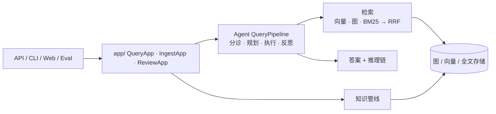

# AgenticGraphRAG

图谱增强的多跳推理问答系统：**知识图谱做结构化记忆，Agent 做决策大脑。**

纯向量 RAG 很难稳定回答「A 的母公司的 CEO 以前在哪工作」这类跨实体、跨文档的问题。本项目让 Agent 按「规划 → 检索 → 反思」沿图谱逐跳追问，输出带引用、可审计的推理链。

默认**全离线**（内存图 + seed 三元组 + Mock LLM），不需要 API Key 或 Docker 即可跑通。

## 特性

- **分诊与概括**：局部问题走 Fast Path / LangGraph 循环；启用摘要的知识库支持 Global map-reduce、覆盖率与原文验证
- **三路混合检索**：向量 / 图 Beam Search / BM25 并行召回，RRF 融合 + 缓存
- **知识库双模**：Schema 约束或开放抽取，实体描述/向量/别名消歧、必审候选、版本快照与可恢复发布；开放模式需显式启用模型
- **增量知识管线**：上传、复核、文档/社区摘要、受影响社区更新，以及人审 Schema 升级与回滚
- **七角色模型**：按知识库固定配置版本，支持模型目录、能力测试、草稿发布和回滚；兼容本地无鉴权服务
- **护栏与预算**：跳数、LLM 调用、token、超时上限；租户 / 用户 / 查询三级预算与熔断
- **需求登记表（可选）**：种子检索、证据约束的状态更新、实体锚定、依赖调度与独立充分性校验；详见 [启用与评估](docs/design/REQUIREMENT_REGISTER.md)。`--no-llm` 保持原流程。
- **可审计取证**：`ReasoningChain`、原文版本引用、独立检索审计与持久化回执；可要求审计成功才返回结果
- **对外接入**：typed REST/OpenAPI、可取消 SSE、独立 Python SDK 和只读 stdio MCP
- **企业能力**：多租户、RBAC、限流、JSON 日志、Prometheus、可选 OTel、PII 脱敏
- **独立多租户应用**：邮箱注册 / 登录、工作空间切换、成员邀请、服务密钥、账号安全与分区笔记历史；[使用指南](docs/product/WEBAPP_GUIDE.md)

扩展能力已完成本地工程验证，见 [交付记录与截图](docs/reviews/GRAPH_PLATFORM_EXTENSION.md)。
真实领域的抽取/概括质量、复核校准、真实供应商和 Claude/Cursor 验收仍待完成，
既有 G2/G3/G4 产品门禁状态不变。

## 快速开始

```bash
./scripts/setup.sh              # 解释器 + 锁定依赖（dev,webapp）+ .env + 环境体检
source .venv/bin/activate

agr-query --no-llm "Who is the CEO of the parent company of NovaTech Industries?"
agr-run-cases --no-llm --cases evals/datasets/poc_cases.jsonl   # 样例评测（走生产路径 QueryApp，eval Profile）
agr-api                                                          # http://localhost:8000/web（默认绑定 0.0.0.0:8000）
AGR_INGEST_INLINE=1 agr-api   # 上传的文档自动抽取入图（冲突进复核队列）
```

`setup.sh` 幂等：重复执行只做增量同步，已存在的 `.env` 不会被覆盖；体检不通过会直接失败并列出修复命令。
随时用 `python scripts/doctor.py` 复查环境（`--json` 机器可读，`--strict` 把警告也判为失败）。
只装核心依赖（离线评测 / CI）用 `./scripts/setup.sh --extras dev`，严格按锁文件复现用 `--locked`。
设计与取舍见 [docs/design/SETUP_DESIGN.md](docs/design/SETUP_DESIGN.md)。

运行带账号与工作空间管理的 Web 应用，在上述虚拟环境中执行：

```bash
./scripts/setup.sh --extras dev,webapp      # 默认已包含；仅补装 Web 依赖时使用
AGR_WEB_ORIGIN=http://localhost:8000 \
AGR_PROFILE=offline AGR_ALLOW_LLM=0 AGR_INGEST_INLINE=1 agr-webapp
```

打开 **http://localhost:8000** → 创建账号 → 进入个人工作空间；也可以用 `agr-webapp-seed --email you@example.com`（密码取 `AGR_DEMO_PASSWORD`，未设则隐藏提示输入）直接建出首个演示账号。顶栏可创建 / 切换团队空间，
“设置 → 成员与邀请”添加成员，“知识库”上传 UTF-8 Markdown / 文本。
新空间初始没有业务知识；上面的命令会自动处理上传任务，离线体验不需要模型 API Key 或 Docker。
`agr-webapp` 与 `agr-api` 默认都使用 8000 端口，启动前结束另一个占用该端口的进程。
完整步骤、离线演示与常见问题见 [Web 使用指南](docs/product/WEBAPP_GUIDE.md)，
开发邮件、改端口和部署配置见 [Web 运维说明](docs/ops/WEBAPP.md)。
批量导入仓库原始语料可运行 `python scripts/import_webapp_corpus.py --email you@example.com`，
密码通过隐藏提示输入；参数与报告说明见 [脚本导入](docs/product/WEBAPP_GUIDE.md#使用脚本批量导入)。

只测试在线 LLM（内存图谱，无需 Docker）：

```bash
bash scripts/online_eval.sh                      # 提示输入 key（隐藏）和模型名
bash scripts/online_eval.sh --preflight-only     # 只检查普通对话与 JSON 输出
bash scripts/online_eval.sh --limit 0            # 运行全部 POC 题目及离线对照
```

也可在不入库的 `.env` 中只填写 `LLM_API_KEY` 和 `LLM_STRONG_MODEL`，脚本会将同一个模型
用于 strong/light 两档。未配置 `LLM_BASE_URL` 时，测试脚本默认沿用现有网关
`https://api.mmkg.cloud/v1`；其他服务商通过 `--base-url` 或 `.env` 覆盖。
默认按类别轮转抽取 5 道题，运行真实对话请求并生成
`reports/online_eval/<时间戳>/report.md`、`summary.json`、`preflight.json` 和逐题 JSONL。
预检也可能计费。测试关闭向量调用；使用自定义题库时需通过 `--seed-triples` 提供匹配的图谱。
退出码：0 表示调用检查通过（准确率单独报告），1 表示在线或运行检查失败，2 表示配置错误。

在线模式（真实 LLM / Neo4j / Qdrant）：

```bash
docker compose up -d
AGR_PROFILE=live AGR_ALLOW_LLM=1 LLM_API_KEY=... agr-api   # Neo4j / Qdrant 不可达时直接拒绝启动
```

运行 Profile：`offline`（默认）、`live`、`hybrid`（Neo4j + 内存向量，须显式声明）、`eval`（评测，关闭缓存）。详见 [docs/ops/RUNBOOK.md](docs/ops/RUNBOOK.md)。

使用文档/社区摘要时，通过 `./scripts/setup.sh --locked --extras dev,webapp,summary`
安装可选 Leiden 依赖，按 [角色模型配置](docs/ops/MODEL_PROFILES.md) 登记并测试实际模型，
然后在知识库中绑定已发布版本、开启摘要并运行 worker。省略 `kb_id` 的旧请求仍使用默认库。
建库、模式选择、增量恢复、embedding 重建与回滚步骤见
[知识库运行手册](docs/ops/GRAPH_PLATFORM.md)。SQLite 协调限单主机，大库与多主机容量另行验收。

## 架构



各模块（Agent、检索、知识图谱、存储、LLM、生成、可观测、评测）的详细架构图见 [docs/ARCHITECTURE.md](./docs/ARCHITECTURE.md)。

## 目录

```
src/agentic_graphrag/   核心代码（分层见 docs/ARCHITECTURE.md §0）
  core/                 共享内核：契约 · 端口 · 领域事件 · IndexVersion
  bootstrap/            组合根：Profile + 能力矩阵
  app/                  应用层：QueryApp · IngestApp · ReviewApp
  api/ cli/             驱动层：HTTP / 命令行
  webapp/               可选的独立身份库、Cookie 会话与租户应用
  agent/ retrieval/ generation/ knowledge/   领域层
  stores/ llm/          适配器
  governance/ observability/ prompts/        横切：策略 · 遥测 · Prompt 版本
configs/                配置、领域 Schema、Prompt
data/                   样例语料与 seed 三元组（见 data/README.md）
evals/                  评测数据集
web/                    Vue 3 零构建工作台（推理笔记本）
sdk/python/             独立同步/异步 HTTP 与 SSE 客户端
integrations/mcp/       通过公共 API 取证的 stdio MCP 适配器
tests/ scripts/         单元测试、门禁与评测脚本
docs/                   架构、设计、运维、评审文档
plan/ reports/          阶段计划与门禁报告
```

## 开发

```bash
ruff check src tests scripts && ruff format --check src tests scripts
mypy
npx --yes --package=typescript@5.9.3 tsc --project web/jsconfig.json
node scripts/check_web_templates.mjs   # Vue 字符串模板编译校验（零构建）
pytest tests/unit --cov=agentic_graphrag --cov-fail-under=80 -q
```

## 文档

| 文档 | 内容 |
|---|---|
| [CHANGELOG.md](./CHANGELOG.md) | 历史变更、旧状态快照与验证记录 |
| [docs/ARCHITECTURE.md](./docs/ARCHITECTURE.md) | 模块架构图与运行路径 |
| [docs/product/PRD.md](./docs/product/PRD.md) | 产品需求与验收标准 |
| [docs/product/WEBAPP_GUIDE.md](./docs/product/WEBAPP_GUIDE.md) | 多租户 Web 应用：启动、注册、邀请、导入知识与问答 |
| [docs/product/TEN_HOP_QUESTIONS.md](./docs/product/TEN_HOP_QUESTIONS.md) | 三道 10 / 10 / 11 跳证据链题目、参考答案与逐跳原文 |
| [docs/ops/WEBAPP.md](./docs/ops/WEBAPP.md) | Web 配置、开发邮件、数据库与部署 |
| [docs/ops/RUNBOOK.md](./docs/ops/RUNBOOK.md) | 部署、环境变量、运维 |
| [docs/ops/GRAPH_PLATFORM.md](./docs/ops/GRAPH_PLATFORM.md) | 知识库双模、摘要任务、迁移恢复、回滚与取证 |
| [docs/ops/MODEL_PROFILES.md](./docs/ops/MODEL_PROFILES.md) | 七角色模型、能力探测与配置发布 |
| [sdk/python/README.md](./sdk/python/README.md) / [integrations/mcp/README.md](./integrations/mcp/README.md) | 独立 SDK 与 MCP 接入 |
| [docs/design/REFACTOR_PLAN.md](./docs/design/REFACTOR_PLAN.md) | 架构重构进度 |
| [docs/design/ARCH_OPTIMIZATION_V2.md](./docs/design/ARCH_OPTIMIZATION_V2.md) | 架构优化当前实现、后续设计与验收标准 |
| [docs/README.md](./docs/README.md) | 全部文档索引 |

## License

[Apache-2.0](./LICENSE)
