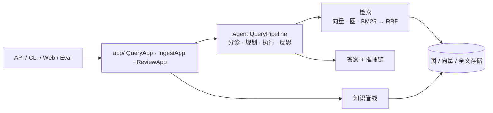

# AgenticGraphRAG

图谱增强的多跳推理问答系统：**知识图谱做结构化记忆，Agent 做决策大脑。**

纯向量 RAG 很难稳定回答「A 的母公司的 CEO 以前在哪工作」这类跨实体、跨文档的问题。本项目让 Agent 按「规划 → 检索 → 反思」沿图谱逐跳追问，输出带引用、可审计的推理链。

默认**全离线**（内存图 + seed 三元组 + Mock LLM），不需要 API Key 或 Docker 即可跑通。

## 特性

- **分诊双路径**：简单问题走 Fast Path，复杂问题走 LangGraph 循环（Planner → Executor → Critic → Answer）
- **三路混合检索**：向量 / 图 Beam Search / BM25 并行召回，RRF 融合 + 缓存
- **知识管线**：上传 → 抽取（LLM / 离线规则）→ Schema 校验 → 实体对齐 → 增量入图（按基数、时间、置信度裁决冲突）→ 人工复核并作用于图谱
- **护栏与预算**：跳数、LLM 调用、token、超时上限；租户 / 用户 / 查询三级预算与熔断
- **可审计**：每次回答产出 `ReasoningChain`，claim 须通过引用、关系一致与蕴含校验，可按 query ID 回查
- **企业能力**：多租户、RBAC、限流、JSON 日志、Prometheus、可选 OTel、PII 脱敏

## 快速开始

```bash
uv venv .venv && source .venv/bin/activate
uv pip install -e ".[dev]"

agr-query --no-llm "Who is the CEO of the parent company of NovaTech Industries?"
agr-run-cases --no-llm --cases evals/datasets/poc_cases.jsonl   # 样例评测（走生产路径 QueryApp，eval Profile）
agr-api                                                          # http://127.0.0.1:8000/web
AGR_INGEST_INLINE=1 agr-api   # 上传的文档自动抽取入图（冲突进复核队列）
```

在线模式（真实 LLM / Neo4j / Qdrant）：

```bash
docker compose up -d
AGR_PROFILE=live AGR_ALLOW_LLM=1 LLM_API_KEY=... agr-api   # Neo4j / Qdrant 不可达时直接拒绝启动
```

运行 Profile：`offline`（默认）、`live`、`hybrid`（Neo4j + 内存向量，须显式声明）、`eval`（评测，关闭缓存）。详见 [docs/ops/RUNBOOK.md](docs/ops/RUNBOOK.md)。

## 架构



各模块（Agent、检索、知识图谱、存储、LLM、生成、可观测、评测）的详细架构图见 [docs/ARCHITECTURE.md](./docs/ARCHITECTURE.md)。

## 目录

```
src/agentic_graphrag/   核心代码（分层见 docs/ARCHITECTURE.md §0）
  core/                 共享内核：契约 · 端口 · 领域事件 · IndexVersion
  bootstrap/            组合根：Profile + 能力矩阵
  app/                  应用层：QueryApp · IngestApp · ReviewApp
  api/ cli/             驱动层：HTTP / 命令行
  agent/ retrieval/ generation/ knowledge/   领域层
  stores/ llm/          适配器
  governance/ observability/ prompts/        横切：策略 · 遥测 · Prompt 版本
configs/                配置、领域 Schema、Prompt
data/                   样例语料与 seed 三元组（见 data/README.md）
evals/                  评测数据集
web/                    Vue 3 零构建工作台
tests/ scripts/         单元测试、门禁与评测脚本
docs/                   架构、设计、运维、评审文档
plan/ reports/          阶段计划与门禁报告
```

## 开发

```bash
ruff check src tests scripts && ruff format --check src tests scripts
pytest tests/unit --cov=agentic_graphrag --cov-fail-under=80 -q
```

## 文档

| 文档 | 内容 |
|---|---|
| [docs/ARCHITECTURE.md](./docs/ARCHITECTURE.md) | 模块架构图与运行路径 |
| [docs/product/PRD.md](./docs/product/PRD.md) | 产品需求与验收标准 |
| [docs/ops/RUNBOOK.md](./docs/ops/RUNBOOK.md) | 部署、环境变量、运维 |
| [docs/README.md](./docs/README.md) | 全部文档索引 |

## License

[Apache-2.0](./LICENSE)
