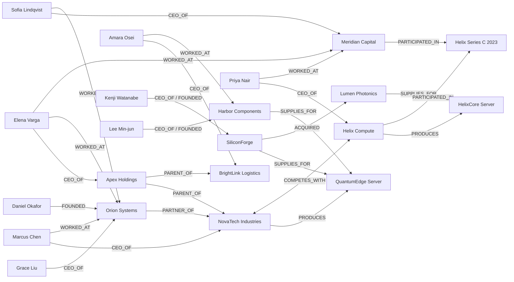

# 样例数据

一套虚构的「公司关系」语料，覆盖 Schema 中全部 5 类实体与 14 类关系中的 13 类，用于离线演示、单测与评测。所有名称均为虚构，无 PII。

| 文件 | 内容 |
|---|---|
| `raw/doc_01 … doc_12.md` | 12 篇英文 Markdown：控股结构、高管履历、产品、供应链、并购 / 融资事件、总部 |
| `processed/seed_triples.jsonl` | 58 条人工标注三元组，离线 API / 评测默认加载 |
| `processed/pilot_*.jsonl` | 合成试点语料的分块与三元组（由 `scripts/generate_pilot_corpus.py` 生成） |
| `pilot/` | 正式试点语料的清单模板与接入约定 |
| `../evals/datasets/poc_cases.jsonl` | 31 条样例问答：16 条 2 跳、10 条 3 跳、5 条开放题 |

## 实体一览

| 类型 | 实体 |
|---|---|
| Company | Apex Holdings · NovaTech Industries · BrightLink Logistics · Helix Compute · SiliconForge · Harbor Components · Orion Systems · Meridian Capital · Lumen Photonics · Cascade Analytics |
| Person | Elena Varga · Marcus Chen · Priya Nair · Grace Liu · Daniel Okafor · Sofia Lindqvist · Kenji Watanabe · Amara Osei · Lee Min-jun |
| Product | QuantumEdge Server · EdgeLite Workstation · HelixCore Server · HelixEdge Appliance · CloudNexus Platform · SF-9 Processor · HC-Power Module |
| Event | Harbor Partnership 2024 · Helix Series C 2023 · Lumen Acquisition 2025 |
| Location | Singapore · Austin · Munich · Seattle · London · Hsinchu · Rotterdam · Busan |

## 关系图（核心部分）

## 典型多跳问题

| 问题 | 路径 | 答案 |
|---|---|---|
| 生产 QuantumEdge Server 的公司，其母公司 CEO 以前在哪工作？ | QE ← NovaTech → Apex ← Elena → WORKED_AT | Orion Systems、Meridian Capital |
| QuantumEdge 的芯片供应商收购了哪家为 HelixCore 供货的公司？ | QE ← SiliconForge → ACQUIRED → Lumen ← SUPPLIES_FOR HelixCore | Lumen Photonics |
| Priya Nair 的前东家参与了哪个事件？ | Priya → Meridian → PARTICIPATED_IN | Helix Series C 2023 |

离线规则（`generation/offline_heuristics/`）只针对原始 6 篇语料调优；新增问题在离线模式下部分不能答对，可作为在线 LLM 模式的回归目标。
