# 架构说明（ARCHITECTURE）

> 描述**当前代码已实现**的模块边界与运行路径，每个模块配一张架构图。目标设计见 [`design/ARCHITECTURE_DESIGN.md`](./design/ARCHITECTURE_DESIGN.md)，业务规则见 [`design/BUSINESS_LOGIC.md`](./design/BUSINESS_LOGIC.md)。

- [0. 总览](#0-总览)
- [1. 接入层 api / cli / web](#1-接入层-api--cli--web)
- [2. Agent 编排 agent](#2-agent-编排-agent)
- [3. 检索 retrieval](#3-检索-retrieval)
- [4. 知识图谱 knowledge](#4-知识图谱-knowledge)
- [5. 存储 stores](#5-存储-stores)
- [6. LLM 网关 llm](#6-llm-网关-llm)
- [7. 答案生成 generation](#7-答案生成-generation)
- [8. 可观测与治理 observability](#8-可观测与治理-observability)
- [9. 评测 eval](#9-评测-eval)
- [10. 查询全链路时序](#10-查询全链路时序)
- [11. 配置与运行模式](#11-配置与运行模式)

---

## 0. 总览

> 本文已同步架构重构（分支 `refactor/arch-v2`）。重构计划与逐项状态见 [`design/REFACTOR_PLAN.md`](./design/REFACTOR_PLAN.md)。

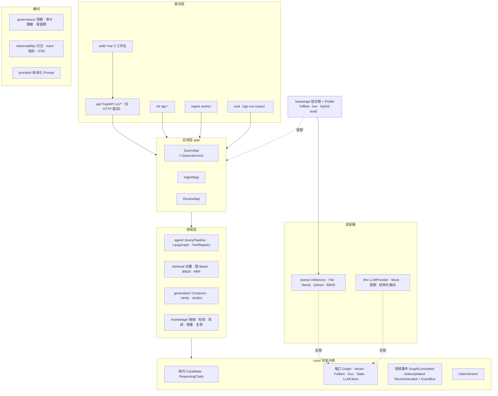

依赖方向自上而下：驱动层只调用 `app/`；领域层只依赖 `core/` 的契约与端口；`core/` 不依赖项目内任何其他包（有单测守护）。具体后端只在 `bootstrap/`（Profile → `stores/factory.create_bundle`）中装配，**不存在隐式回退**。`langgraph` 依赖限定在 `agent/` 内。旧的导入路径（如 `api.service`、`retrieval.contracts`、`generation.trace`、`stores.interfaces`、`llm.budget`）保留为模块别名，指向同一个模块对象。

| 目录 | 职责 | 关键文件 |
|---|---|---|
| `core/` | 共享契约、端口、领域事件、索引版本 | `evidence.py` `reasoning.py` `events.py` `versioning.py` `ports/{stores,state,llm}.py` |
| `bootstrap/` | 组合根：Profile、能力矩阵、存储装配 | `profile.py` `stores.py` |
| `app/` | 应用层用例（所有驱动共用） | `query_service.py`(QueryApp) `query_run.py` `query_stream.py` `ingest_app.py` `review_app.py` `write_path.py` `contracts.py` `errors.py` |
| `api/` | HTTP 驱动：鉴权限流、RBAC、SSE、路由 | `app.py` `auth.py` `rbac.py` `sse.py` `routes/` |
| `cli/` | `agr-*` 命令行驱动 | `ingest.py` `index_cmd.py` `graph_cmd.py` `cases.py` `cases_run.py` |
| `agent/` | QueryPipeline（路由 + 策略）、LangGraph 状态机、工具注册表、护栏、记忆 | `pipeline.py` `loop.py` `loop_runtime.py` `state.py` `tools/registry.py` `executor*.py` `critic.py` `guardrails.py` |
| `retrieval/` | 三路检索、图 Beam、RRF 融合、缓存 | `graph.py` `graph_beam.py` `fusion.py` `cache.py` |
| `knowledge/` | 文档接入、抽取、Schema 校验、消歧、增量更新、复核 | `extract_pipeline.py` `graph_ingest.py` `incremental.py` `review/` |
| `stores/` | 存储适配器与工厂 | `factory.py` `memory_graph.py` `neo4j_store.py` `vector_store.py` |
| `llm/` | Provider 适配器、结构化输出、熔断 | `provider.py` `structured.py` `circuit.py` |
| `generation/` | 答案组装、引用与蕴含校验、Verdict 分类、置信度 | `answer.py` `citations.py` `entailment.py` `verdict.py` `confidence.py` |
| `governance/` | 预算（唯一计量）、推理链审计、安全审计、PII 脱敏、保留期 | `budget.py` `budget_policy.py` `audit_store.py` `audit_events.py` `redaction.py` `retention.py` |
| `observability/` | 遥测：JSON 日志、trace、Prometheus、OTel | `logging_setup.py` `trace.py` `metrics.py` `otel_bridge.py` |
| `prompts/` | Prompt 版本登记（内容哈希） | `__init__.py`；Prompt 文本在 `configs/prompts/*.md` |
| `eval/` | 金标生成、评分、基线、坏例归因 | `gold_gen.py` `scoring.py` `baseline_rag.py` `badcase.py` |

---

## 1. 驱动层与应用层 api / cli / app

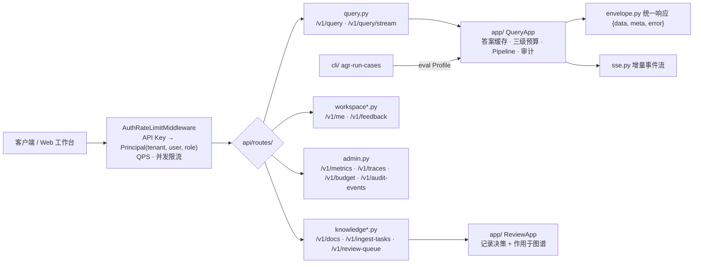

- **鉴权与租户**：`auth.py` 解析 `AGR_API_KEYS=tenant:key:role`，`rbac.py` 提供 admin / operator / reader 三角色路由守卫。
- **QueryApp**（`app/query_service.py` + `query_run.py` / `query_stream.py`）：查答案缓存 → 预留预算 → `QueryPipeline` → 落审计 → 结算预算 → 指标。`run_query()` 返回 API 视图，`run_query_chain()` 走同一条生产路径但返回完整 `ReasoningChain`（供 eval / CLI 使用）。
- **ReviewApp**：`POST /v1/review-queue/{id}/decision` 只做鉴权与参数校验，记录决策和执行决策都在 `ReviewApp.decide()` 中完成。
- **上传**：`POST /v1/docs` 创建任务（UTF-8 md/txt，≤5 MiB/文件，≤20/批）；worker（`AGR_INGEST_INLINE=1` 时在 API 进程内运行，`IngestApp` 装配）完成分块索引并抽取三元组入图，冲突进入复核队列（见 §4.4）。
- **web/**：Vue 3 ESM 零构建，`api.js` 调用上述接口。

---

## 2. Agent 编排 agent

### 2.1 QueryPipeline：路由与策略

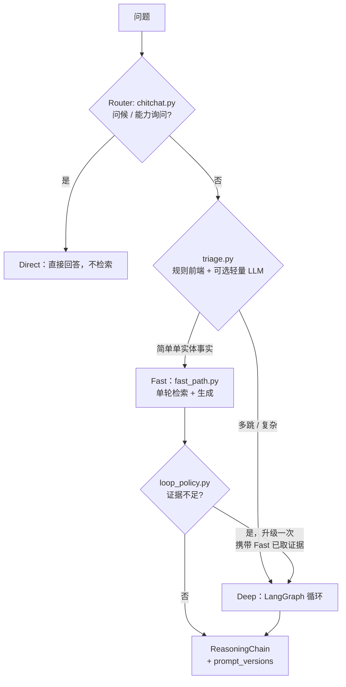

`agent/pipeline.py` 是**唯一**的执行实现：`iter_query_progress()` 逐步产出事件，终止事件固定为 `(__final_chain__, chain)`。SSE 直接消费事件；非流式的 `loop.run_query()` / `run_agentic_query()` 只是把同一个迭代器消费到结束（`run_pipeline` / `drain`），不再维护第二套代码。Fast 升级到 Deep 时，Fast 已检索到的证据作为初始 `evidence` 进入 Agent 状态（`metadata.inherited_evidence` 记录条数）。`agent/loop_stream.py` 保留为 `pipeline` 的别名。

### 2.2 LangGraph 状态机

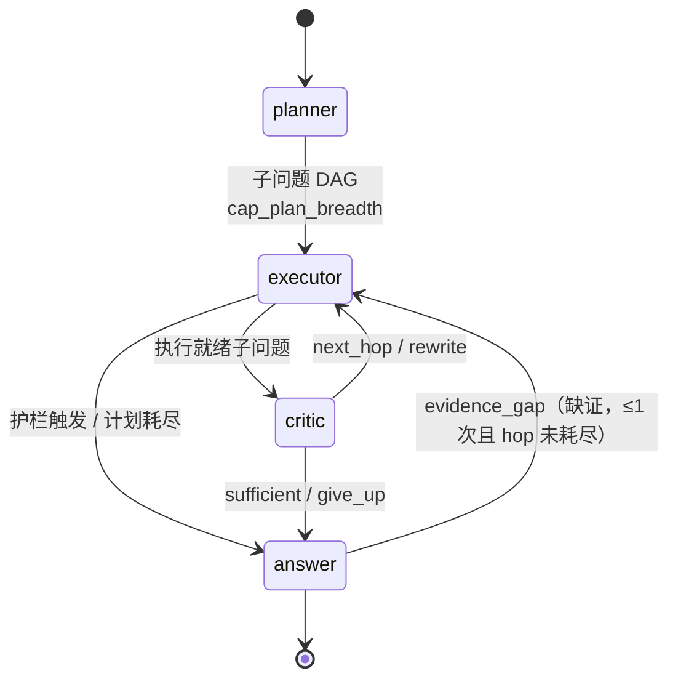

| 节点 | 实现 | 说明 |
|---|---|---|
| planner | `planner.py` `plan_dag.py` `planner_patterns.py` | 问题 → 带依赖的子问题 DAG，`{from:sqN}` 占位由上游结论物化；广度受 `max_sub_questions` 限制，被裁剪项写入 metadata |
| executor | `executor.py` `executor_plan.py` `executor_dispatch.py` `parallel_branches.py` `tools/registry.py` | 为子问题选择工具（graph_neighbors / graph_path / graph_subgraph / vector_search / fulltext_search），**所有工具调用都经 `ToolRegistry.invoke()`**（ToolSpec 含 schema、成本、超时、权限；护栏 / 预算 / trace 以中间件挂在注册表上），并行执行后 RRF 融合；就绪且互不依赖的 DAG 节点并发检索、共享同一 hop |
| critic | `critic.py` `critic_offline*.py` `critic_guard.py` | 子问题级 + 全局两级判断：`sufficient` / `next_hop` / `rewrite` / `give_up` |
| answer | `generation/answer.py` `generation/verdict.py` | 引用绑定生成答案。校验失败按 Verdict 分类：**表述类**（无 claim、引用 id 缺失或越界）在生成层内定向重生成一次；**缺证类**（claim 不被证据支持、不蕴含）在仍有 hop 时输出 `evidence_gap`，经 answer → executor 回边补充检索（每次运行最多 1 次），否则重生成后走保守回答 |

`AgentState` 只在 `agent/state.py` 定义一次并带 `state_version`，初始状态只由 `initial_state()` 构造（`tenant_id` 必填）；`check_state_version()` 拒绝读取比当前更新的 checkpoint。

### 2.3 运行时支撑

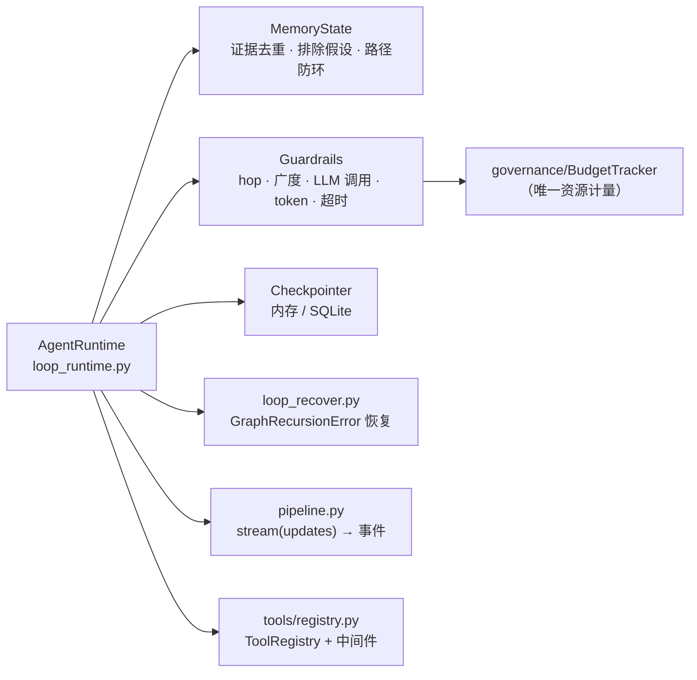

Guardrails 只负责控制流（hop、广度、截止时间），资源计量（LLM 调用、token、embedding 调用）统一由 `governance/budget.py` 的 `BudgetTracker` 负责，Guardrails 通过 `check()` 查询余量。hop 计数的是**依赖深度**：被并发预取的兄弟节点不再消耗 hop，广度由 `max_sub_questions` 单独限制。默认护栏（`configs/default.yaml`）：`max_hops=4`、`max_sub_questions=4`、`max_llm_calls=16`、`max_tokens_per_query=50000`、`query_timeout_seconds=45`、`recursion_limit=15`。

---

## 3. 检索 retrieval

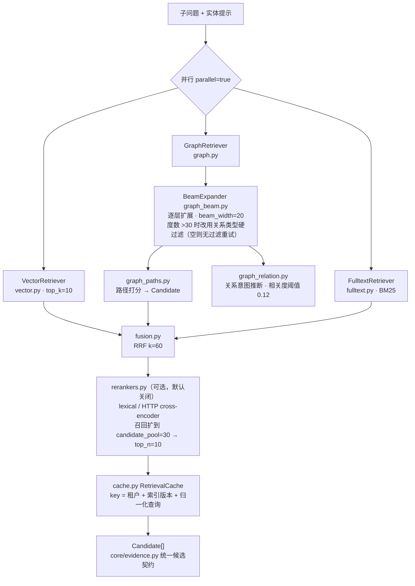

- `core/evidence.py`（`retrieval/contracts.py` 为别名）定义 `Candidate` / `Citation` / `CandidateSource`，三路结果统一为同一结构，`rrf_fuse` 按排名融合。
- `IndexVersion` 在图、向量、全文更新后递增，使缓存自然失效；缓存键包含 `tenant_id`，保证租户隔离。注意 `IndexVersion` 目前是**全局**计数器，任意租户写入都会让所有租户的缓存失效（ARCH_OPTIMIZATION_V2 X-2 待做）。
- 两阶段召回（V2 O-5）：`retrieval.rerank.kind`（环境变量 `AGR_RERANK`）为 `lexical` 或 `http` 时，向量和全文召回扩到 `candidate_pool`，RRF 之后重排，再截取 `top_n`。HTTP 重排器出错或超时时退回 RRF 顺序，并标 `metadata.rerank_fallback`。离线 A/B 没有显著收益，默认关闭。
- 边到 chunk 溯源（V2 O-6）：图候选的 `structured.source_chunk_ids` 和 `citations[].chunk_id` 来自 `RelationRecord.sources`（构图时写入，Neo4j 会持久化）。

---

## 4. 知识图谱 knowledge

### 4.1 领域 Schema（`configs/schema/domain_v0.yaml`）

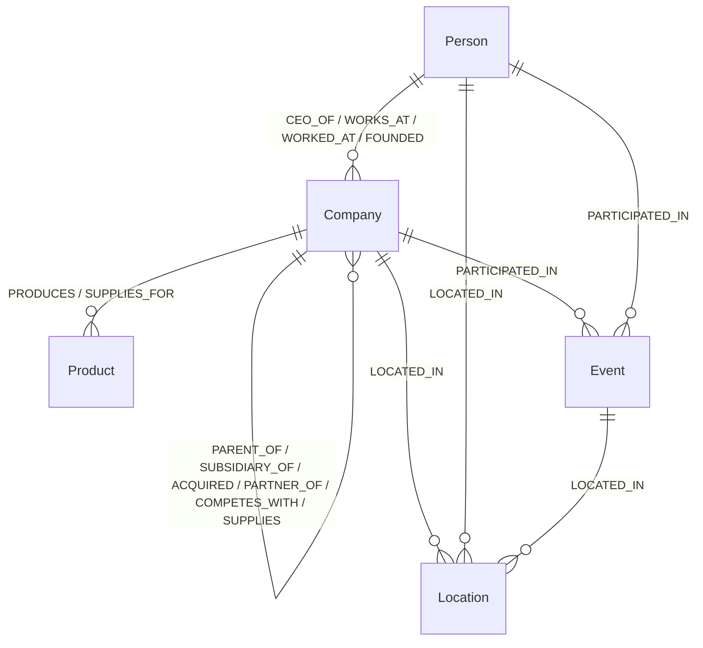

### 4.2 构建管线（CLI 离线建图）

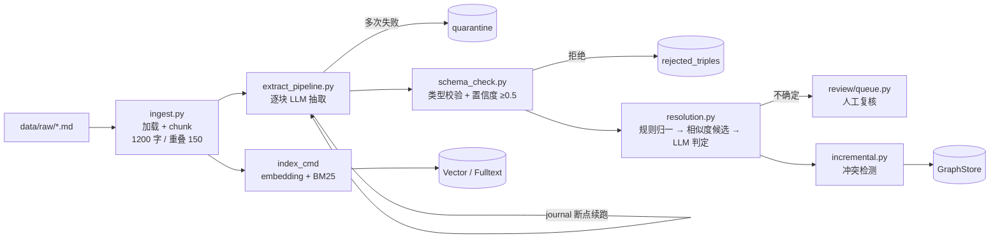

### 4.3 增量冲突决策（`incremental_conflicts.py`，只在本租户范围内比较）

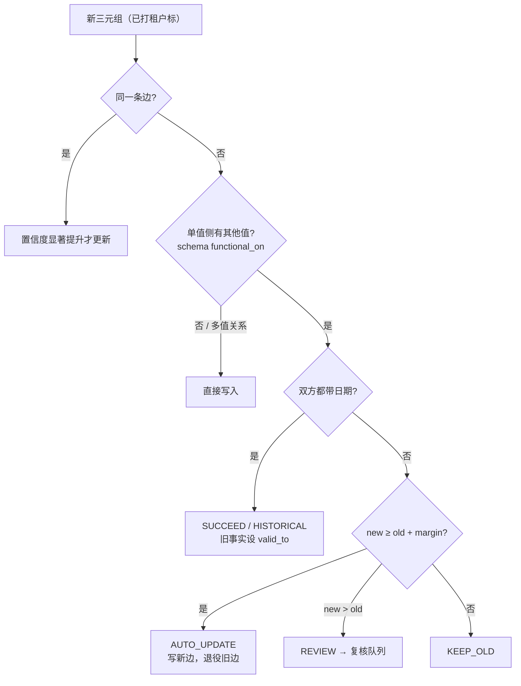

### 4.4 运行期写入路径（上传 → 图谱 → 复核）

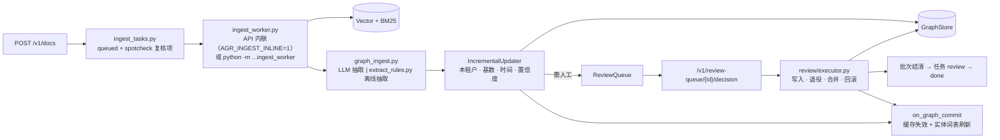

> 离线模式下图谱与向量在进程内存，应使用 API 内联 worker；在线模式（Neo4j/Qdrant）独立 worker 与 API 共享存储。

### 4.5 时间维度（`knowledge/temporal.py`）

关系可带 `valid_from` / `valid_to`（ISO 年 / 年-月 / 日期）。同一条边重复出现时较新日期优先；单值关系出现新值且双方都带日期时，按时间裁决（`SUCCEED` / `HISTORICAL`），旧事实写入 `valid_to` 而非删除。检索时已结束的事实降权（问题含「以前 / 曾 / previously」时不降），证据文本标注区间，如 `[2010–2016]`。

---

## 5. 存储 stores

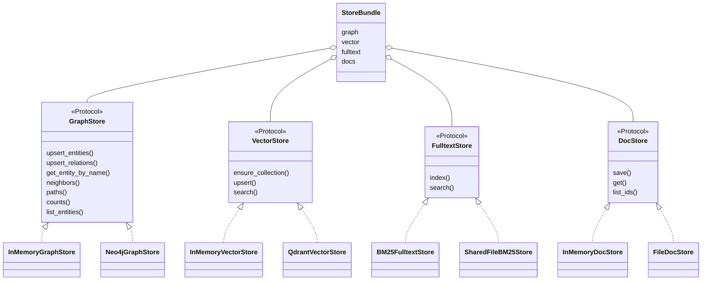

存储协议定义在 `core/ports/stores.py`（`stores/interfaces.py` 为别名）；限流、预算、审计存储协议在 `core/ports/state.py`。`factory.create_bundle(graph, vector)` 精确构建请求的后端，Neo4j 与 Qdrant 都会 ping，失败直接抛错；`create_offline_bundle()` / `create_live_bundle()` 是它的两个固定组合。**已移除所有隐式回退**：`create_live_bundle(allow_memory_graph_fallback=True)` 会直接报错，Neo4j + 内存向量必须声明为 `hybrid` Profile（见 §11）。`Neo4jGraphStore.list_entities()` 已实现（与内存图相同的租户语义），运行期实体对齐、图谱浏览和词表刷新在 Neo4j 下同样生效。所有读写都带 `tenant_id` 过滤。

全文检索（V2 O-3）：`offline` / `eval` 使用进程内 `BM25FulltextStore`，启动时从 `data/indexes/bm25.json` 读一次；`live` / `hybrid` 使用 `SharedFileBM25Store`：每次 `index()` 后原子写快照，`search()` 前发现快照的 mtime 变化就重新加载，API 和独立 worker 只要挂同一个卷就能互相看到写入。快照会写入 `tenant_id`；旧格式没有该字段时按 `""`（全局可见）处理。多主机部署需要服务端全文检索（V2 S-2）。

---

## 6. LLM 网关 llm

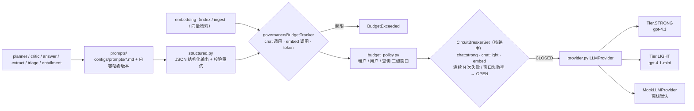

chat、embedding 和 NLI（蕴含判定）都经过 `LLMProvider`，共享磁盘缓存；熔断器按路由拆分（V2 O-8，`llm.resilience`）：embedding 故障不再连带 chat，STRONG 熔断时若开启 `fallback_to_light`，会改用 LIGHT 模型完成调用（`provider.degradations` 计数）。默认参数与 V1 等价。embedding 单独计为 `embed_calls`（并计 token），不占用限制推理跳数的 chat 调用额度。所有 Prompt（含蕴含判定）都在 `configs/prompts/`，每次加载都会按内容哈希登记版本，最终写入 `chain.metadata.prompt_versions`。

---

## 7. 答案生成 generation

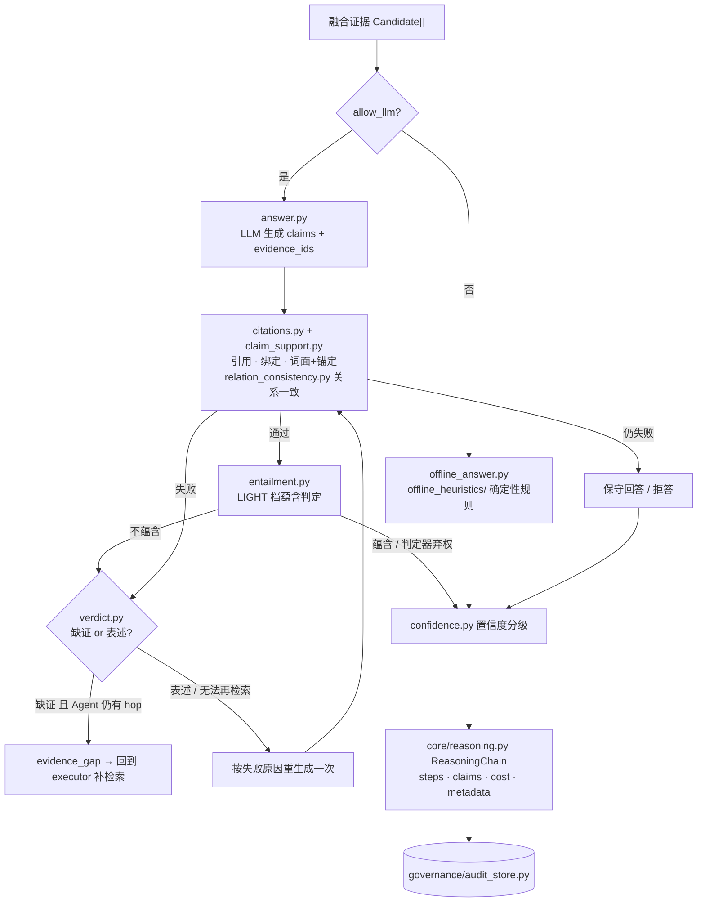

`ReasoningChain` 契约见 [`configs/schema/reasoning_chain_v1.json`](../configs/schema/reasoning_chain_v1.json)。`offline_heuristics/` 只服务演示语料，保证 CI 可复现，不是生产路径。

---

## 8. 治理 governance 与可观测 observability

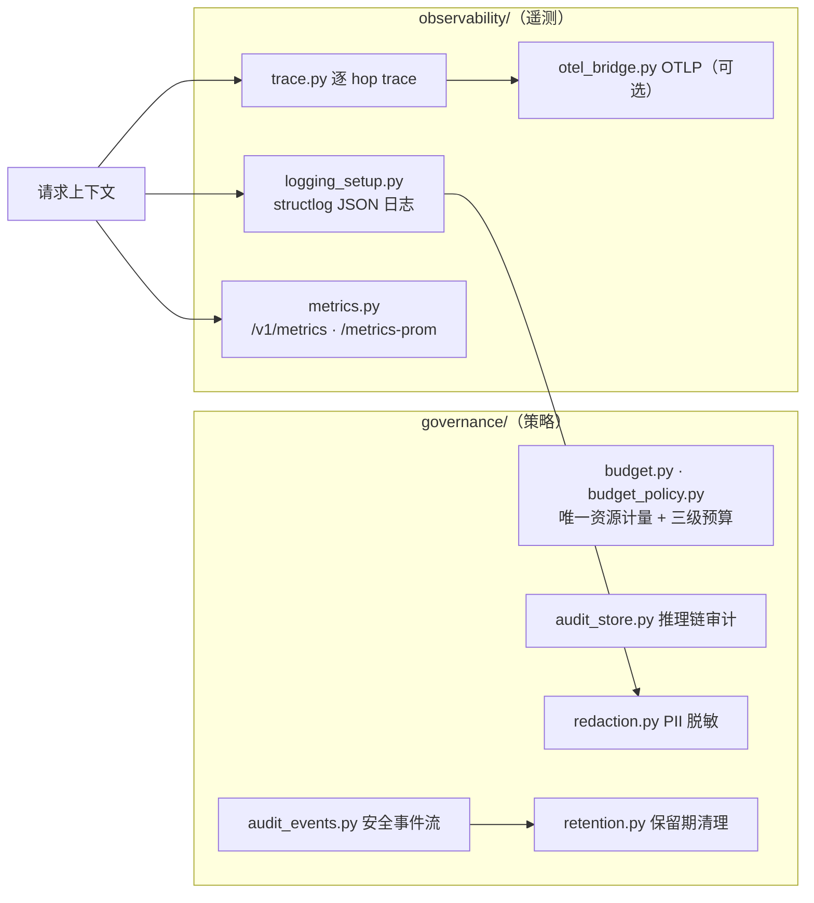

`governance/` 只放策略（预算、审计、脱敏、保留期），`observability/` 只放遥测数据。旧路径 `llm.budget`、`llm.budget_policy`、`generation.audit_store`、`observability.audit_events`、`observability.redaction`、`retention` 保留为别名。

### 8.1 领域事件（读写解耦）

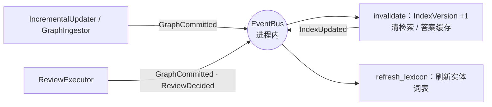

写路径不再持有 `on_graph_commit` 回调，而是发布 `core/events.py` 中的领域事件；读侧订阅在 `app/write_path.subscribe_read_side()` 中注册。进程内使用同步的 `InProcessEventBus`：普通订阅者异常只记日志、不影响写入；**critical 订阅者**（V2 O-4，目前是缓存失效）失败后重试 2 次，仍失败就执行 fail-safe（清空检索缓存和答案缓存），并计入 `agr_event_handler_failures_total`；跨进程部署时用 outbox + Redis Streams 实现同一个 `EventBus` 协议即可。`IndexVersion` 位于 `core/versioning.py`。

---

## 9. 评测 eval

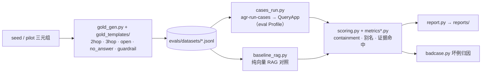

`agr-run-cases` 默认通过 `QueryApp.run_query_chain()` 运行（eval Profile：关闭答案和检索缓存、加载 seed 图；指定 `--neo4j` 时使用 hybrid Profile），评测的就是生产路径（预算、Pipeline、审计、指标）。真实 LLM 的响应由 provider 的磁盘缓存回放。`--direct` 保留旧的直接调用 Agent 循环的方式。重构前后 `poc_cases` 的结果一致（21/31，31 条预测、状态和路由逐条相同）。

V2 评测工具（O-1 / O-2）：`scripts/eval_compare.py` 对两次运行做配对 A/B（Wilson 95% CI、精确 McNemar、分类别和分模板准确率、P50/P95 延迟、LLM 调用均值），p < 0.05 才判定“更好”或“更差”；`scripts/audit_gold.py` 在三元组上校验金标（`path_edge_missing` / `inverse_label` / `gold_unreachable` / `ambiguous_gold`），CI 中以 `--max-flagged 0` 阻断（金标已按正确方向与完整答案集合重生成）。CI 门禁：poc ≥30/31，g2_all ≥196/200，probe_compositional ≥52/54，probe_negative ≥19/20；准确率 JSON 另含 `strict`（答案实体集合精确匹配，仅报告）。

---

## 10. 查询全链路时序

---

## 11. 配置与运行模式（Profile）

启动时只解析出一个 Profile，按能力矩阵装配并校验；组合不合法、凭据缺失或后端不可达时**拒绝启动**，不会静默降级。

| Profile | 图 | 向量 | LLM | 缓存 | seed 图 | 用途 |
|---|---|---|---|---|---|---|
| `offline`（默认） | 内存 | 内存 | Mock；`AGR_ALLOW_LLM=1`+key 时为真实 LLM | 开 | 加载 | 本地 / CI |
| `live` | Neo4j | Qdrant | 同上 | 开 | 不加载 | 生产 |
| `hybrid` | Neo4j | 内存 | 同上 | 开 | 不加载 | 显式声明的混合部署 |
| `eval` | 内存 | 内存 | Mock 或真实 LLM（磁盘缓存回放） | 关 | 加载 | 评测 |

解析顺序：`AGR_PROFILE` → 兼容旧开关（`AGR_USE_LIVE_STORES=1` 等价于 `live`）→ `offline`。实现见 `bootstrap/profile.py`（`CAPABILITY_MATRIX`、`resolve_runtime_profile`）和 `bootstrap/stores.py`（`build_stores`）。API（`build_default_service`）和 ingest worker 都经过它。

应用参数在 `configs/default.yaml`，由 `config.py` / `config_enterprise.py` 解析；密钥与端点走 `.env`。部署与变量清单见 [`ops/RUNBOOK.md`](./ops/RUNBOOK.md)，Neo4j 外部运行时见 [`ops/EXTERNAL_RUNTIMES.md`](./ops/EXTERNAL_RUNTIMES.md)。
