# 架构说明（ARCHITECTURE）

> 描述**当前代码已实现**的模块边界与运行路径，每个模块配一张架构图。目标设计见 [`design/ARCHITECTURE_DESIGN.md`](./design/ARCHITECTURE_DESIGN.md)，业务规则见 [`design/BUSINESS_LOGIC.md`](./design/BUSINESS_LOGIC.md)。

- [0. 总览](#0-总览)
- [1. 接入层 api / cli / web](#1-接入层-api--cli--web)
- [2. Agent 编排 agent](#2-agent-编排-agent)
- [3. 检索 retrieval](#3-检索-retrieval)
- [4. 知识图谱 knowledge](#4-知识图谱-knowledge)
- [5. 存储 stores](#5-存储-stores)
- [6. LLM 网关 llm](#6-llm-网关-llm)
- [7. 答案生成 generation](#7-答案生成-generation)
- [8. 可观测与治理 observability](#8-可观测与治理-observability)
- [9. 评测 eval](#9-评测-eval)
- [10. 查询全链路时序](#10-查询全链路时序)
- [11. 配置与运行模式](#11-配置与运行模式)

---

## 0. 总览

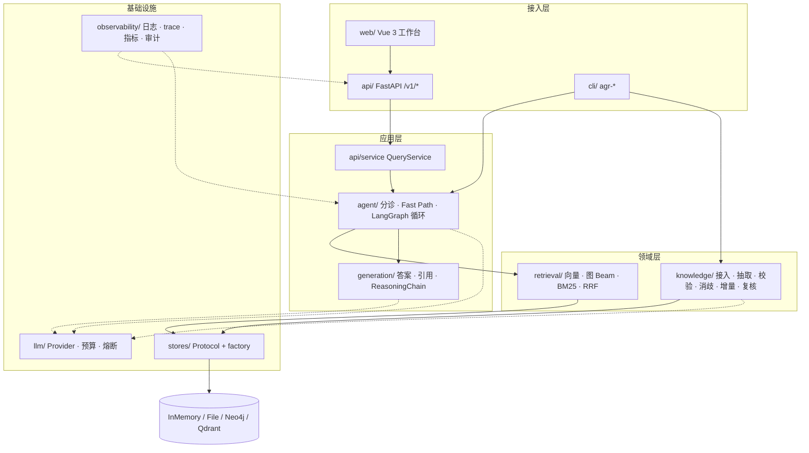

依赖方向自上而下：上层只依赖下层的 **Protocol**（`stores/interfaces.py`、`llm/interfaces.py`），具体后端只在 `stores/factory.py` 组合根中装配。`langgraph` 依赖限定在 `agent/` 内。

| 目录 | 职责 | 关键文件 |
|---|---|---|
| `api/` | HTTP 接入、鉴权限流、RBAC、SSE、应用服务 | `app.py` `auth.py` `rbac.py` `service*.py` `routes/` |
| `cli/` | `agr-*` 命令行入口 | `ingest.py` `index_cmd.py` `graph_cmd.py` `cases_run.py` |
| `agent/` | 分诊、Fast Path、Planner/Executor/Critic 状态机、护栏、记忆 | `loop.py` `loop_runtime.py` `triage.py` `planner.py` `executor.py` `critic.py` `guardrails.py` |
| `retrieval/` | 三路检索、图 Beam、RRF 融合、缓存 | `graph.py` `graph_beam.py` `fusion.py` `cache.py` `contracts.py` |
| `knowledge/` | 文档接入、三元组抽取、Schema 校验、实体消歧、增量更新、复核队列 | `extract_pipeline.py` `schema_check.py` `resolution.py` `incremental.py` `review/queue.py` |
| `stores/` | 存储协议与实现 | `interfaces.py` `factory.py` `memory_graph.py` `neo4j_store.py` `vector_store.py` |
| `llm/` | Provider 抽象、结构化输出、三级预算、熔断 | `provider.py` `structured.py` `budget*.py` `circuit.py` |
| `generation/` | 答案生成、引用绑定、置信度、推理链、审计存储 | `answer.py` `citations.py` `trace.py` `audit_store.py` |
| `observability/` | JSON 日志、trace、Prometheus、安全审计、PII 脱敏、OTel | `logging_setup.py` `metrics.py` `audit_events.py` `redaction.py` |
| `eval/` | 金标生成、评分、基线、坏例归因 | `gold_gen.py` `scoring.py` `baseline_rag.py` `badcase.py` |

---

## 1. 接入层 api / cli / web

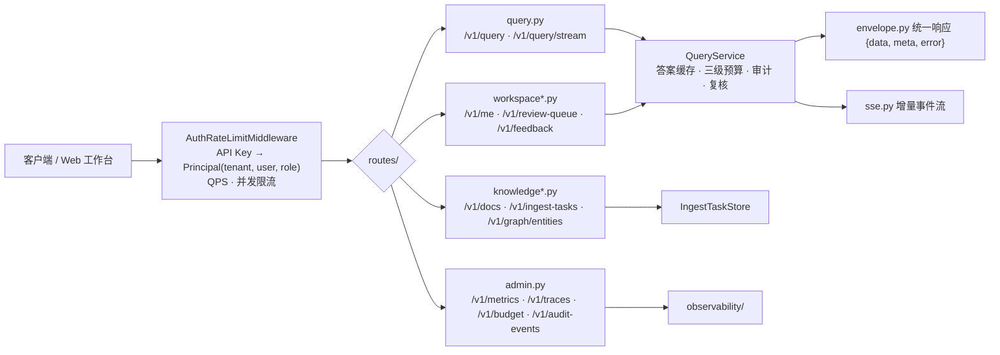

- **鉴权与租户**：`auth.py` 解析 `AGR_API_KEYS=tenant:key:role`，`rbac.py` 提供 admin / operator / reader 三角色路由守卫。
- **QueryService**（`service.py` + `service_query.py` / `service_stream.py`）：查答案缓存 → 预留预算 → 调用 Agent → 落审计 → 结算预算；流式请求经 `loop_stream.py` 逐 hop 推送事件。
- **上传**：`POST /v1/docs` 创建任务（UTF-8 md/txt，≤5 MiB/文件，≤20/批）；worker（`AGR_INGEST_INLINE=1` 时在 API 进程内运行）完成分块索引并抽取三元组入图，冲突进入复核队列，决策由复核执行器作用于图谱（见 §4.4）。
- **web/**：Vue 3 ESM 零构建，`api.js` 调用上述接口，视图位于 `static/js/views/`（chat / knowledge / review / graph / ops）。

---

## 2. Agent 编排 agent

### 2.1 入口与分诊

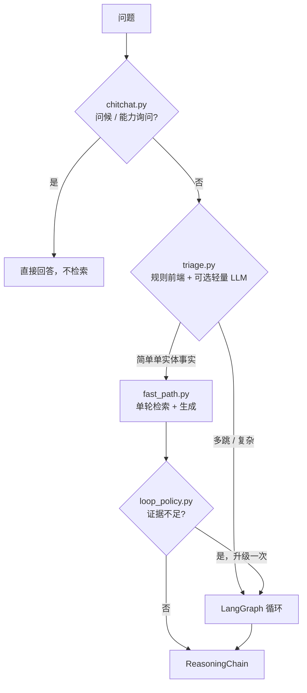

### 2.2 LangGraph 状态机

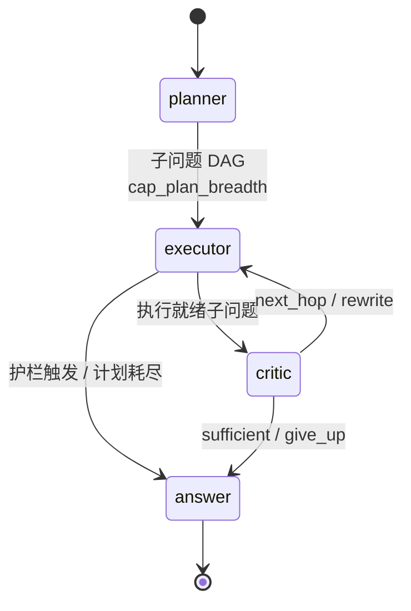

| 节点 | 实现 | 说明 |
|---|---|---|
| planner | `planner.py` `plan_dag.py` `planner_patterns.py` | 问题 → 带依赖的子问题 DAG，`{from:sqN}` 占位由上游结论物化；广度受 `max_sub_questions` 限制，被裁剪项写入 metadata |
| executor | `executor.py` `executor_plan.py` `executor_dispatch.py` `parallel_branches.py` | 为子问题选择工具（graph_neighbors / graph_path / graph_subgraph / vector_search / fulltext_search），并行执行后 RRF 融合；就绪且互不依赖的 DAG 节点并发检索、共享同一 hop |
| critic | `critic.py` `critic_offline*.py` `critic_guard.py` | 子问题级 + 全局两级判断：`sufficient` / `next_hop` / `rewrite` / `give_up` |
| answer | `generation/answer.py` | 引用绑定生成答案，失败重试一次后走保守回答 |

### 2.3 运行时支撑

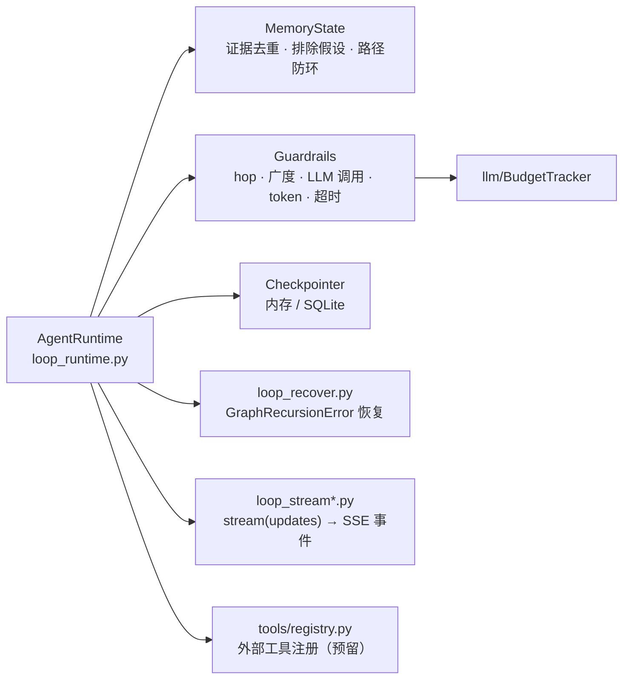

hop 计数的是**依赖深度**：被并发预取的兄弟节点不再消耗 hop，广度由 `max_sub_questions` 单独限制。默认护栏（`configs/default.yaml`）：`max_hops=4`、`max_sub_questions=4`、`max_llm_calls=16`、`max_tokens_per_query=50000`、`query_timeout_seconds=45`、`recursion_limit=15`。

---

## 3. 检索 retrieval

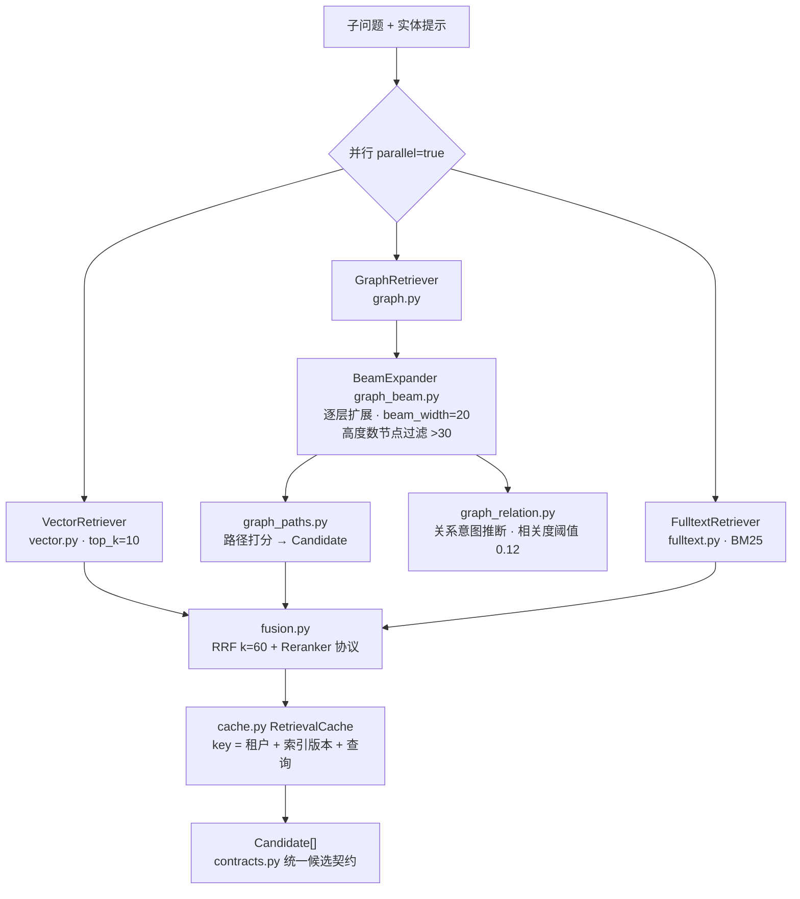

- `contracts.py` 定义 `Candidate` / `Citation` / `CandidateSource`，三路结果统一为同一结构，`rrf_fuse` 按排名融合。
- `IndexVersion` 在图、向量、全文更新后递增，使缓存自然失效；缓存键包含 `tenant_id`，保证租户隔离。

---

## 4. 知识图谱 knowledge

### 4.1 领域 Schema（`configs/schema/domain_v0.yaml`）

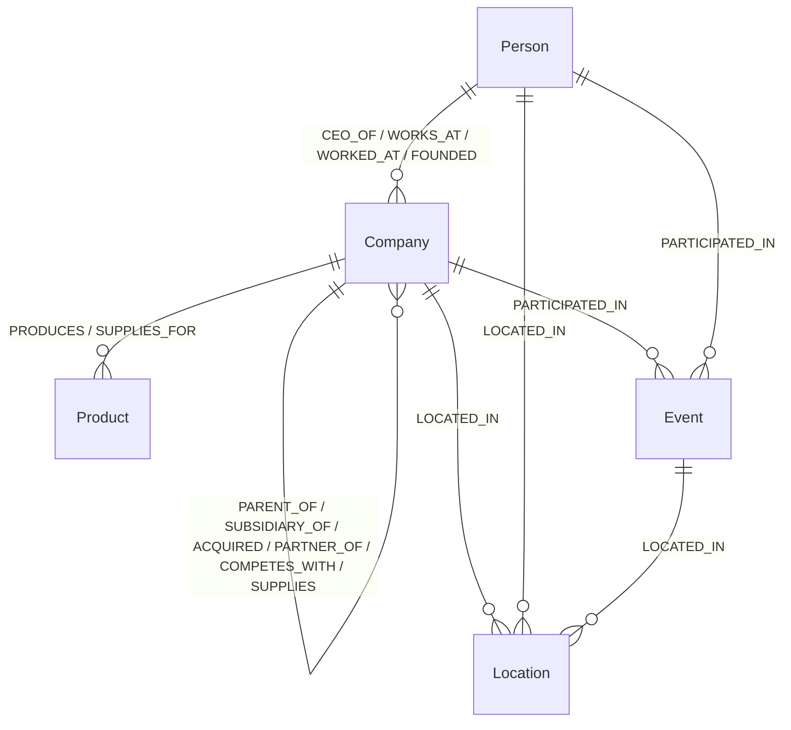

### 4.2 构建管线（CLI 离线建图）

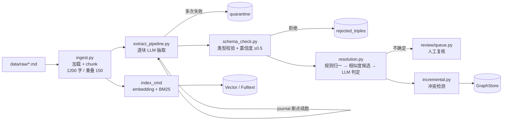

### 4.3 增量冲突决策（`incremental_conflicts.py`，只在本租户范围内比较）

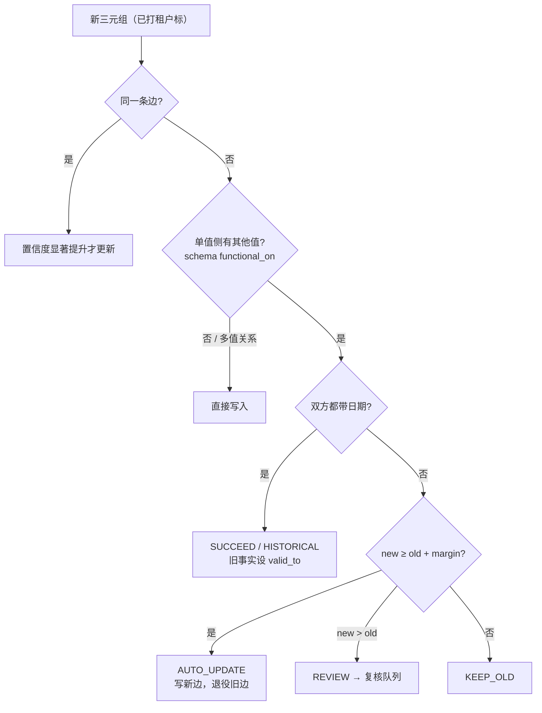

### 4.4 运行期写入路径（上传 → 图谱 → 复核）

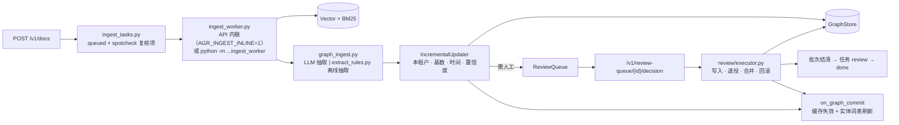

> 离线模式下图谱与向量在进程内存，应使用 API 内联 worker；在线模式（Neo4j/Qdrant）独立 worker 与 API 共享存储。

### 4.5 时间维度（`knowledge/temporal.py`）

关系可带 `valid_from` / `valid_to`（ISO 年 / 年-月 / 日期）。同一条边重复出现时较新日期优先；单值关系出现新值且双方都带日期时，按时间裁决（`SUCCEED` / `HISTORICAL`），旧事实写入 `valid_to` 而非删除。检索时已结束的事实降权（问题含「以前 / 曾 / previously」时不降），证据文本标注区间，如 `[2010–2016]`。

---

## 5. 存储 stores

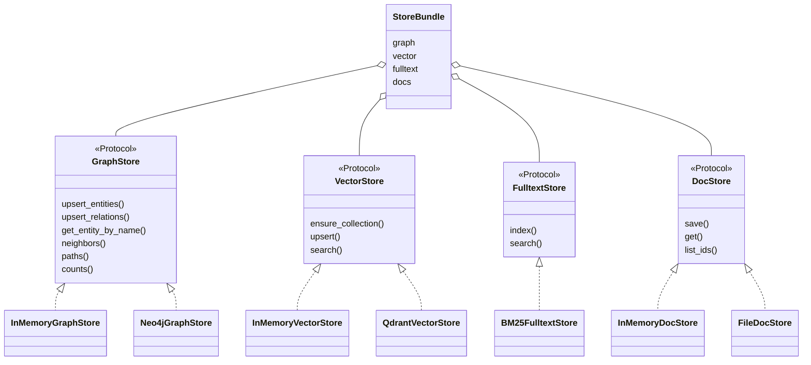

`factory.py` 提供 `create_offline_bundle()`（内存图 + 进程内向量 + BM25 + 文件 DocStore）与 `create_live_bundle()`（Neo4j + Qdrant，Qdrant 初始化失败回退内存向量）。`neo4j_codec.py` / `neo4j_queries.py` 负责序列化与 Cypher 生成；`scheduling_protocols.py` 定义限流、预算、审计存储协议。所有读写都带 `tenant_id` 过滤。

---

## 6. LLM 网关 llm

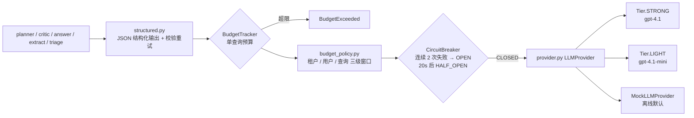

---

## 7. 答案生成 generation

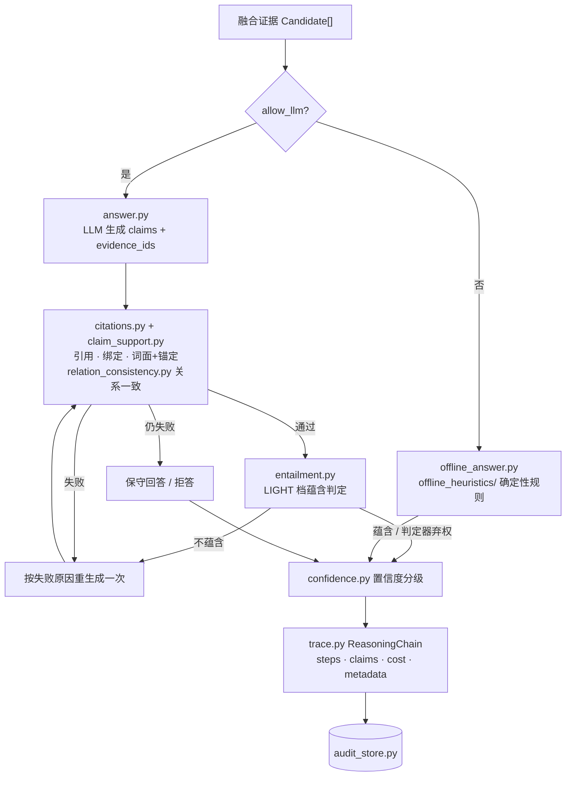

`ReasoningChain` 契约见 [`configs/schema/reasoning_chain_v1.json`](../configs/schema/reasoning_chain_v1.json)。`offline_heuristics/` 只服务演示语料，保证 CI 可复现，不是生产路径。

---

## 8. 可观测与治理 observability

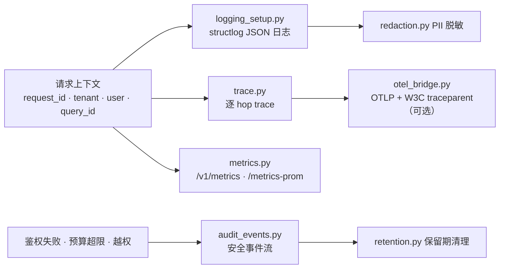

---

## 9. 评测 eval

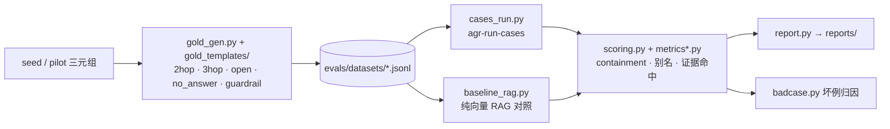

---

## 10. 查询全链路时序

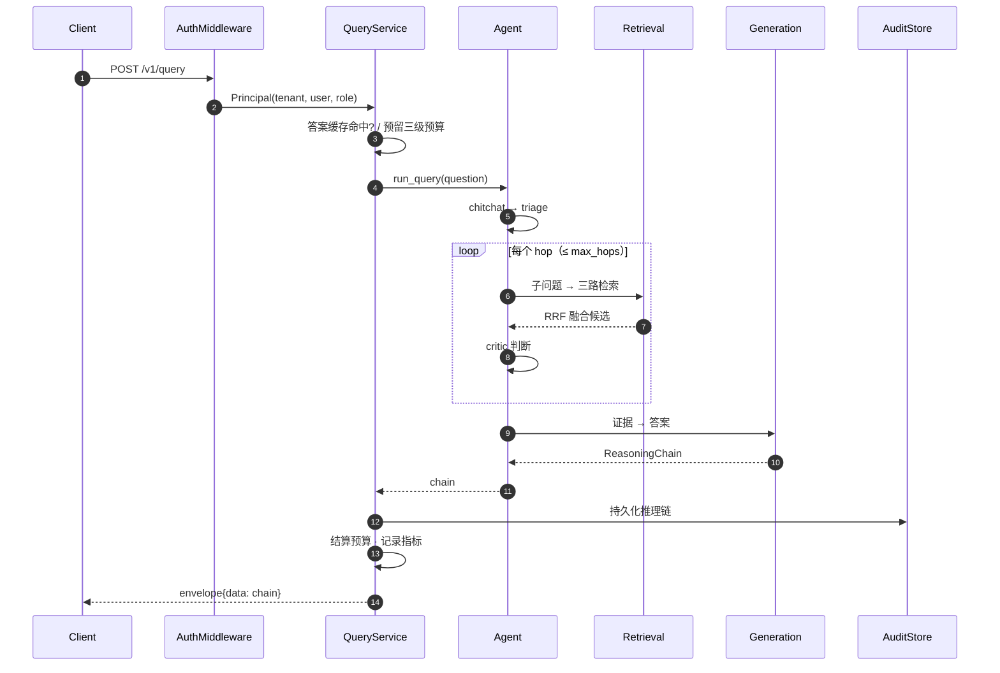

---

## 11. 配置与运行模式

| 能力 | 离线（默认） | 在线（显式开启） |
|---|---|---|
| 图 | `InMemoryGraphStore` + `data/processed/seed_triples.jsonl` | Neo4j（`AGR_USE_LIVE_STORES=1`） |
| 向量 | 进程内 + 已持久化 embedding | Qdrant |
| 全文 / 文档 | BM25 + 文件 DocStore | 同左 |
| LLM | `MockLLMProvider` + 离线规则 | `AGR_ALLOW_LLM=1` + `LLM_API_KEY` |

两个开关相互独立。应用参数在 `configs/default.yaml`，由 `config.py` / `config_enterprise.py` 解析；密钥与端点走 `.env`。部署与变量清单见 [`ops/RUNBOOK.md`](./ops/RUNBOOK.md)，Neo4j 外部运行时见 [`ops/EXTERNAL_RUNTIMES.md`](./ops/EXTERNAL_RUNTIMES.md)。
