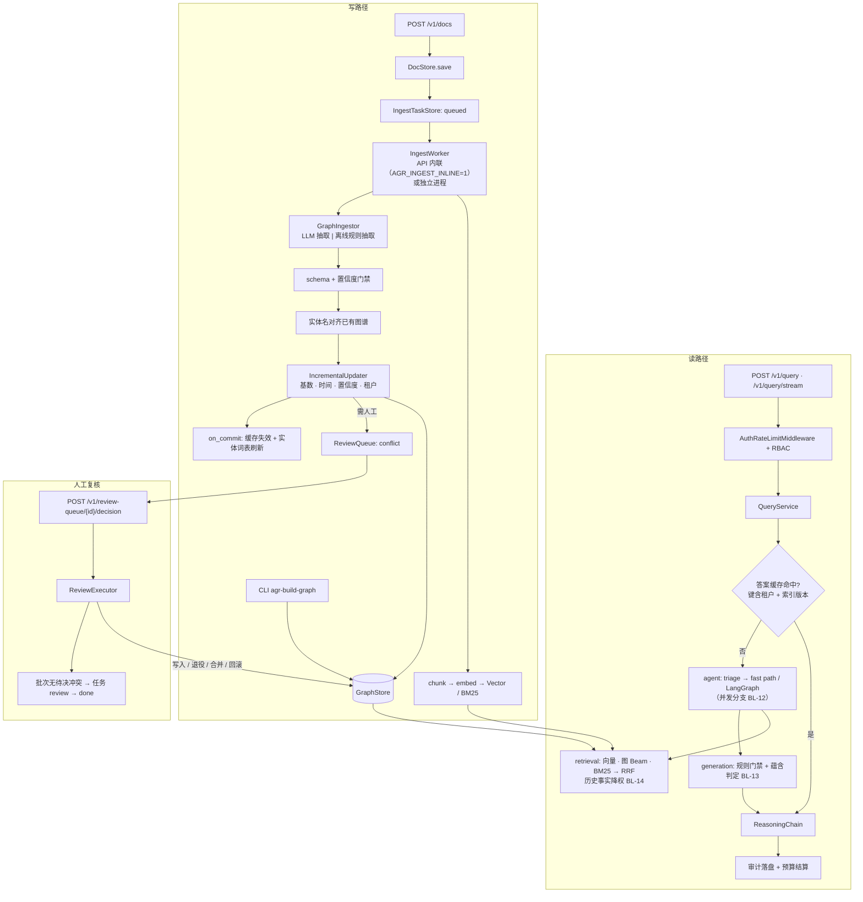
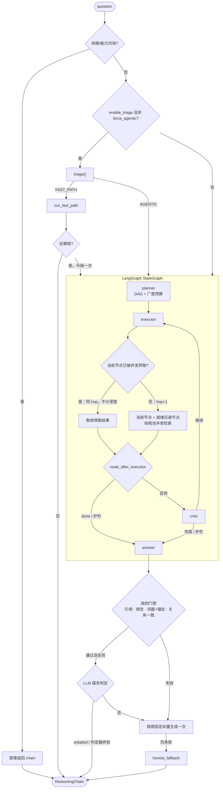
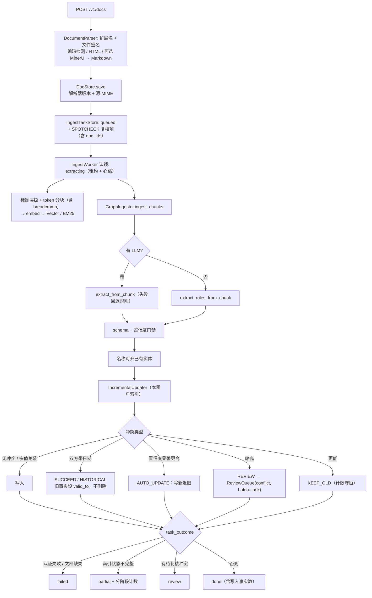
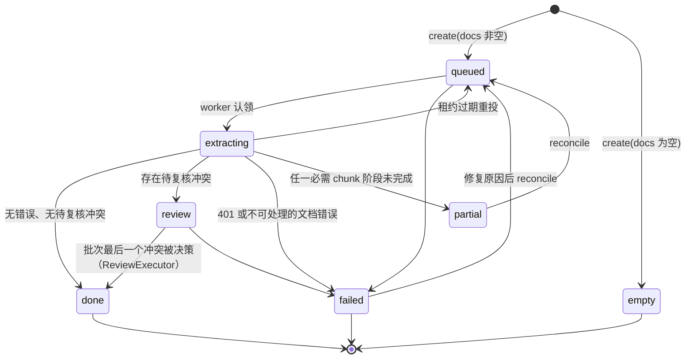
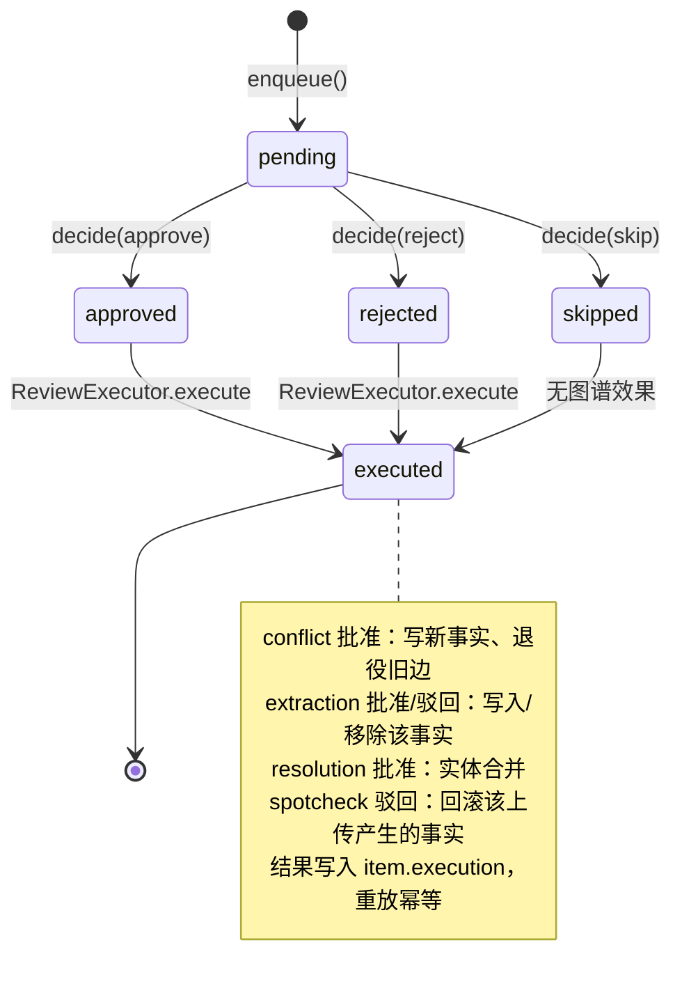

# 业务逻辑图与完整性审查（BUSINESS LOGIC）

**状态：** BL-01…BL-14 已实现；当前行为与边界见 §3–§5。

## 0. 总体结论

| 领域 | 业务逻辑完整性 | 说明 |
|------|----------------|------|
| 查询链路（问 → 答） | **完整** | triage / fast-path / agentic / guardrail / 兜底 answer 全部有出口 |
| 护栏与预算 | **完整** | 「计数 → 判定 → 降级出口」三段齐全；hop 现只计**依赖深度**，广度单独预算（BL-12） |
| 检索链路 | **完整** | 三路检索 + RRF + 租户维度缓存键；历史事实降权（BL-14） |
| 输出契约 / 引用门禁 | **完整** | 四级规则门禁（引用 → 绑定 → 词面+对象锚定 → 关系一致）+ 在线 LLM 蕴含判定（BL-02 / BL-13） |
| 知识写入链路（文档 → 图谱） | **完整** | 上传 → 任务 → worker → 抽取（LLM / 离线规则）→ 校验 → 消解 → 增量入图 → 冲突复核（BL-01） |
| 人工复核闭环 | **完整** | 决策由 `ReviewExecutor` 作用于图谱，结果写回条目，批次结清后任务 `review → done`（BL-03） |
| 多租户隔离 | **完整** | SSE 透传 `tenant_id`；写路径按租户打标、冲突与删除均限定在本租户（BL-04 / BL-01） |
| 摄取任务状态机 | **完整** | `REVIEW` 有生产者与消费者；`EXTRACTING` 崩溃可重投（BL-05 / BL-06 / BL-11） |
| 计划（DAG）执行语义 | **完整** | 就绪且互不依赖的节点并发检索、共享同一 hop（BL-12） |
| 图谱时间维度 | **完整** | 关系带 `valid_from/valid_to`；时效冲突按时间裁决，旧事实闭区间保留（BL-14） |

**一句话结论：** 读路径与写路径均已闭环 —— 产品叙事「上传 → 抽取 → 校验 → 复核 → 入图 → 可被多跳检索」在服务进程内有完整通路，复核决策是控制面而非台账。

---

## 1. 全局业务逻辑图

---

## 2. 查询链路逻辑图（读路径）

### 2.1 判定点

| 判定点 | 位置 | 分支 |
|--------|------|------|
| 闲聊短路 | `agent/chitchat.py` | 命中 → 跳过检索 |
| 路由 | `agent/loop.py` `_run_with_triage` | FAST_PATH / AGENTIC |
| Fast Path 升级 | `agent/loop_policy.py` | 证据弱 → agentic |
| 并发分支 | `agent/parallel_branches.py` `retrieve_for_node` / `loop_runtime._start_node` | 预取命中 → 同 hop；否则 hop+1 并预取就绪兄弟 |
| executor / critic 后路由 | `loop_runtime.route_after_*` | 护栏 / hop 上限 → answer |
| 递归兜底 | `agent/loop_recover.py` | `GraphRecursionError` → checkpoint 重建 |
| 规则门禁 | `generation/citations.validate_answered_claims` + `claim_support.claim_supported` | 失败 → 定向重生成 |
| 蕴含判定 | `generation/entailment.judge_claims` | 非 entailed → 定向重生成；判定器异常 → 弃权并记录 |

### 2.2 护栏：计数 → 判定 → 出口

| 护栏 | 计数点 | 触发出口 |
|------|--------|----------|
| max_hops（依赖深度） | `Guardrails.on_hop_start`（并发预取节点走 `check_branch`，不加 hop） | executor 置 `done` → answer |
| max_sub_questions（广度） | `plan_dag.cap_plan_breadth` / 动态插入前检查 | 超出部分记入 `metadata`，不静默丢弃 |
| 超时 / LLM 调用 / token | `Guardrails._check` | 同上 |
| recursion_limit | 编译期下限 `2*hops+5` | `loop_recover` 重建部分答案 |
| 租户预算 | `service_query` 预留 / 结算 | 429 `BUDGET_EXCEEDED` |

---

## 3. 知识写入链路逻辑图（写路径）

### 3.1 摄取任务状态机

### 3.1.1 文档身份、索引一致性与恢复（BL-06 / BL-10，2026-11-03）

- API 与 CLI 写入使用 UUID；`source_uri` 标识来源，`content_sha256` 标识 UTF-8 文本内容，
  `version` 从 1 递增，保留 `created_at` 并刷新 `updated_at`。同租户同 hash 返回
  `duplicate`：已完成索引的文档不再处理，尚未完成的文档由该任务补齐（重试可恢复中断的上传）；
  同来源新内容沿用 UUID、递增版本。`POST /v1/docs` 整批校验并解析通过后才接受任何文件。
- 替换与 `DELETE /v1/documents/{doc_id}` 共用 `DocumentLifecycle`：先记录替换/删除意图，
  再依次清理 vector、fulltext、graph，最后提交新版本或删除源文档。任一步失败保留意图，
  reconcile 可重入；图谱只移除该文档的来源，仍有其它来源支持的关系保留。
- FileDocStore 的 `documents.sqlite3` 原子保存文档身份索引、正文及 chunk journal。
  `(tenant, source)`、`(tenant, hash)`、`id` 均有索引；list 不解析正文，无租户 get
  只解码唯一命中的文档，歧义返回空。旧 JSON 自动导入一次；UUID 迁移见 RUNBOOK。
- chunk 的 `embedded`、`fulltext_indexed`、`graph_extracted`、`embedding_model`
  只在对应存储确认成功后持久化。`done` 要求所有已配置阶段完成；未完成为 `partial`，
  附 `total/embedded/fulltext_indexed/graph_extracted/incomplete` 计数。冲突继续使用 `review`。
- embedding 按 `indexing.embedding_batch_size` 请求，429/5xx/timeout 使用有上限的指数退避
  与 full jitter；401 不重试，任务为 `failed` 并显示 401（不回传供应商正文）。
  任务 journal 使用进程共享锁和刷新读取，chunk checkpoint 消除旧 `_processed` 内存集合。
- `reconcile --tenant` 重试缺失阶段并恢复中断的清理；`reindex --tenant` 仅重新生成与配置
  模型不同的向量。内存 adapter 用相同逻辑 ID 原子 upsert；Qdrant 在租户独立的新 collection
  构建完整向量空间，成功后原子切换 alias，再清理旧向量，支持维度变化。查询按 active
  collection 的模型编码；在途 alias 切换会重新编码，防止旧 encoder 查询新空间。
- 上传容量见 `indexing` 配置。`/uploads/init`、`/uploads/{id}/parts/{number}`、
  `/uploads/{id}/complete` 支持持久化、乱序和幂等重传，GET 返回已接收 part；校验每片和总量，
  complete 校验完整性与可选 hash，并在会话锁之外走统一解析端口。所有路径由当前 Principal
  限定租户；删除、完成上传有审计。

### 3.1.2 文档解析与 token 分块（BL-08）

- `core/ports/parsing.py` 定义 `DocumentParser` / `ParsedDocument`；API 与 CLI 共用
  `knowledge/parsers` 路由。扩展名白名单与 magic bytes 双重校验，OOXML 检查 ZIP
  包内主文档类型，不解压文件；伪装成 PDF 的可执行文件在调用解析器前拒绝。
- `TextParser` 支持 MD/TXT；charset-normalizer 检测非 UTF-8 编码，支持 GBK/GB18030，
  去 BOM、统一换行后以 Unicode Markdown 保存。严格 UTF-8 优先；检测阈值为
  `encoding_min_confidence`（`1 - chaos`，不是统计概率），短文本编码同分时按
  `encoding_preference`（默认 GB18030）选择。类型/签名不符或 MinerU 未配置为 **415**，
  无可靠解码或无有效正文为 **422**，文件/批量超限仍为 **413**。
- `HtmlParser` 用 trafilatura 提取正文，BeautifulSoup 去除 nav/footer/script 等噪声并
  解实体；提取失败或丢失标题/表格时用结构化 Markdown 渲染兜底。`MinerUParser`
  显式调用可配置的 HTTP `/file_parse`，支持路由 PDF、DOCX、PPTX、XLSX 及图片扫描件；
  使用 `parse_method=auto`，由服务执行 OCR。服务故障/超时返回 **503**。
  返回 Markdown 中的 HTML 表格也转为 Markdown 表格，代码围栏里的示例保持原样。
- `knowledge/chunking.py` 按 Markdown 标题层级划分 section，段落 → 中英文句子 → token
  递归拆分；默认 **512 tokens / 最多 64 tokens overlap**，预算包含
  `Doc title > H1 > H2` 前缀。重叠不跨 section、不截断表格或代码；大表格只在整行间
  拆分，每片重复表头。围栏/缩进代码、单个列表项和引用块保持完整；单个原子结构或
  表头加一行仍超预算时，worker 明确报 failed 并提示增大预算，不生成超限块。
- `chunk_text` 保留为薄兼容入口，`chunk_size` / `overlap` 现以 token 计量；配置迁移为
  `chunk_size_tokens` / `chunk_overlap_tokens`，旧 `*_chars` 键明确报错。
  默认 cl100k_base 词表随包分发、校验 SHA-256，无首次下载；`tokenizer` 可指定本地
  编码器定义，格式见 [tokenizers/README](../../src/agentic_graphrag/knowledge/tokenizers/README.md)。
- 文档元数据保存 `parser_name`、`parser_version`（适配器协议版本）、`source_mime_type`；
  文本另记 `source_encoding`，服务报告版本时另记 `mineru_version`。块保存 `breadcrumb`、
  `heading_path`、`token_count`、`tokenizer`，继承源元数据。doc_id 规则、`doc_id:index`
  格式与索引恢复约定见 §3.1.1。
- 离线回归覆盖：GBK/BOM、正文去噪与实体、双语 token 上限、层级 breadcrumb、整行表格、
  围栏保护、文件伪装、MinerU 响应及错误边界。运行配置与 HTTP 合约见
  [RUNBOOK §6.1](../ops/RUNBOOK.md#61-文档解析与分块bl-08)。

### 3.2 复核队列状态机与执行

| 条目类型 | 批准 | 驳回 |
|---|---|---|
| conflict | 写入 incoming，退役 superseded（限本租户） | 保留现有事实 |
| extraction | 写入提议事实 | 若已入图则移除 |
| resolution | `apply_entity_merge(keep, drop)` | 两实体保留 |
| spotcheck | 接受上传 | 回滚「来源全部为该批文档」的关系 |
| feedback | 无图谱效果 | 无图谱效果 |

---

## 4. 验证项与落地测试

| # | 验证项 | 状态 | 自动化测试 |
|---|--------|------|-----------|
| V-01 | 上传后图谱实体增加 | ✅ | `test_bl_write_path::test_api_upload_reaches_graph_via_inline_worker` |
| V-02/03 | 中文 claim 不再必然失败 | ✅ | `test_citations.py`（BL-02 既有用例） |
| V-04 | 复核批准后图谱变化 | ✅ | `test_bl_write_path::test_conflict_goes_to_review_and_approval_takes_effect` |
| V-05/06 | 流式租户隔离 / 缓存 | ✅ | `test_audit_tenant_cache_isolation.py`、`test_live_sse_stream.py` |
| V-07 | worker 命令消费队列 | ✅ | `test_bl_write_path::test_cli_worker_is_wired_to_queue_and_graph` |
| V-08 | 中断恢复 | ✅ | `test_enterprise_completion.py`（stale requeue） |
| V-09/10 | 上传校验 | ✅ | `test_enterprise_readiness.py` |
| V-11…13 | 越权与存在性泄漏 | ✅ | `test_console_api.py`、`test_graph_entities_api.py` |
| V-14 | 批次计数守恒 | ✅ | `test_review_fixes.py` + `conflicts_temporal` 新计数 |
| V-15 | 非流式检索缓存生效 | ✅ | 缓存键含租户（BL-04） |
| V-16 | 超量子问题不再静默丢弃 | ✅ | `test_plan_dynamic_sq_insert.py` |
| V-17 | 并行分支延迟 Σ → max | ✅ | `test_bl_reasoning_gates::test_branches_run_concurrently`、`test_parallel_sibling_shares_the_hop` |
| V-18 | 关系错配被拦截（运行期与评测同口径） | ✅ | `test_bl_reasoning_gates::test_gate_rejects_claim_citing_edge_with_another_relation`、`test_eval_fabrication_uses_same_relation_rule` |
| V-19 | 时效冲突按时间裁决 | ✅ | `test_bl_write_path::test_dated_successor_closes_previous_ceo_instead_of_deleting`、`test_older_fact_is_stored_as_history` |

历次验证结果见 [CHANGELOG](../../CHANGELOG.md#bl-test-results)；当前门禁见 [CLAUDE.md](../../CLAUDE.md)。

---

## 5. 当前落地状态

> `[x]` 已完成并有测试；括号内为主要实现位置。

| 缺口 | 状态 | 落地内容 |
|---|---|---|
| BL-01 上传→图谱无通路 | `[x]` | 新增 `knowledge/graph_ingest.py`（抽取 → 门禁 → 名称对齐 → 增量入图）与离线规则抽取器 `knowledge/extract_rules.py`（中英文句式，含日期）；`IngestWorker` 增加图谱阶段与 `task_outcome`；API 内联 worker `api/service_ingest.py`（`AGR_INGEST_INLINE=1`），独立 worker 移至 `knowledge/ingest_worker_cli.py` 并接入图谱；写入后发布 `GraphCommitted` 事件使缓存失效并刷新实体词表 |
| BL-02 中文 claim 必然失败 | `[x]` | CJK 二元组切词 + 按失败原因定向修复提示（既有） |
| BL-03 复核决策无执行器 | `[x]` | 新增 `knowledge/review/executor.py`：五类条目的批准/驳回语义、按租户删除、幂等重放、结果写回 `item.execution`、批次结清后任务 `review → done`；`IncrementalUpdater` 的待复核冲突直接进入 `ReviewQueue`；决策路由调用执行器 |
| BL-04 SSE 未传租户 | `[x]` | 既有修复；写路径同样按租户打标（`graph_builder.stamp_tenant`） |
| BL-05 / BL-06 | `[x]` | 既有修复；CLI worker 另接入图谱阶段 |
| BL-07 schema 门禁 | `[x]` | 既有修复；运行期写路径与复核执行器均经门禁 |
| BL-08 | `[x]` | 2026-11-03：API/CLI 共用文档解析端口、文件签名校验、编码检测、结构化 Markdown 与 token 分块；详见 §3.1.2 |
| BL-09 / BL-10 | `[x]` | 既有修复；复核执行与图谱阶段失败均显式上报，不静默 |
| BL-11 空分支 / 计数 | `[x]` | `IngestStatus.REVIEW` 现有生产者（`task_outcome`）与消费者（`_settle_task`）；新增 `conflicts_temporal` 计数保持守恒 |
| BL-12 广度/深度混同 | `[x]` | `agent/parallel_branches.py`：就绪且互不依赖的节点线程池并发检索，结果预取入状态，取用时不增 hop（`Guardrails.check_branch`）；`guardrails.parallel_branches` / `max_parallel_branches` 可配；并发组记入 `metadata.parallel_branches` |
| BL-13 门禁只到词面 | `[x]` | `generation/relation_consistency.py`：中英文关系线索 vs 边关系类型（含兼容/蕴含映射），运行期门禁与评测 `fabrication_rate` 同口径；`generation/entailment.py`：在线路径 LIGHT 档批量蕴含判定（`llm.entailment_check`），非 entailed 触发定向重生成，判定器异常则弃权并记录 |
| BL-14 图谱无时间维度 | `[x]` | `knowledge/temporal.py`：`valid_from/valid_to`；同边合并以较新日期优先；`incremental_conflicts` 新增 `SUCCEED / HISTORICAL`，旧事实设 `valid_to` 而非删除；检索对已结束事实降权（问「以前/曾」时不降）并在证据文本标注区间；schema 声明 `functional_on` 基数，多值关系不再误判冲突；抽取提示要求输出日期 |

### 5.1 仍需知悉的边界（非缺口）

| 项 | 说明 |
|---|---|
| 内联 worker 默认关闭 | 需 `AGR_INGEST_INLINE=1`；离线模式下独立 worker 与 API 不共享内存图谱，故离线请用内联方式，在线（Neo4j/Qdrant）两者皆可 |
| MinerU 默认关闭 | PDF、Office、图片需显式配置 `knowledge.parsing.mineru.enabled/endpoint/timeout_seconds`；未配置返回 415。OCR 模型由服务部署管理，离线测试只 mock Markdown |
| 规则抽取器 | 精确优先，只覆盖常见公司关系句式；在线模式优先用 LLM 抽取，失败逐块回退规则 |
| 蕴含判定成本 | 每次作答额外 1 次 LIGHT 调用；`MockLLMProvider` 与离线路径不调用 |
| 时间裁决前提 | 仅当冲突双方都带日期时按时间裁决，否则沿用置信度规则 |
| 并发范围 | 并发的是检索；critic 仍按节点顺序评估，避免改变判定语义 |

---

## 6. 历史追踪

初次审查的缺口、旧代码行号与修复批注见 [CHANGELOG](../../CHANGELOG.md#bl-original-audit)。
