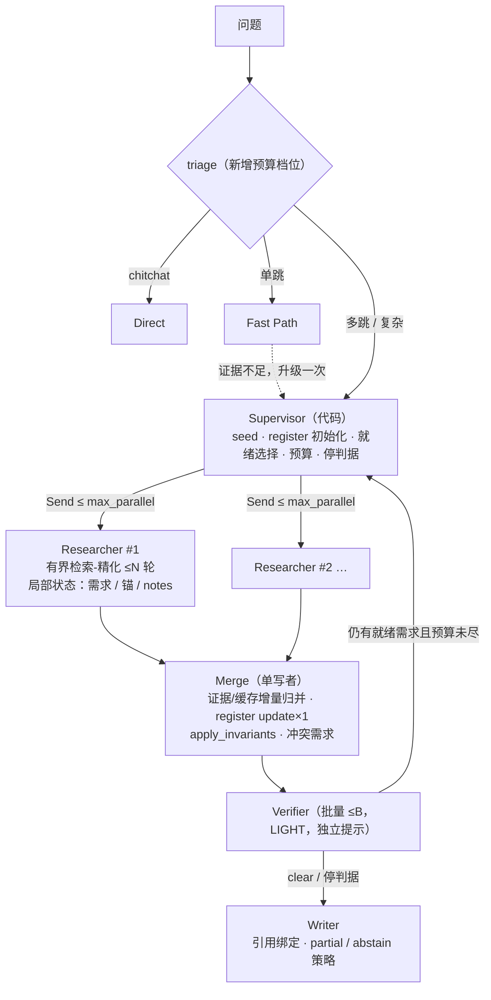

# 多 Agent 编排：黑板 + 监督者 + 并行研究者

> **本文性质**：对一份外部提案（黑板 + 监督者 + 并行研究者，**不是**自由对话式多智能体）的逐条评估
> 与修订后的设计。**代码未实现**；`agent.mode` 默认 `single`。分步迁移见 §4，评估协议见 §5；
> 翻转默认之前必须有 `reports/multi_agent_eval.md` 的配对报告。
> **结论先行**：方向成立——它是现「需求登记表」模式（[REQUIREMENT_REGISTER.md](REQUIREMENT_REGISTER.md)）
> 的并行化与角色化，而不是第二套范式；但提案有 6 处与代码事实或本仓库约束不符/欠妥（§0.2），
> 按下文修订版设计。**主要收益面是「同一依赖深度上互相独立的需求」的延迟**，不是准确率本身；
> 纯链式问题不会变快（依赖深度即路径长度）。
> **关联**：[ARCH_OPTIMIZATION_V2.md](ARCH_OPTIMIZATION_V2.md)（A/B 协议与开关先例）·
> [BUSINESS_LOGIC.md](BUSINESS_LOGIC.md) BL-12（检索并发先例）· [ARCHITECTURE.md](../ARCHITECTURE.md) §2（当前实现）·
> [rules.md](../../plan/engineering/rules.md) §3/§6/§7 · tech-stack.md ADR-003/ADR-005 · [IMPORTANT.md](../reviews/IMPORTANT.md)。

---

## 0. 评估：这个设计会让项目变好吗

### 0.1 结论

**有条件地是，值得按修订版分期实现。** 判断依据：

1. **问题与成本结构对得上。** Live heldout agentic 的 P95 ≈ 92s，AC-4 目标是 8s（IMPORTANT.md §0/§10）；
   当前每一跳都是串行 LLM 往返。register 模式已经把「搜什么/何时停」收进代码（工程已验证；
   真实 LLM 效果仍待评估，见 REQUIREMENT_REGISTER.md），但它每轮只推进**一条**需求
   （`register_invariants.schedule` 保证恰一条 active，`loop_runtime.py` 按
   `requirement_register.enabled` 把节点处理器换成 `RegisterRuntime`）。对比较型 / 多实体型问题，
   同深度的独立需求本来可以并行检索与验证——这是现有结构里尚未吃到的延迟收益之一。
2. **它顺势而为，不是重写。** 黑板语义（单一写者 + 证据池 + 事件流 + 每轮预算）在 register 模式里已有约八成；
   检索层并行也有先例（BL-12 兄弟节点预取、工具级线程池）。增量是：按需求扇出的研究者子图、
   合并节点、逐角色模型、归因台账、分支级观测。
3. **准确率收益是二阶的。** 同一份证据、同一套检索/融合/引用校验之下，并行本身不提升准确率；
   只有「冲突显式化 + 验证器批量否决 + 无进展需求退役」这些配套机制可能减少误结案。
   因此本设计**不承诺**准确率提升，验收口径是「不回退 + 目标题集 P95 改善」。
4. **代价真实。** 并发状态合并、预算放大、验证器成本、检查点语义、测试确定性都会变复杂（§6）。
   所以默认关闭、逐承诺迁移、有报告才翻转。

### 0.2 对提案的六处修订（对照代码逐条核对见 §1）

| # | 提案原文 | 修订 | 理由 |
|---|---|---|---|
| 1 | "register runtime with its own nodes" | 更正：**同一批节点，换处理器**。graph 仍是 planner/executor/critic/answer（`loop.py:64-89`），`AgentRuntime` 按开关把四个节点委托给 `RegisterRuntime`（`loop_runtime.py:81/107/167/212`）。多模式才真正新增节点。 | 评估的前提要建立在事实之上；这也意味着迁移是"加节点"而非"改图语义"。 |
| 2 | Researcher 用 "Small ReAct loop" | 改为**有界检索-精化循环**（≤N 轮，工具选择默认沿用确定性策略；LLM 选具可选、默认关）。 | ADR-005 明确否决自由智能体式消息框架，理由是护栏与确定性控制要"与框架对抗"；工具选择现已是确定性启发式（`executor_plan.choose_tools`），不应在研究者里推翻。 |
| 3 | "Merge 节点合并提案；研究者输出 proposals" | 研究者只输出**证据增量 + 缓存增量 + 可选注释**；**register 更新仍是每轮一次的单一 LLM 调用**（沿用 `register_update` 提示与上下文），单写者不变。 | 若每条需求各自改 register，会碎片化更新语义、破坏"恰好一条 active"的既有不变量与验收口径（验证器输入是"拟解决的条目 + 其引用的完整证据"）。保持单点更新使 (b) 步可与现状做逐题等价（p=1）验证。 |
| 4 | 冲突时"创建 resolve conflict 需求" | 采纳，但明确：**验证器不裁决冲突**（它只看单条需求+证据）；冲突需求用现有 Requirement 机具表达（`depends_on=[双方]`、锚并集、notes 记录双方证据 id），未解决则走既有 partial + missing_info 路径。 | 验证器的契约（独立提示、只收子问题与证据、`register_llm.verify`）不能扩成裁判，否则破坏其"独立复核"的语义；需求机制已经足够承载。 |
| 5 | "budget ledger（per run / per requirement / per role）" | 台账是 **BudgetTracker 的归因视图**，不是第二个计量器（CLAUDE.md：governance/budget 是唯一计量）。provider 的记账路径不变；**并发下给 `BudgetTracker` 加锁**（计数器读改写原子化），台账由 merge 按分支返回的 usage 增量**归因写入**（只累加角色/需求维度，不再调用 `record_call`，避免双计）。 | 现有 `BudgetTracker` 无锁（`budget.py:45-52`），而分支线程会经 provider 触发 `record_call`/`record_embedding`（`provider.py:127-131/160-164`）；加锁保住"唯一计量"且不失并发安全。 |
| 6 | "Checkpointing 使失败分支单独重跑" | 保留目标，修正语义：LangGraph 的 Send 扇出在同一 superstep 内执行，**不做子图级 checkpoint 隔离承诺**。分支节点内捕获异常并返回错误增量（不 abort superstep）；失败需求的"单独重跑"实现为**下一轮重试 + per-run 去重缓存**（重跑廉价）。节点级 `RetryPolicy` 作为实现时的可选验证项。 | 诚实描述框架边界（langgraph 1.2.9，`Send` 已实测可用）；把"重跑"落到需求维度（attempts 计数已存在）而不是伪装成分支维度。 |

另有两条"不做"：不引入消息总线/自治会话（ADR-005 已否决 AgentScope 的同构理由）；不换运行时。

---

## 1. 现状核对（逐条对代码）

图例：✓ 与代码相符　◐ 部分相符/需修正　✗ 与代码不符

| 提案断言 / 设计要素 | 代码事实（file:line） | 判定 |
|---|---|---|
| 一个 LangGraph 循环 `planner → executor → critic → answer` | `agent/loop.py:64-89`；条件边含 answer→executor 的 evidence_gap 回边 | ✓ |
| register runtime"有自己的节点" | ✗ 见 §0.2-1：同一节点集、处理器级委托（`loop_runtime.py`） | ✗ |
| `parallel_branches` 只在检索层预取兄弟节点 | `parallel_branches.py:117-135`（线程池 + `prefetched` 暂存；hop 计依赖深度）；工具级并发 `executor_dispatch.py:240-269`（`MAX_PARALLEL_WORKERS=8`） | ✓ |
| register 模式推理串行 | 每轮仅一条 active 需求（`register_invariants.py:86-95`）；轮数上限 `min(max_rounds=15, max_hops=4)`（`register_runtime.py:42`） | ✓ |
| Triage 设置预算档位 | `TriageResult` 只有 route/estimated_hops/confidence/rule_hit（`triage.py:68-74`），无 tier 字段 | ✗（新增项） |
| Verifier：独立模型、批量、只看需求+证据 | 独立提示 + LIGHT 档已存在（`register_llm.py:123-130`）；"只看需求+证据"✓（`register_progress.py:48-68`）；**批量**✗（现为逐项调用）；"独立模型"取决于配置——STRONG=LIGHT 同模时只是独立提示校验（register 设计文档已注明） | ◐ |
| 黑板状态 | 部分已有：register 表（单写者 `apply_invariants`，`register_invariants.py:21-46`）、证据池（`state.evidence` + `MemoryState`，`memory.py:55-144`）、事件（`register_events`）、每轮缓存（`register_cache`，存在 state 里**原地更新**，`register_runtime.py:149/178`——并行下是数据竞争，需改造） | ◐ |
| 停止规则（clear / round / token / 依赖阻塞） | `register_runtime.py:269-278`（clear/round_budget/context_limit/dependency_blocked）+ 护栏 `guardrails.py`（hop/calls/tokens/timeout/recursion） | ✓；verifier 否决上限为新增 |
| 分支级 OTel span + SSE branch_id | span/OTel 桥已有（`observability/trace.py`、`otel_bridge.py`），但粒度停在请求级（CONTEXT_ENGINEERING_AND_OBSERVABILITY_GAPS.md §2）；SSE 事件名固定且前端忽略未知字段（rules §8） | ◐（加属性与字段） |
| 检查点支撑失败重跑 | MemorySaver 默认 / SQLite 可选（`checkpointer.py`）；递归兜底 `loop_recover.py`；Send 扇出见 §0.2-6 | ◐ |
| 逐角色模型 | 只有两档全局模型（`config.py:96-98`，`llm/factory.py:35-48`）；角色→档位是调用点隐式约定（grep `tier=`：planner/register 初始化与更新/答案=STRONG；分诊/critic/fast/verifier/蕴含/消解=LIGHT） | ✗（新增配置层） |
| 预算"per run / requirement / role" | 单一 `BudgetTracker`（`budget.py`）+ 三级 `MultiLevelBudget`（`budget_policy.py`）+ provider 记账（`provider.py:127-131/160-164`）；无角色/需求归因 | ✗（扩展项） |
| 框架与选型约束 | langgraph 锁版 1.2.9（`uv.lock`），`langgraph.types.Send` 可用（已实测）；ADR-005：roles-in-pipeline、拒绝 AgentScope、langgraph 限定 `agent/` 内 | ✓（设计须遵守） |
| 前端 HopRail 展示并行分支 | `railFromProgress` 按 hop 号线性成轨（`hoprail.js:86-103`），无分组概念 | ◐（可选 UI 跟进，见 §2.11） |

---

## 2. 修订后的目标设计

### 2.1 模式开关与边界

```yaml
agent:
  mode: single          # single | multi；默认 single，报告无回退前不翻转（env 覆盖仿 AGR_CRITIC_MODE）
  max_parallel: 1       # 就绪需求扇出上限；先 1（等价迁移），评估时 3
  researcher_rounds: 2  # 每个研究者的有界检索-精化轮数
```

- **multi 的前置**：需要 LLM（无 LLM 时 `RegisterRuntime.enabled()` 已返回 False，自然回落到旧循环）；
  `--no-llm` 离线路径**逐字节保持现状**，multi 是 live-only 模式（与 rules §6「离线路径是默认」一致——
  离线不引入新依赖，也不改变任何现有行为）。
- **multi = register 黑板的并行化**：复用 `initialize / update / verify / apply_invariants /
  answer_from_register`、全部检索栈、`ToolRegistry`、护栏与预算；不是新循环。
- **分诊保持现有三个落点**（chitchat/Direct、单跳 Fast、多跳 Agentic），新增的只是可选 `tier`
  预算档位字段（默认 S = 现状）。**汇总型问题**（多实体求和/并列）当前落入 Agentic，在 multi 下
  自然表现为多条并列需求并行扇出、由 Writer 汇总——不需要新路由分支；如后续评估显示需要
  单独类别，再单列。
- 共同不变量（两种模式都强制）：单一写者；证据只来自实际取回（`Candidate` 引用闭包）；实体锚必须
  落在所引证据文本中；租户贯穿（`tenant_id` 随 state 进每个分支）。

### 2.2 黑板状态（AgentState v3）

| 字段 | 形状 | 归并语义 | 写入者 |
|---|---|---|---|
| `requirement_register` | dict | **无 reducer**（唯一写者） | Merge 节点（`apply_invariants`） |
| `evidence_by_id` | `dict[str, Candidate]` | dict 合并（同 id 幂等覆盖；内容相同） | 分支以**增量**返回，merge 归并（不再共享可变 dict） |
| `proposals` / `register_events` | list | append reducer | 分支 / Merge |
| `budget_ledger` | `dict[str, {calls, tokens}]`（key=role 或 req_id） | dict 合并求和 | Merge 归因写入（§2.9） |
| `register_cache` | `dict[query_key, hits]` | dict 合并（分支返回增量） | 分支返回增量，merge 归并 |
| 分支局部状态 | 不进共享状态 | — | Researcher（question / 需求 / 锚 / notes / 已知证据 id） |

- 迁移（步骤 a）：`evidence` 由 `list[dict]` 改为按键字典；`state_version` 升到 3，读取 v2 检查点时
  按 id 归一（对齐 `state.py` 现有的"旧版可读"约定）。行为等价，全部现有单测与离线地板保持。
- 并行安全原则：**分支只返回值，不改共享对象**（LangGraph reducer 只合并返回值；现 `register_cache`
  的原地更新必须移除）。
- 去重缓存键 = `tenant + run`：cache 生命周期 = 单次查询（register 现状即 per-run），键沿用
  `register_search.query_key` 的归一化（BM25 词排序、语义保序、图参数稳定 JSON）；分支间共享同一张表，
  经 merge 合并增量，天然租户隔离（state 属于单租户单次运行）。

### 2.3 监督者（代码为主）

职责（除 register 初始化外全部为确定性代码；每轮的 register 更新在 Merge 节点，见 §2.5）：

1. 种子检索（复用 `seed_search`，`seed_top_k=5`）→ 初始化 register（复用 `initialize`，STRONG）。
2. 就绪选择：**全部**依赖已满足的未完成需求，按（尝试次数升序, req_id 字典序）取 ≤ `max_parallel`。
   `schedule()` 从"恰一条 active"扩展为"≤max_parallel 条 active，缺省 max_parallel=1 时与原语义完全一致"。
3. 预算分配：按档位（§2.9）为每个分支设定本次轮次的调用/ token 上限；任何时刻受全局护栏约束
   （`max_llm_calls`/`max_tokens`/`query_timeout_seconds`）。
4. 扇出（LangGraph `Send`），收敛后评估停止规则（§2.10），决定继续下一轮还是交 Writer。

### 2.4 研究者子图（每需求一实例）



- 输入：`{question, requirement, anchors, notes, known_evidence_ids}`（局部状态，不进共享状态）。
- 循环体（每轮）：`choose_tools`（确定性策略；LLM 选具为可选开关，默认关）→ `ToolRegistry.invoke()`
  → RRF 融合 → 依据新证据决定是否精化查询（notes 增量）；同参查询命中 per-run 去重缓存（失败调用保持
  可重试，成功空结果也缓存——沿用 `register_search` 语义）。
- 输出：`{evidence_delta, cache_delta, traces, notes_update?, usage}`；**永不写 register**（状态形状 + reducer
  在结构上强制）。
- 分支失败：节点内 try/except，返回错误增量（`{events: [{type: "branch_error", ...}]}`），superstep 正常完成。

### 2.5 Merge 节点（单一写者）

1. reducer 归并证据/缓存/提案/事件增量（顺序确定性：按 req_id 排序）。
2. **一次** register 更新：输入 = register 上下文 + 本轮全部新证据（与现状 critic 节点相同），
   STRONG 档，沿用 `register_update` 提示；随后 `apply_invariants` 执行既有校验（依赖合法、闭包、
   锚落地、引用必须来自实际取回）。max_parallel=1 时此路径与现状逐字段一致（步骤 b 的等价验收）。
3. **冲突检测（multi 新增）**：同一实体/关系出现互斥断言（结构化比较图边 source/relation/target/时间；
   文本级冲突以 `generation/relation_consistency.py` 的同精神检查兜底）时**不静默取一**：
   生成 `resolve_conflict` 需求——`text` 模板化（"判定 X 的 R 关系：A 还是 B？"）、
   `depends_on=[双方 req_id]`、`anchors=双方锚并集`、notes 记录双方证据 id；该需求同其他需求一样被
   调度、验证。未在预算内解决 → 既有 partial + `missing_info` 路径（`register_answer.annotate_register`）。
4. 派发验证（§2.6），产出进度事件（`register_events`）与 SSE `progress`。

### 2.6 验证器（既有，批量化 + 否决上限）

- 批量：一次调用处理 ≤B（默认 4）条"拟解决"项，逐项裁决（沿用独立提示 `register_verify`、LIGHT 档、
  只收需求 + 引用证据）。
- 否决上限：同一需求累计否决 ≥K（默认 3）→ `retired(reason="verifier_rejections")`（新停判据，见 §2.10）。
- 预算异常/无效 JSON/上下文超限的既有处理不变（否决不能结案）。

### 2.7 Writer（既有）

`answer_from_register` + `answer_policy=partial|abstain` 保留；证据池 = merge 后全量；
未解决需求写 `missing_info` 并禁止 answered（既有逻辑）；引用/论断校验路径不变。本设计不改生成语义。

### 2.8 逐角色模型（roles）

```yaml
llm:
  strong_model: gpt-4.1          # 现有
  light_model: gpt-4.1-mini      # 现有
  roles:                          # 新增：角色 → 档位（或显式 model 覆盖）
    triage: light
    supervisor: strong            # register 初始化 + 每轮更新（初始化在 supervisor，更新在 merge）
    researcher: light
    verifier: light
    writer: strong
```

- 接线：`config.py` 新增 `RolesConfig` → `llm/factory.py` 构造时映射；provider 侧保持
  `model_for(tier)`（默认映射与现状连续：见 §1 表"角色→档位"行），显式 `model` 值直接覆盖。
- env 覆盖仿 `AGR_CRITIC_MODE` 的 Settings alias 模式（`config.py:237` 先例）。
- 评估回放安全：LLM 磁盘缓存键包含模型名（`provider.py:211-213`），角色分档不破坏回放。

### 2.9 预算台账（归因，不新增计量）

- `BudgetTracker` 增加可选归因参数：`record_call(..., role=None, req_id=None)` → `ledger` 计数；
  `snapshot()` 增 `ledger`；`ReasoningChain.metadata.budget_ledger` 落审计。
- **记账与归因分离**：provider 的内部记账路径不变（唯一计量）；并发下给 `BudgetTracker` 加锁
  （步骤 c 前置，见 §2.13）。台账由 merge 按分支返回的 `usage` 增量归因写入（`ledger[role|req] += delta`），
  **不二次调用 `record_call`**——归因是视图，不重复计数。
- 档位表（`agent.tiers`）：先定义 `S = 现状默认`（max_llm_calls=16 / max_tokens=50000 / timeout=45s）；
  `M/L` 留待评估标定。`TriageResult` 增可选 `tier` 字段（默认 S），监督者据此分配每轮额度。

### 2.10 停止规则（完整清单）

| 判据 | 触发 | 现状/新增 | 行为 |
|---|---|---|---|
| clear | 无未完成需求 | 现状 | 交 Writer |
| round_budget | 轮数 ≥ `min(max_rounds, max_hops)` | 现状 | 部分答案 |
| token / LLM 调用 / 超时 | 护栏与预算 | 现状 | 部分答案 + 记录 |
| dependency_blocked | 无就绪项但仍有未完成 | 现状 | 显式停止 |
| context_limit | 保守字节上限 | 现状 | 保留上一张已通过校验的表 |
| verifier_rejections | 同需求否决 ≥K | **新增**（multi） | retire（带理由），其他需求继续 |
| no_progress | 连续轮次仅缓存命中、无新证据且 register 无变化 | **新增**（multi） | retire / notes 记录，不空转 |

### 2.11 可观测

- **分支 span**：`agent.branch` span，属性 `agr.req_id / agr.role / agr.model / agr.tokens / agr.outcome`，
  父 span 为查询级 span（`observability/trace.py` 的 `span()` 已双写 OTel，`otel_bridge.py` 无 SDK 时 no-op）。
  线程安全：分支 span 先收集进分支返回值，merge 后统一 append（与台账同策略；`TraceContext.spans` 现状非线程安全）。
- **SSE**：`thinking / sub_question / hop_done` 载荷**增量**字段 `branch_id`、`req_id`；事件名不变；
  前端已忽略未知字段（rules §8），后端先行、前端可后跟进。
- **HopRail（仅小规模，独立事项）**：并行分组显示只在 `max_parallel ≤ 3` 且有评估结论后再做
  （现轨道模型按 hop 序线性，`hoprail.js`）；不在 (a)–(d) 承诺内。

### 2.12 检查点与失败重跑（诚实语义）

- 运行 `thread_id` 不变；MemorySaver 默认（SQLite 可选）。
- Send 扇出在同一 superstep 提交，**不做子图级 checkpoint 隔离承诺**；失败分支返回错误增量，
  下一轮以 `attempts` 计数重试该需求（配合 per-run 缓存，重跑廉价）。
- 节点级 `RetryPolicy`、以及"从某一需求的中间状态恢复"作为实现时**待验证项**记录，不写成既定能力。

### 2.13 并发安全清单（实现前置）

1. reducer 归并顺序确定化（排序键 = req_id）；分支只返回增量，不改共享对象。
2. `register_cache` 从"state 内原地更新"改为"增量 + 合并"（现实现 `register_runtime.py:149/178` 必须改）。
3. `BudgetTracker` 加线程锁：分支线程会经 provider 触发 `record_call`/`record_embedding`，
   计数与 `check()` 的读改写必须原子（步骤 c 前置）。
4. `TraceContext.spans` 的合并策略（§2.11）。
5. 测试策略：线程调度不做保证 → 断言只依赖归并后的确定性结果。

---

## 3. 兼容、隔离与门禁

- **默认与回退**：`agent.mode=single` 默认；multi 需 LLM；`--no-llm` 与未启用开关的路径行为不变
  （离线地板逐题一致）。
- **租户隔离**：`tenant_id` 随 state 进每个分支；检索缓存键已含租户（BL-04）；去重缓存生命周期 = 单次
  查询。分支不读取其他运行的任何状态。
- **门禁（每步全跑，rules §1–§3）**：`ruff`、`ruff format --check`、`mypy`、
  `pytest tests/unit --cov=agentic_graphrag --cov-fail-under=80`、`python scripts/check_code_metrics.py`；
  离线地板：`poc_cases` 两条路径 ≥30/31、`g2_all` ≥196/200、`probe_compositional` ≥52/54、
  `probe_negative` ≥19/20、金标审计 `--max-flagged 0`。不扩覆盖率 omit 名单。
- **架构边界**：LangGraph（含 `Send`/reducer）仍只出现在 `agent/`；不引入 LangChain 检索/链抽象；
  节点保持"状态入→状态出"（单测不依赖 LangGraph 运行时）。`Send` 是 langgraph 1.2.9 自身能力，
  非技术选型变更，无需新 ADR；若实现中发现需要新依赖，先补 ADR（rules §7）。
- **文档同步（本变更集已完成）**：`docs/ARCHITECTURE.md` §2 增补「需求登记表模式」图（当前已实现部分）；
  `docs/reviews/IMPORTANT.md` 挂账一行；`docs/README.md` 索引本文件。

---

## 4. 分步迁移（每步一个提交，门禁全绿）

| 步骤 | 内容 | 行为保证 | 验证 |
|---|---|---|---|
| **(a) 黑板状态 v3（等价重构）** | `evidence_by_id` 字典 + `proposals`/`events`/`budget_ledger` 字段与 reducer 骨架；`state_version=3`（v2 可读）；`register_cache` 改增量语义。 | 单模式与 register 模式逐题等价 | 全量单测 + 四项离线地板 + `test_register_runtime.py` 全绿；register 模式（MockLLM）判分与改前一致 |
| **(b) 研究者 + Merge，max_parallel=1** | 新节点集（supervisor → researcher → merge → verifier → writer）；Send 扇出上限=1；register 更新保持单写者、每轮一次。 | 与现 register 轮次等价（同输入、同输出） | 同上 + 新增单测（扇出选择、合并确定性、单写者约束）；评估等价性用同一 MockLLM 序列逐题比对（p=1 口径同 register 验证） |
| **(c) max_parallel=3 + 并发安全** | §2.13 清单落地；冲突需求；SSE `branch_id`；per-run 缓存跨分支共享（增量合并）；预算归因台账。 | 默认仍 `max_parallel=1`，行为不变 | 并发单测（归并确定性、缓存合并、冲突需求生成、台账求和）+ 全部门禁；`AGR_*` 开关下冒烟 |
| **(d) 逐角色模型** | `llm.roles` 配置 + factory/provider 接线；默认映射复现现状档位。 | 默认配置下行为不变（同模型同档） | 单测（映射、env 覆盖、回放缓存键）+ 门禁 |
| **(e) 收口（以报告为前置）** | 跑 §5 评估；报告无准确率回退 → 翻转 live 默认到 multi（保留 `single` 开关一个发布周期）；旧 planner/critic 循环仅 `--no-llm` 路径保留。 | 翻转前默认仍 single | `reports/multi_agent_eval.md` + 全部门禁 + 离线地板 |

---

## 5. 评估协议（产出 `reports/multi_agent_eval.md`）

- **三臂，配对**（同一数据集、同一图、同一模型与缓存策略；eval profile 即生产路径）：
  - C = single（现默认 agentic；register 开关保持当前生产配置）
  - A = multi，`max_parallel=1`
  - B = multi，`max_parallel=3`
- **数据集**：`g2_all`（200）+ 两个 probe 集 + `poc` 冒烟；有真域集则追加。链式题与比较型题分别统计。
- **"多种子"口径修正**：金标生成是确定性的（`eval/gold_gen.py` 无种子参数）；温度 0 下重复运行近似确定。
  做法：每臂重复 R≥3 次，报告均值与样本方差（`eval/search_drift.py::summarize_repeats`）；如需真实采样
  方差，另设温度 >0 的可选实验并单独记录。
- **指标**：accuracy（Wilson CI、精确 McNemar）、证据召回（对齐后 chunk）、P50/P95 延迟、`llm_calls` 均值、
  tokens（prompt/completion）、成本（按运行时实际价格换算，不硬编码）、fabrication / partial 率、
  按 hop / 模板分解、register 轮数与分支数。
- **延迟测量纪律**：LLM/embedding 磁盘缓存回放会掩盖真实延迟 → 延迟只取缓存关闭或首次运行的样本；
  注明本环境已知风险（网关 403、embedding 401）。
- **验收判据（翻转默认的条件）**：准确率无非劣（McNemar 不显著劣于 C 且点估在噪声内）+ 四项离线地板
  与金标审计全绿 + 成本受档位约束 + 目标题集（比较/多实体）P95 改善方向明确。**纯链式题不变快是预期
  结果，不视为失败**。
- **命令草案**（与 register 验证同一路径）：

```bash
# 每臂（示例：B 臂；A/C 换开关重复）
AGR_AGENT_MODE=multi agr-run-cases --cases evals/datasets/g2_all.jsonl \
  --seed-triples data/processed/pilot_triples.jsonl --run-name multi-p3
python scripts/eval_compare.py reports/single.jsonl reports/multi-p3.jsonl \
  --cases evals/datasets/g2_all.jsonl --json reports/multi_agent_paired.json
PYTHONPATH=src python scripts/analyze_search_drift.py reports/multi-p3.jsonl \
  --base reports/single.jsonl --cases evals/datasets/g2_all.jsonl --out reports/multi_agent_drift.json
```

---

## 6. 风险与未决

| 风险 | 说明 | 缓解 |
|---|---|---|
| 并发记账/状态竞态 | 现 `BudgetTracker`、`TraceContext`、`register_cache` 均为单线程假设 | §2.13 清单为步骤 (c) 的前置；实现前逐个过 |
| 预算放大 | 每轮 ≤3 分支 × (工具轮 + 验证) 可能顶满 `max_llm_calls=16` | 档位表 + 每轮额度预留 + 全局护栏；评估看 llm_calls 均值 |
| 验证器成本 | 批量上限 B 与 K 次否决上限需要标定 | 默认 B=4 / K=3，评估时扫描 |
| 冲突需求循环 | resolve_conflict 自身也可能无进展 | no_progress 停判据 + retire 规则 |
| 检查点语义 | superstep 粒度，非分支粒度 | §2.12 诚实表述；重跑走需求维度 |
| 测试确定性 | 线程调度不可控 | 归并确定性 + 排序键；断言只看合并结果 |
| 前端范围 | HopRail 并行显示是小规模可选项，易扩成 UI 工程 | 只做增量字段，UI 独立立项、以报告为前置 |
| LangGraph 升级（R11） | 依赖 Send/reducer 行为稳定 | 版本已锁 + 评估回归流程（既有机制） |
| 环境 | live 评估受网关 403 / embedding 401 影响 | 缓存回放跑通路径；报告注明可复现范围 |

**未决（需后续决定）**：档位表 M/L 数值；researcher 是否启用 LLM 选具；HopRail 并行显示是否立项；
live 默认翻转的版本窗口。

---

## 7. 附录：预计改动面（实现时核对）

- 新增：`agent/blackboard.py`（reducer 与状态合并）、`agent/researcher.py`（子图）、
  `agent/supervisor.py` / `agent/merge.py`（或并入现有 `loop_runtime` 的 multi 分支、
  按 300 行拆分预算评估）。
- 修改：`agent/state.py`（v3）、`agent/register_invariants.py`（active 集）、`agent/register_search.py`
  （缓存增量）、`agent/pipeline_graph.py`（Send 图编译）、`agent/loop_stream_events.py`（branch_id）、
  `governance/budget.py`（归因，可选锁）、`llm/factory.py` + `config.py`（roles/tiers）、
  `configs/default.yaml`（`agent:`、`llm.roles`、tiers）。
- 测试：`tests/unit/test_multi_agent_state.py`、`test_researcher_fanout.py`、`test_merge_conflicts.py`、
  `test_budget_ledger.py`、SSE 字段断言扩展（并保持 `test_web_claude_ui.py` 注入安全断言）。
- 文档：实现后同步 `ARCHITECTURE.md` §2 的多模式图（替换本设计稿的引用行）、README/CLAUDE 的开关清单
  （`AGR_AGENT_MODE` 属于 Settings 别名而非裸环境直读）、`plan/workstreams/agent-orchestration.md` 的 ⚠ 差异节。
