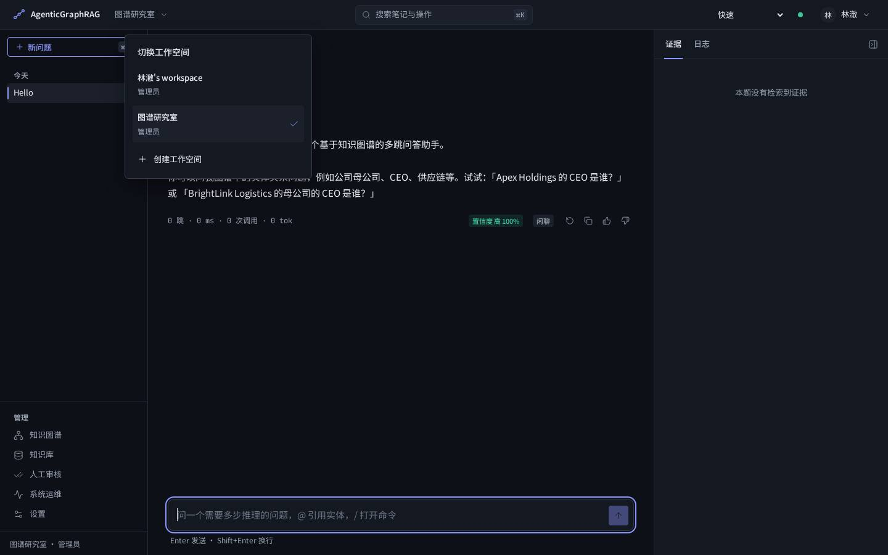
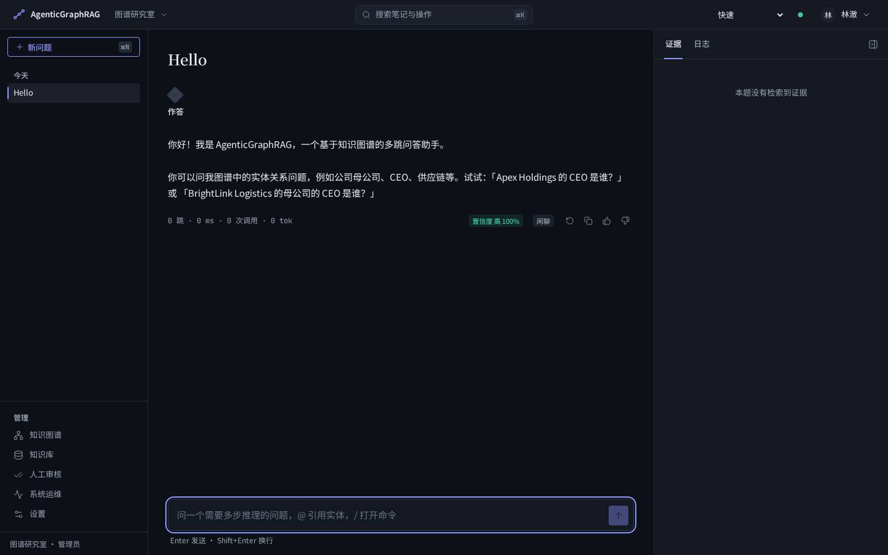

# 多租户 Web 应用使用指南

从浏览器管理账号、工作空间和知识库，按问题记录推理与证据。
应用入口命令为 `agr-webapp`，默认地址 **http://localhost:8000**。

## 启动应用

需要 Python 3.12+ 和 `uv`。在仓库根目录执行；已有 `.venv` 时跳过创建环境这一步：

```bash
uv venv .venv
source .venv/bin/activate
uv pip install -e ".[dev,webapp]"
AGR_WEB_ORIGIN=http://localhost:8000 \
AGR_PROFILE=offline AGR_ALLOW_LLM=0 AGR_INGEST_INLINE=1 agr-webapp
```

保持终端运行，浏览器打开 **http://localhost:8000**。停止服务使用 `Ctrl+C`。
以后启动只需激活虚拟环境并运行最后一条命令，无需重复安装。

这条命令启用离线模式和进程内上传处理器；不需要模型 API Key、Docker 或前端构建。
首次启动会自动创建 SQLite 身份库并执行迁移。
默认 `agr-api` 也占用 8000 端口；已经启动时先停止它，或按
[更换监听地址和端口](../ops/WEBAPP.md#更换监听地址和端口)运行另一端口。

浏览器地址须与 `AGR_WEB_ORIGIN` 一致。按上述命令启动时使用 `localhost`，
不要在登录过程中混用 `127.0.0.1`。若已有 `.env` 配置了 HTTPS Secure Cookie，
本地 HTTP 体验需将 `AGR_WEB_SECURE_COOKIES` 设为 `false`。

## 注册和创建工作空间

1. 首页点击“创建账号”，填写邮箱、显示名称和密码。
2. 密码使用 12–128 个字符，至少包含大小写字母、数字、符号中的三类；
   也可使用 20–128 个字符的长密码。
3. 注册成功后自动登录并创建个人工作空间，你是该空间的管理员。
4. 点击顶栏空间名称 →“创建工作空间”，输入名称后点击“创建并进入”。
5. 再次点击空间名称即可在已有空间之间切换。

每个空间拥有独立的知识、成员和服务密钥；同一个人在不同空间可以拥有不同角色。
新建空间初始为空，仓库演示语料不会自动复制进去。



## 邀请成员

管理员在目标空间打开“设置 → 成员与邀请”：

1. 填写对方邮箱，选择角色，发送邀请。
2. 对方打开邀请链接，使用**受邀邮箱**登录或注册。
3. 点击“接受邀请并进入”，加入该空间。

邀请默认 7 天有效，仅能接受一次；管理员可重发或撤销。重发后旧链接失效。
角色变更即时生效；更换管理员时，先将另一名成员设为管理员，再调整原管理员角色。

| 能力 | 管理员 admin | 操作员 operator | 只读成员 reader |
| --- | --- | --- | --- |
| 提问、查看图谱 | ✓ | ✓ | ✓ |
| 上传知识、人工审核 | ✓ | ✓ | — |
| 系统运维 | ✓ | — | — |
| 管理本空间的成员、邀请、服务密钥和名称 | ✓ | — | — |
| 个人资料、主题、密码与登录会话 | ✓ | ✓ | ✓ |

开发环境默认使用日志邮件，**不会向真实邮箱发送邮件**。邀请人从服务端的开发邮件日志
取得链接，再交给受邀者；首次体验需按 [查看开发邮件](../ops/WEBAPP.md#查看开发邮件)
启动日志输出。真实邮件配置见同一文档的 SMTP 说明。

## 导入知识并提问

1. 确认顶栏显示正确的工作空间。
2. 打开“知识库”，选择 UTF-8 `.md` / `.txt` 文件。每批最多 20 个，每个不超过 5 MiB。
3. 按“选择文件 → 预览 → 确认 → 进度”提交；等待任务处理。
4. 任务为 `review` 时进入“人工审核”处理待确认项；`done` 表示处理完成。
   `done` 不保证抽取出图谱事实，任务消息会给出写入的事实数量。
5. 在“知识图谱”查找实体，回到笔记本提问；可打开回答的引用核对证据。

若任务一直是 `queued`，确认启动命令包含 `AGR_INGEST_INLINE=1`。
离线存储在 API 进程内；本地体验使用同一进程的处理器，才能立即看到新索引。
当前文件选择器不支持 PDF、Word 或图片，需要先转成 UTF-8 文本。

### 使用脚本批量导入

在应用保持运行时，另开终端并激活 `.venv`：

```bash
python scripts/import_webapp_corpus.py --dry-run
python scripts/import_webapp_corpus.py --email you@example.com
```

将邮箱替换为已注册账号。脚本会隐藏输入密码，默认递归导入 `data/raw/` 与
`data/pilot/raw/` 中的 `.md` / `.txt`；包含被 Git 忽略的本地试点语料。
默认地址为 `http://localhost:8000`，每批最多 20 篇，并等待每批处理完成。
首次命令仅检查文件，不连接服务或登录。

导入自己的目录并指定工作空间：

```bash
python scripts/import_webapp_corpus.py /path/to/corpus \
  --email you@example.com --tenant-id YOUR_TENANT_ID \
  --report reports/corpus-import.json
```

可传多个文件或目录。省略 `--tenant-id` 时使用登录接口返回的默认空间，新账号为个人空间；
目标空间 ID 可从 `/v1/me` 的 `tenants` 列表取得，脚本也会输出本次目标 ID。
账号须在目标空间拥有 admin 或 operator 权限。

| 参数 | 用法 |
| --- | --- |
| `--url http://localhost:8000` | 必须与服务端 `AGR_WEB_ORIGIN` 一致 |
| `--dry-run` | 仅检查文件编码、大小和同名冲突，并生成清单 |
| `--batch-size 20` | 每批 1–20 篇 |
| `--no-wait` | 上传入队后返回；报告状态为 `submitted` |
| `--wait-timeout 300` | 每批最多等待的秒数，超时以非零状态退出 |
| `--poll-interval 2` | 任务状态轮询间隔，单位为秒 |
| `--password-stdin` | 配合 `--email`，从标准输入读取一行密码，用于自动化 |
| `--api-key-stdin` | 从标准输入读取服务密钥，替代邮箱登录；密钥固定属于其创建空间 |
| `--report PATH` | 保存 JSON 清单、目标空间、任务 ID 和处理结果 |

默认报告保存在 `reports/webapp-import-<time>.json`，不记录密码、服务密钥或 Cookie。
失败或中断时保留已提交的任务结果；网络超时不会自动重发上传，请先按报告与知识库中的任务
核对接收情况。`review` 会保留为待人工审核，不会自动批准。

重复执行会新建导入任务和抽查记录，空间内同名文档会更新，可用于离线服务重启后重新导入。
同次导入中，两个不同文件不能使用相同文件名；单文件上限为 5 MiB，且须为 UTF-8。
目录中的其它格式与符号链接会跳过；默认目录选择原始语料，不扫描身份库、缓存或处理产物。

### 一次离线演示

在当前空间的“知识库”同时上传仓库内这两个样例：

- [doc_01_apex_holdings.md](../../data/raw/doc_01_apex_holdings.md)
- [doc_02_novatech.md](../../data/raw/doc_02_novatech.md)

等待处理完成，在笔记本输入：

```text
Who is the CEO of the parent company of NovaTech Industries?
```

示例答案中的人物应为 **Elena Varga**，关系为 NovaTech Industries → Apex Holdings → CEO。
这是合成企业关系语料，适合验证上传、图谱和问答流程。

离线抽取和回答依赖确定性规则，适合该类演示；任意业务文档的理解与生成需要配置真实模型，
并确认领域 schema 适用。模型配置与存储选择见 [连接真实模型](../ops/WEBAPP.md#连接真实模型)。
更长的关系组合测试见 [十跳推理题](TEN_HOP_QUESTIONS.md)：三题分别要求 10 / 10 / 11 跳的
完整证据链，附参考答案、逐跳原文和文件行号。

## 使用笔记本和账号设置

“新问题”开始一份新笔记；左侧历史打开当前账号、当前空间的笔记。
顶栏搜索或 `Ctrl/⌘ + K` 打开命令面板。手机通过左上角菜单打开导航。
推理模式可选择快速、多跳或先确认计划；跳数预算在“设置 → 个人资料”调整。
当前后端未提供计划预览接口，“先确认计划”会提示并按多跳模式执行。



点击右上角用户名可进入“个人资料”“账号安全”、切换主题或退出。
个人资料可改名；账号安全可改密码或撤销不再使用的登录会话。
忘记密码时，在登录页点击“忘记密码？”，通过邮件链接设置新密码。
修改或重置密码后需要重新登录。

**笔记历史保存在当前浏览器，按账号与空间分区。退出会清除这个账号所有空间的本地笔记历史。**
它不是服务器同步的跨设备历史；退出不会删除空间的知识库和成员。
切换空间会停止正在进行的查询，并清空当前检查器；另一个标签页也会同步切换。
身份同步失败时点击页面中的“重试”。

## 给脚本创建服务密钥

管理员打开“设置 → 服务密钥”，填写名称、角色和有效期后创建。
完整密钥只显示一次，立即保存；之后只能看到前缀和状态。密钥固定属于创建时的空间。

网页用邮箱和密码登录；服务密钥用于调用本应用的 API。
服务器连接模型使用的 `LLM_API_KEY` 则配置在服务器 `.env` 中。

将服务密钥读入当前终端变量后，可以验证脚本身份：

```bash
read -r -s AGR_SERVICE_KEY
curl -sS http://localhost:8000/v1/me \
  -H "Authorization: Bearer ${AGR_SERVICE_KEY}"
```

执行 `read` 后粘贴密钥并回车，输入不会显示；响应中的 `tenant_id` 和 `role` 应与创建时一致。
撤销密钥后，使用它的脚本会立即失去访问权限。

## 常见问题

| 现象 | 处理方式 |
| --- | --- |
| `agr-webapp: command not found` 或缺少 SQLAlchemy | 激活 `.venv`，执行 `uv pip install -e ".[dev,webapp]"` |
| 8000 端口已被占用 | 停止此前启动的服务，或更换端口并同步修改 `AGR_WEB_ORIGIN` |
| 登录提示页面验证失败 / `CSRF_FAILED` | 核对浏览器地址与 `AGR_WEB_ORIGIN` 的协议、主机和端口，修改后刷新页面 |
| 收不到邀请 / 重置邮件 | 默认仅写开发邮件日志；开启日志输出或配置 SMTP |
| 看不到成员、知识库或运维菜单 | 核对当前空间和角色；菜单按该空间的权限显示 |
| 新空间没有图谱、示例问题答不出来 | 先上传本空间的语料并等待处理完成；默认不共享其它空间的资料 |
| 上传成功但图谱仍为空 | 查看任务的图谱事实数量；离线规则可能不识别该文档的句式 |
| 重启后内存图谱 / 索引缺少上传内容 | 离线图谱是进程内存储，已完成任务不会自动重放；重新导入，长期使用配置持久化后端 |
| 退出后找不到历史笔记 | 本地笔记历史按当前退出策略清除；知识库和成员仍保留 |
| 笔记链接显示 404 | 检查账号、空间和浏览器；链接对应的本地笔记必须仍存在 |

数据库、SMTP、HTTPS 与备份 / 索引升级操作见 [Web 运维说明](../ops/WEBAPP.md)。
