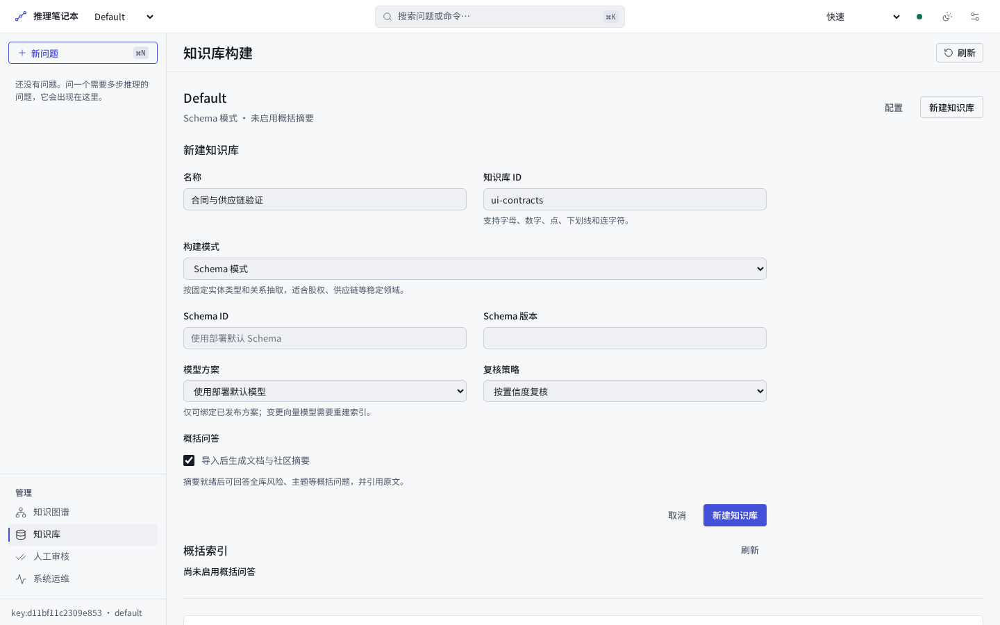
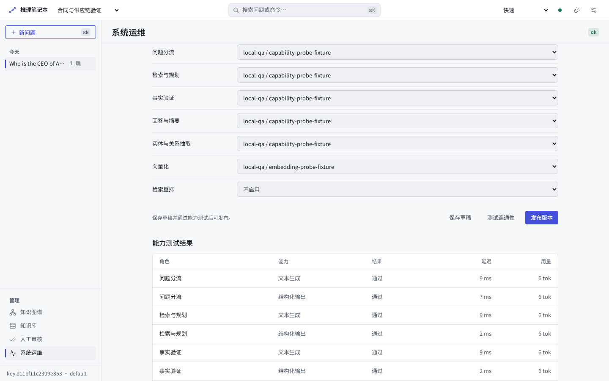
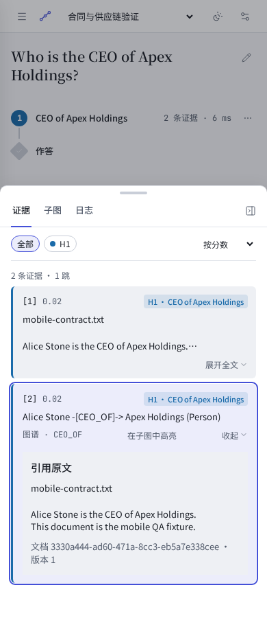
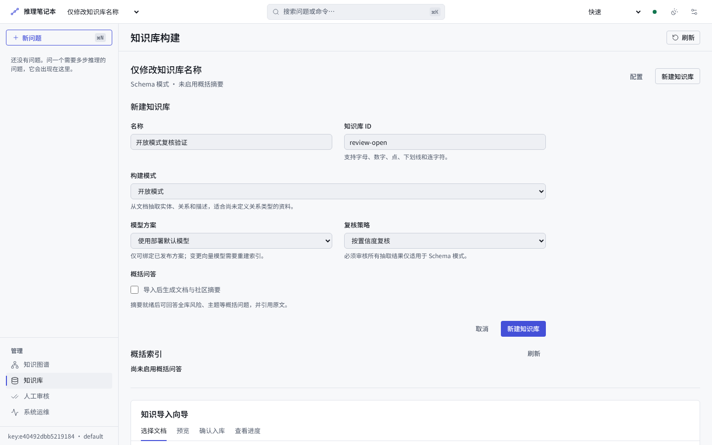
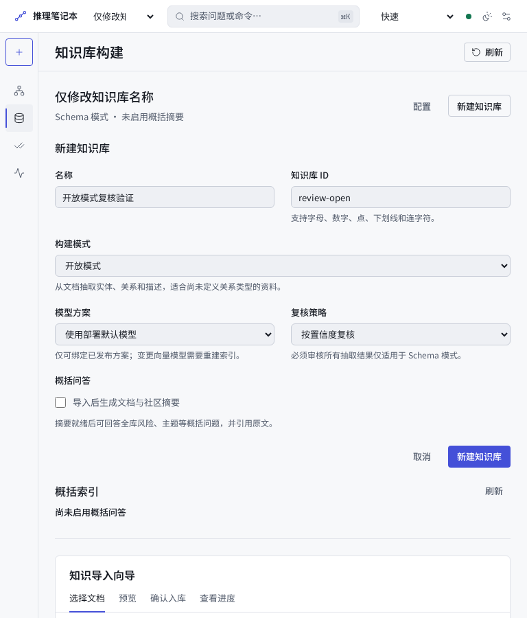
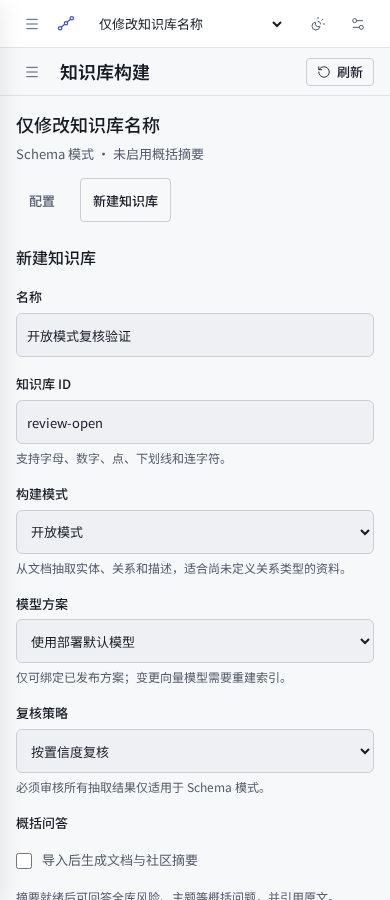

# 图谱扩展交付与验证记录

日期：2026-11-04。基线：`1fc5689`；候选：`feat/extend` 当前工作区。

知识库双模、版本发布、七角色配置、摘要/Global、Schema 人审升级、取证审计以及
SDK/MCP 已接入实际应用路径。18 项任务中 14 项工程完成，4 项保留真实环境验收。
本记录不关闭 G2/G3/G4 产品门禁。设计差异见
[工作流 §10](../../plan/workstreams/graph-platform-extension.md#10-交付证据差异与剩余验收)，
使用与恢复见 [运行手册](../ops/GRAPH_PLATFORM.md)。

## 1. 工程验证

| 检查 | 结果 |
|---|---|
| `./scripts/setup.sh --locked --extras dev,webapp,summary,contracts` | 通过；doctor 无 error/warn，未覆盖已有 `.env` |
| Ruff / format / strict mypy / Python 代码指标 | 通过；478 个 Python 源模块，657 个文件格式检查 |
| TypeScript 5.9.3 checkJs / Vue 模板编译 | 通过；仍为零构建 Vue ESM |
| 自有前端修改文件行数 | 43 个 JS/CSS/HTML 文件均 ≤300 行 |
| 核心全量 pytest / 覆盖率 | 1169 passed、4 xfailed，91.82%，84.99 s |
| REST/SSE 导出漂移 | 通过；见下方兼容检查边界 |
| SDK 独立锁定环境 | lint/format/mypy 通过；39 tests，98.90%；wheel/sdist 构建通过 |
| MCP 独立锁定环境 | lint/format/mypy 通过；22 tests，95.06%；wheel/sdist 构建通过 |
| 仅安装两个 wheel 的独立消费环境 | 通过；不存在 `agentic_graphrag` 服务端模块，SDK/MCP 从 site-packages 加载 |
| 官方 MCP 客户端 → stdio → SDK → 本地 HTTP → FastAPI | 五工具发现/调用、原文取证、查询/检索审计、跨库拒绝通过 |

核心测试命令：

```bash
ruff check src tests scripts
ruff format --check src tests scripts
mypy
python scripts/check_code_metrics.py
npx --yes --package=typescript@5.9.3 tsc --project web/jsconfig.json
node scripts/check_web_templates.mjs
pytest tests/unit --cov=agentic_graphrag --cov-fail-under=80 -q
python scripts/export_api_contracts.py --check --base-ref 1fc5689
```

SDK/MCP 分别通过其 `scripts/setup.sh` 安装到新的 `UV_PROJECT_ENVIRONMENT`，运行
`uv run --locked ruff check src tests`、format、mypy、`pytest -q --cov` 和
`uv run --locked uv build --no-sources`。消费环境同时指定两个本地 wheel，生成独立锁文件
后 `uv sync --locked`；SDK 未发布到 PyPI，不能只安装 MCP 后期待注册表提供 SDK。
完整 stdio/HTTP 验收结果与最终 wheel SHA-256 见
[wheel-smoke.json](assets/graph-platform-extension/wheel-smoke.json)。

兼容检查边界：基线 `1fc5689` 尚无入库的 OpenAPI/SSE 导出，因此 `--base-ref` 此次跳过
机械 schema 对比，不能将该命令通过描述为已经比较了旧版导出。
现有旧请求形状、默认库、envelope 与事件行为由 API/SDK 回归验证；新增导出供后续 PR
做漂移和兼容门禁。没有降低离线下限或扩大 coverage omit。

## 2. 重点行为证据

| 行为 | 回归入口与结果 |
|---|---|
| 作用域、默认库、shadow generation 与恢复 | `test_knowledge_workflow.py`、`test_generation_pipeline.py`、`test_publication_recovery.py`、`test_knowledge_maintenance.py`：跨租户/跨库、旧任务、断点、回滚及冲突拒绝 |
| 开放抽取与语义实体 | `test_open_graph.py`、`test_entity_semantic_index.py`、`test_entity_generations.py`、`test_open_resolution_review.py`：自由关系、别名、歧义、向量空间与来源谱系 |
| 必审事实及 Schema 升级 | `test_required_schema_review.py`、`test_schema_promotion.py`、`test_review_advisor.py`：未审不可见、人审映射、恢复、校准与自动化门禁 |
| 摘要、社区与 Global | `test_summary_pipeline.py`、`test_summary_jobs.py`、`test_communities.py`、`test_global_query.py`、`test_global_boundaries.py`：覆盖、增量、原文支持、稀有风险、预算及 partial |
| 模型目录/角色 | `test_model_profiles.py`、`test_model_roles.py`：无鉴权本地 provider、能力不足、版本/租户隔离、用量与失败契约 |
| 取证、审计、删除与流 | `test_retrieval_contract.py`、`test_query_source_withdrawal.py`、`test_stream_bridge.py`、`test_query_cancellation.py`、`test_source_artifacts.py` |
| SDK/MCP 与前端异步状态 | `test_client_contracts.py`、`test_web_knowledge.py`、`test_web_models.py` 及 Node runtime suites |

这些测试位于 [`tests/unit`](../../tests/unit/)。删除回归在真实 FastAPI HTTP/SSE 查询
和 search 即将持久化时并发删除引用文档，确认终态撤回内容、强制审计失败、唯一终态与预算
结算。无法收回删除之前已经通过网络发送的进度帧；Web 收到撤回终态后清理本次中间结论。

四项 xfail 为既有规划/改写边界；本次未增加 xfail。唯一 warning 为上游
FastAPI/Starlette TestClient 的 httpx 弃用提示，不影响本轮断言。
以上均为本地验证，本变更尚无远端 CI 运行记录。

前端修复通过先失败后通过的运行时用例验证：成功刷新清除旧错误、切库后的旧操作不能改变
新作用域 busy 状态、组件卸载后不恢复轮询；原文分页按 Unicode 字符推进，过期/已删读取
不会把旧内容放回当前面板。

取证性能回归确认同一批次的重复路径/不同 chunk 只读取一次相同文档，包含缺失文档；
下一批次重新读取，因此后续删除或新增可见。原文版本/hash 检查与持久化事务保留。

## 3. 离线效果与性能口径

| 数据集/检查 | 结果 | 当前门禁 |
|---|---|---|
| POC agentic | 31/31 | ≥30/31 |
| POC triage | 31/31 | ≥30/31 |
| G2 | 基线与候选均 200/200 | ≥196/200 |
| Compositional probes | 54/54 | ≥52/54 |
| Negative probes | 20/20 | ≥19/20 |
| `evals/datasets/dev.jsonl` | 153/153 | Prompt 变更的离线 dev 回归 |
| G2 金标审计 | 200 条、0 flagged | `--max-flagged 0` |

POC/triage 用 seed triples；G2、probes、dev 使用同一份
`data/processed/pilot_triples.jsonl`，全部 `--no-llm --memory-graph`，每次使用独立运行目录。
dev 离线结果不执行新 Prompt 的真实模型生成，实际 provider 的 Prompt 质量仍需验证。

最终配对报告：[paired-g2.json](assets/graph-platform-extension/paired-g2.json)。
同一解释器、同图、关闭缓存，基线与候选顺序运行，未与测试/浏览器并发：

| 指标 | 基线 | 候选 |
|---|---|---|
| 正确率 | 200/200 | 200/200 |
| `chain.cost.latency_ms` P50 | 37 ms | 39 ms |
| `chain.cost.latency_ms` P95 | 65 ms | 64 ms |
| LLM 调用均值 | 0 | 0 |

McNemar `p=1.0`，无翻转题；结论为无显著差异，不声称效果提升。
原始报告为 `reports/extension_g2_delivery.jsonl`、`reports/extension_ab_delivery.json`；
基线报告保留在独立 checkout 的 `reports/extension_baseline_delivery.jsonl`。

上表的 chain 计时在原文/审计持久化前结束，与基线边界相同，**不是端到端响应时间**。
另外使用 200 条 G2、同样的独立运行目录顺序测量完整 `run_query_chain` 调用：

| 完整服务调用，含原文/审计持久化 | 基线 | 候选 |
|---|---|---|
| P50 | 36.56 ms | 43.72 ms |
| P95 | 61.77 ms | 65.90 ms |
| 均值 | 40.80 ms | 46.16 ms |

这是独立一轮测量，仍不包含 HTTP 序列化与网络。记录分别为
[baseline](assets/graph-platform-extension/extension_service_baseline.json) 与
[candidate](assets/graph-platform-extension/extension_service_candidate.json)。
新增耐久取证存在少量开销；请求内复用消除了大部分重复来源读取。
大型文档、真实后端、并发请求及 Global 的建库/查询费用尚不能从这组离线数字推断。

## 4. 浏览器与界面复核

环境为真实 Chromium、本地 FastAPI 和离线业务路径，1440/768/390 ×900。
管理端的 `qa-chat`/`qa-embedding` 是仅接受固定能力探测文本的 loopback 响应器，
不是生产模型；正文使用两段演示合同。所有样例只存在隔离的临时运行目录。

- 实际建库/选择、上传/索引、查询及点击版本化原文完成。
- 摘要不可用时显示启用模型的原因；删除后重新打开原文显示已撤回。
- 草稿保存、固定文本探测、显式发布、第二版发布及回滚至第一版完成。
- 390px 下 Enter 发送问题、Enter 打开引用抽屉、关闭返回，以及表单按钮焦点通过。
- 模型操作按钮和能力回执在三种宽度下可达。

沿用现有“推理笔记本”布局、Inter/Source Serif/JetBrains Mono 字体与配色；没有新抽签方向
或 seed，也未增加图片素材/运行时框架。三个界面首先回答：当前操作哪一个知识库、各角色
使用哪一版模型、答案依据哪一段哪一版原文。版本与原文是本产品的主要识别元素。

新增组件源码 lint：18 文件，0 FAIL/0 WARN。实浏览器使用 taste-skill 的
CDP/probe/layout/app/judge 检查已认证场景，共 23 张最终截图，0 FAIL、12 WARN，
无横向溢出或 console error。应用标题按 app 规则检查，不采用营销页的大标题规则。
基线为匿名欢迎页（0 FAIL/0 WARN），与最终操作场景不同，不能直接作为视觉得分提升证据。
完整结果与截图清单：[browser-report.json](assets/graph-platform-extension/browser-report.json)。

保留的 WARN：短答案下的工作区留白给持续写作/后续问题使用；摘要未就绪页面保留真实任务
区；第三种字体来自既有标题/技术 ID 系统，本次组件扩展未改全局主题。未隐藏告警。

```text
ROUND 1 — final application review
Seen in one second: selected knowledge base, editable model roles, cited original.
Idea (one sentence): keep configuration versions and source versions visible beside the work.
Live thing: actual scoped query, original-source drawer and draft/test/publish controls.
Layout words by section: knowledge=stacked form / models=role rows / evidence=side pane or phone sheet.
Scores: design 7.0 · usability 7.5 · creativity 6.5 · content 8.0 → overall 7.2
Caps applied: app rules; no photography or motion floor. Existing shell typography retained.
Top three limitations, with evidence and disposition:
1. Long model identifiers truncate in phone selects (models-actions-390.png); native option selection
   keeps the full value available. Compact role controls retained; a future catalog detail view could help.
2. A short answer leaves desktop canvas space (evidence-original-1440.png); the composer remains at
   a stable bottom position. This is a workspace state, not an empty content section to pad with fixtures.
3. Three shell fonts remain (evidence-drawer-390.png); source text uses the existing reading face,
   identifiers the established mono. A global type simplification is outside this component extension.
```

应用复核：表单和面板边缘一致；颜色用于操作/状态；0/1 覆盖计数来自实际 API，固定探测的
token 数明确只属于测试响应器；缺失版本与关闭角色有文字状态；手机导航折叠，引用以抽屉
呈现。无业务图表或虚构 KPI。7.2 为本轮自评，仍有长表滚动与旧壳字体的改善空间。







## 5. 复审边界修复（2026-11-04）

六项复审问题均增加回归并修复：

- 默认库在检索后删除原文，即使 citation 无法解析，也按原始文档 ID/版本检查 tombstone；
  原文归档保留 citation，HTTP/SSE 终态及审计/原文回读撤回内容。
- 自由字典响应切换兼容 JSON-object 模式，保留工具参数和三元组属性；固定字段仍使用 strict
  schema，同时保留名为 `default` 的字段。
- 待审批次在进程内图重启后重放持久化批准记录，恢复抽取完成状态；覆盖批准/拒绝、发布失败
  后 retry/reconcile、恢复过程中再次失败和重启，既有批准回执保持不变。
- Open 模式禁用 Required 复核并显示原因，API 创建/修改拒绝该组合。
- 无关配置保存保留固定模型 revision；用户显式修改方案才解析当前活动 revision。
- 缓存命中的 SSE 使用流已有 query ID，事件 ID、payload、响应头和审计查找一致。

最终核心单测 **1185 passed / 4 既有 xfailed / 91.88%**；SDK **39 / 98.90%**、MCP
**22 / 95.06%**。Ruff/format、mypy、代码指标、checkJs、模板与契约漂移检查通过。
复审后的离线下限：POC/triage 各 **31/31**、G2 **200/200**、probes **54/54、20/20**，
金标审计 **0 flagged**；这些仍仅证明离线路径的确定性回归。
最初受限环境重现 TestClient 启动挂起；放开执行环境后全套完成，没有更改测试或应用启动逻辑。

设置控件真实 Chromium 验证：固定 revision 1 的库在方案发布 revision 2 后仅改名仍为 1，
generation 不变；显式改选后为 2。先选 Schema/Required 再改为 Open，自动回到 confidence，
Required 禁用且保存成功。1440/768/390 三张截图均 0 FAIL/0 WARN，无溢出和控制台错误。
固定响应模型只接受能力探测，没有调用真实供应商业务模型。
[浏览器检查记录](assets/graph-platform-extension/review-fixes-browser-report.json)。

```text
ROUND 1 — configuration control regression
Seen in one second: the selected knowledge base and its configuration form.
Idea (one sentence): knowledge and model versions remain attached to the user's selection.
Live thing: rename a pinned base, explicitly change its binding, and save Open configuration.
Layout words by section: header=scope / configuration=labelled fields / summary=status.
Scores: design 7 · usability 8 · creativity 6 · content 8 → overall 7.2
Caps applied: app component rules; surrounding design retained, no draw or new assets.
Top three limitations, with evidence and disposition:
1. Phone Save is below the first viewport (review-open-configuration-390.png); the existing
   vertically scrolling form remains the interaction model.
2. Desktop controls use the existing bounded width (review-open-configuration-1440.png);
   retained to keep text fields readable and aligned with the existing configuration sections.
3. The shell keeps its existing typography and accent (all three screenshots); this control
   correction does not redesign the surrounding application.
```





## 6. 未关闭的验收项

以下对应 P5-EXT-01/15/17/18，并已登记 [IMPORTANT](IMPORTANT.md)：

1. 冻结真实脱敏文档、开发/留出集、人工金标、规模与 SLO，验证开放抽取、误合并、概括及少数风险。
2. 实际 provider/model revision 的能力、Prompt 回归、预算/费用，以及真实留出集的 Agent 复核校准。
3. Claude Desktop/Cursor 实际版本的发现、检索、回答、取证、审计与取消。
4. 目标 Neo4j/Qdrant 的迁移/回滚/崩溃演练和大库快照复制、恢复内存、并发及 HTTP 端到端容量。

当前协调限单主机 SQLite；操作 ID 全局唯一；CAS 不自动 rebase；缺 embedder 时不复用
变更描述的旧向量。SSE 无持久化重放，已发送内容无法从客户端收回。这些是公开的实现边界。
