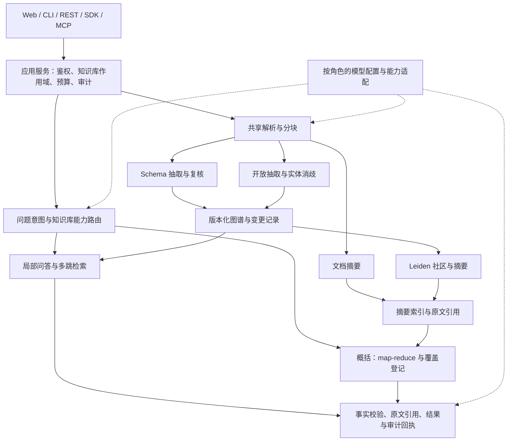

# 图谱双模、概括问答与对外接入扩展计划

**版本**：V0.2，2026-11-04。

**代码基线**：`1fc5689`；§1 的差距表保留立项时快照，当前实现与验证见 §7、§10。

**状态**：工程实现和本地验证已交付；18 项中 14 项完成，4 项保留真实领域/供应商/指定客户端验收。本文不表示 G2/G3/G4 产品门禁已通过。

**关联**：[路线图](../roadmap.md) · [工程规则](../engineering/rules.md) ·
[ADR-010～012](../engineering/tech-stack.md) · [未完成项总账](../../docs/reviews/IMPORTANT.md)

## 1. 建议与现状

建议先补知识库作用域、版本和按角色用模，再建设开放图与概括问答。
REST 契约、Python SDK 和 MCP 可以作为独立交付线，在基础契约稳定后提前交付。
Leiden、LLM 抽取和模型厂商适配均通过本项目端口接入，继续复用现有存储、
登记表、引用校验与预算机制。

下表描述实施前的缺口，§2～§9 保留批准的设计与验收目标；实际交付差异集中记录在 §10。
新功能是否启用由知识库配置和服务能力共同决定；现有 Schema 离线演示继续可用。

| 方向 | 基线实际能力（`1fc5689`） | 实施前缺口与源码依据 |
|---|---|---|
| 知识库边界 | 数据、任务、查询按 `tenant_id` 隔离 | 尚无一等 `kb_id`；[存储端口](../../src/agentic_graphrag/core/ports/stores.py)、[查询契约](../../src/agentic_graphrag/app/contracts.py)需贯穿扩展 |
| Schema 构建 | 抽取、Schema/置信度门禁、增量冲突、人工决策写回 | 当前不是全部高价值事实先审后入图；[GraphIngestor](../../src/agentic_graphrag/knowledge/graph_ingest.py)默认载入领域 Schema，失败时可能回退规则抽取 |
| 实体消歧 | 名称归一、别名、字符串相似度、可选 LLM 合并 | [EntityResolver](../../src/agentic_graphrag/knowledge/resolution.py)没有实体 embedding 召回；上传路径主要按已有名称归一；[实体 ID](../../src/agentic_graphrag/knowledge/graph_builder.py)由类型与名称生成 |
| 开放关系 | `RelationRecord.type` 是字符串 | [Neo4j](../../src/agentic_graphrag/stores/neo4j_store.py)将类型作为物理标签/边类型，限制安全标识符；自由关系需要独立编码与查询适配 |
| 登记表与规划 | 登记表、不变量、Verifier、checkpoint 已实现 | [配置](../../src/agentic_graphrag/config_register.py)默认关闭；[register_search](../../src/agentic_graphrag/agent/register_search.py)仍以 `allow_llm=False` 选择工具；[图检索](../../src/agentic_graphrag/retrieval/graph.py)仍会推断固定关系类型 |
| 概括问答 | Triage 当前只有 Fast Path/Agentic | [triage](../../src/agentic_graphrag/agent/triage.py)没有概括意图；没有文档摘要、社区发现、社区摘要和全局 map-reduce 索引 |
| 增量基础 | 文档版本、chunk checkpoint、任务租约、删除/reindex 已有 | [事件总线](../../src/agentic_graphrag/core/events.py)与 [IndexVersion](../../src/agentic_graphrag/core/versioning.py)主要是进程内机制，变更事件不含社区重算所需的完整增删改集 |
| 模型接入 | OpenAI 兼容聊天/embedding HTTP、强轻档、独立 embedding 端点、Verifier 选模 | [provider](../../src/agentic_graphrag/llm/provider.py)与 [factory](../../src/agentic_graphrag/llm/factory.py)可扩展；缺按角色/知识库绑定、能力探测与管理配置；[HTTP rerank](../../src/agentic_graphrag/retrieval/rerank_http.py)是另一种协议 |
| 对外接口 | REST、增量 SSE、FastAPI `/docs`、`/openapi.json` 已有 | [查询路由](../../src/agentic_graphrag/api/routes/query.py)仍以通用 JSON 返回，公开响应/事件需明确类型和兼容策略；暂无 Python SDK 或 MCP Server |
| 审计引用 | Candidate 引用、claim 绑定、推理链落库/回查已有 | [证据目录](../../src/agentic_graphrag/generation/evidence_catalog.py)主要保留截断片段；[审计写入](../../src/agentic_graphrag/app/telemetry.py)失败不阻断回答，返回值目前未成为公开持久化状态 |

**⚠ 设计与实现差异**：下文新增类型、配置键、接口和目录均为拟议契约。
`agent/tools/registry.py` 是内部工具调度器，不能据此认定已有可供外部客户端连接的 MCP Server。

## 2. 目标架构与共同边界



### 2.1 知识库是一等作用域

新增 `KnowledgeBase`：`tenant_id`、`kb_id`、名称、`build_mode`、可选
`schema_id/schema_version`、`model_profile_id`、`config_revision`、`active_generation`。
一个知识库在一个已发布 generation 中只有一种构建模式。

- 核心业务库保存知识库配置，提供内存与持久化适配器；不依赖可选 `webapp/` 身份库。
  身份模块仍只负责传递用户、租户和权限。
- 首版知识库继承租户权限；新增文档级 ACL 时必须同时扩展摘要的授权边界。
  `kb_id` 必须在已认证租户内解析，不能把客户端传来的租户字段直接作为授权依据。
- `KnowledgeScope(tenant_id, kb_id)` 贯穿四种 store、实体词表、复核、worker、
  任务、审计、checkpoint、缓存和管理查询；不能只在 HTTP 层做过滤。
- 原有数据迁移到所属租户的 `default` 知识库。旧请求省略 `kb_id` 时仍只访问该库，
  不自动聚合该租户新建的所有库；跨库联合检索列为后续扩展。
- 文档内容 hash 去重、source URI 替换和实体合并均限定在同一知识库内。
  同名、相同原文可以分别存在于两个知识库，不能串库去重或删除。
- Schema 加载按 `schema_id/version` 缓存并绑定当前知识库，替代写入路径对
  `default_schema()` 进程级单一默认值的依赖；切库不得修改全局 `get_config()` 对象。

### 2.2 版本、来源与发布

| 拟新增契约 | 必须记录的内容 | 用途 |
|---|---|---|
| `KnowledgeSnapshot` | 作用域、generation、图/向量/摘要版本、Schema 与模型配置版本、文档选择指纹 | 查询固定读取范围；缓存、审计和恢复复用同一快照 |
| `SourceRef` | 文档 ID/版本、chunk ID、内容 hash、原文 span、可用的页码/段落定位 | 叶子证据回查；规范化文本位置与原始文件位置分开表示 |
| `GraphChangeSet` | 操作 ID、顺序号、源版本、实体/边增删改、来源撤回、相关文档 | 社区失效、消歧重算和跨进程恢复；大变更集通过持久化记录引用传递 |
| `SummaryRecord` | 类型、版本、结构化结论、逐结论 SourceRef、依赖指纹、模型/Prompt 版本、状态 | 摘要缓存、增量更新和查询时追溯 |

从现有 `DocumentLifecycle`、任务租约与 reindex 机制扩展，不另写一条绕过它们的导入链。
持久化元数据首先采用核心侧 SQLite/本地文件适配器，支持单机多进程；
多主机部署再增加共享数据库适配器，不把 SQLite 网络共享文件作为分布式协调方案。

持久化写入意图 → 幂等写各索引 → 记录完成的变更集 → 发布可读版本。
元数据库与 Neo4j/Qdrant 不共享事务，必须由恢复任务补齐中间失败；
不能将一次进程内 `GraphCommitted` 当成持久化 outbox。
摘要任务至少一次投递，以 `(scope, artifact_kind, input_fingerprint)` 去重，
发布时检查目标版本，旧 worker 的结果不能覆盖新版本。

模式迁移和模型重建使用影子 generation。固定快照必须落实到存储过滤、
版本化记录或不可变索引，不能只在 response.metadata 写版本号。
增量索引可复用未变分区，查询不能混用不同版本的图、文档和摘要。
删除先设不可读标记并失效缓存，再回收派生索引；在途查询返回前复查可见性。

## 3. 图谱双模构建

### 3.1 共享流水线与不同门禁

保留解析、分块、任务恢复、来源标记、批量 embedding 和索引写入；
抽取与校验改为显式策略：`SchemaExtractor/SchemaValidator` 和
`OpenExtractor/OpenValidator`，最终汇入统一图记录与来源契约。

| 项目 | Schema 模式 | 开放模式 |
|---|---|---|
| 抽取对象 | 受版本化 Schema 约束的实体、关系与属性 | 实体、别名、描述；自由实体类型提示、关系名称/方向/描述、来源 |
| 校验 | 当前 Schema、置信度、基数/时态约束 | 结构、引用有效性、文本长度、置信度、端点一致性；不套领域关系白名单 |
| 复核 | 高价值域可配置候选事实先审后发布；冲突继续进入复核队列 | 不确定消歧、矛盾与异常抽取进入复核；不套用公司领域的单值关系假设 |
| 查询 | 已验证的规则配置或 LLM + 登记表 | 局部问题使用 LLM + 登记表；概括问题使用第 4 节路线及覆盖登记 |
| LLM 不可用 | 现有离线演示路径保留 | 返回能力不足或显式降级状态；不回退为领域规则抽取/规划 |

开放不等于取消所有验证。抽取结果仍用严格结构契约，并由服务端核对/补写来源，
不信任模型生成的 doc ID、版本或不存在的原文引用。
独立实体也可入候选区，不要求每个实体必须先构成三元组。

Schema 的 `review_policy=required` 下，候选事实存入 staging，人工批准后才进入
可检索图；拒绝、修改、合并均保留操作记录。Agent 复核按“影子建议 → 低风险自动处理
加抽检 → 达标后扩大覆盖”推进，采用独立验证、可撤销决策和误放行评测，
不能直接把模型自报置信度等同于人工复核通过。

### 3.2 开放图的数据表达与消歧

实体采用持久化 canonical ID，mention ID 由来源位置稳定标识。
开放图不能继续仅按“类型 + 名称”合并，否则同名不同人会在消歧前丢失区别。
保留 mention → entity 映射、合并历史和旧 ID 重定向，便于复核、拆分和引用回查。

消歧流程：可信标识/已确认别名 → 别名和实体描述 embedding 联合召回 →
结合来源上下文、类型兼容性、邻接事实判定 → 合并/分开/复核。
embedding 相似度只用于候选和辅助判定；同名、跨语言别名、缩写、一对多别名必须单独评测。
候选生成使用索引和 top-k，避免沿用全体实体两两比较。

当前 `VectorStore` 面向 chunk。新增实体语义索引端口与独立命名空间，
按 `(tenant, kb, embedding_space)` 存储；实体、关系描述和摘要不能冒充原文 chunk。
embedding 空间包含 provider/model revision、维数和归一化约定。

Neo4j 开放图建议使用固定物理 `AG_ENTITY` / `AG_RELATION`，
自由 `entity_type`、`predicate` 与描述作为参数化属性；
Schema 图保留现有物理编码，通过 codec 提供一致逻辑记录。
同步适配邻居、路径、关系过滤、合并重连、删除和扫描接口；
开放模式实体访问优先使用 ID，名称多义时不得任取第一条。

### 3.3 开放模式的规划约束

`build_mode=open` 解析出的运行策略必须启用登记表，并关闭领域规则 planner、
规则工具选择及固定关系推断。特别检查：

- `planner.plan()` 的空计划回退；`GraphIngestor` 的失败规则抽取。
- `register_search.search()` 的 `allow_llm=False` 和 `executor_plan.choose_tools()` 的规则优先分支。
- `triage` 的领域关系链规则、`GraphRetriever.infer_relation_types()`、实体名称唯一性假设。

researcher 从知识库关系目录、实体候选与工具 JSON Schema 生成计划；
登记表复用现有依赖、不变量、证据追加、Verifier 与停止判据。
规则护栏、参数校验、预算和权限继续执行，它们不属于被禁用的领域 planner。
无有效计划时有限重试，然后部分回答/无法回答；不能静默切回 demo 规则。

### 3.4 从开放图反推 Schema

1. 在固定快照上归并关系别名，按独立文档数、实体对数统计支持度；
   去除重复导入和重叠 chunk 的重复计数，同时保留低频高价值关系候选。
2. 生成 `SchemaDraft`：关系语义、方向、候选端点类型、属性、支持度、原文例子、
   反例/歧义、建议映射与未覆盖比例；不能仅凭高频推断基数或必填约束。
3. 人工审定草案和映射；将未映射、冲突事实显式列入待处理区。
4. 创建目标 Schema generation，从原文重抽取或按已审映射转换并严格校验，
   完成引用、问答回归和覆盖率检查后切换活动指针；保留开放 generation 供回滚。

**Schema 升级不自动启用规则 planner。** 当前规则与公司关系域耦合；
新 Schema 默认仍走 LLM + 登记表，只有声明并通过测试的 `rule_planner_profile`
才能开启相应规则。禁止只改 `mode` 字段就把旧开放事实当成合法 Schema 图。

## 4. 全局与概括问题

### 4.1 导入后建立两层摘要

摘要能力独立于构建模式，可在两种图上启用：

- 文档摘要：基于完整文档的分块分批生成，保存主题、重要事实/风险、时间信息和逐条来源；
  长文档内部也做受预算控制的分层归并，未抽出图关系的文档仍有入口。
- 社区发现：对知识库固定图版本构造加权无向投影，保留原图方向、时态及证据。
  去重后设置权重，避免重复文档把边权放大；固定排序、随机种子和算法参数。
- 社区摘要：按成员实体、关系描述及原文证据生成报告，保留 findings → SourceRef。
  大社区分层处理；孤立点、小组件和没有实体的文档不能从概括覆盖范围消失。

增加 `CommunityDetector`、`SummaryStore` 和摘要任务类型；Leiden 在后台本地运行，
无需强依赖 Neo4j GDS。具体 Leiden 包在 E0 锁定可复现的 Python 3.12 运行方案，
通过可选依赖懒加载，不引入整个 GraphRAG 框架。
摘要生成要求 LLM 能力；单测使用固定图、固定向量和结构化响应替身。

文档基础检索 ready 与概括索引 ready 分开展示。摘要任务失败不反复重做已完成的
图/向量索引；展示 pending/partial/failed 与进度、重试入口。

### 4.2 Triage 与 map-reduce

增加 `intent=global_summary` 和内部 Global 策略；保留现有局部事实、多跳和闲聊路径。
概括意图识别先于“短问题即简单事实”的规则，分类同时读取知识库能力和摘要就绪状态。
“这批合同”必须解析成明确的文档选择：请求携带 `doc_ids`/批次引用，或使用已选知识库。
无法确定“这批”的范围时返回可操作的范围澄清，不默认为所有租户文档。

处理顺序：固定作用域和快照 → 枚举覆盖单元 → map → reduce → 原文校验 → 输出。

1. **覆盖单元**：默认面向全部选定文档建立覆盖清单，按社区报告分组，并用文档摘要
   补足图外文档。不能只取向量 top-k 社区后宣称已概括全库。
2. **map**：在 token/并发上限内提取与问题有关的要点、重要性、冲突、来源。
   登记表记录每组完成/失败与未满足的信息需求，不按现有四跳上限截断社区数量。
3. **reduce**：去重并归并主题，保留少数但高严重性的风险与反例；
   为每条结论保留所使用的 map finding 与原文引用，不把整个社区的引用笼统挂到所有结论。
4. **校验**：回读最终使用的原文片段，检验引用、文档版本和事实支撑；
   现有 claim verifier 扩展摘要谱系，不把“摘要说过”当作独立证据。
5. **结果**：`claims` 带原文引用，metadata 带文档/社区已覆盖与总数、失败数、
   快照、索引新鲜度、局限及成本。未覆盖完整范围时给 `partial` 和缺失项。

输出示例应能说明：“本次覆盖 120/120 份合同，付款责任是主要风险之一”，
并为该结论提供对应原文。数量、比例和“普遍存在”需要去重后的文档级事实统计；
不能用社区数、边数或 LLM 估计充当分母。
“没有违约条款”等缺失判断需要检查相应文档范围，不能从摘要未提及直接推断。
事实观察、风险解释和建议区分呈现，推断不得伪装成合同原句。

筛选文档子集时，只有全部支撑来源都在授权/选择范围内的摘要才可直接使用。
否则用范围内文档摘要或原文重做 scoped map；不能先使用全库摘要，再删掉越界引用。

### 4.3 增量社区更新

分别处理“社区划分是否变化”和“社区摘要是否过期”：

1. 由持久化变更集确定改动实体、边、来源版本以及旧社区。
   文档内容变化即使图拓扑相同，也必须失效受影响的文档/社区摘要。
2. 文本/描述变动但拓扑不变：保留成员划分，仅刷新依赖变化的摘要。
3. 拓扑变动：从旧社区和边界邻居开始，处理新孤立组件、跨社区连边、桥边删除、
   实体合并/拆分；扩大到受影响闭包，必要时对相关连通分量重新运行 Leiden。
4. 按成员与内容依赖指纹复用未变摘要；对拆分/合并记录旧社区到新社区的 lineage，
   层级摘要向上失效，父级新版本不能引用已废弃子报告。
5. 合并短时间内的多次导入事件，去重调度、租约恢复，并在发布时检查最新版本。
   记录重算社区比例、复用比例、积压和收敛耗时。

Leiden 不保证任意局部编辑只改变固定邻域，也不保证局部修复等同于全量重跑。
因此“只重算受影响社区”以依赖闭包为边界；大范围重连、参数/模型/Prompt 变化
或漂移检查失败时显式触发全量重建。摘要生成只重做输入指纹变化的报告。
E3 先提供全量构建基准，E4 再交付增量优化与周期性全量对照。

## 5. 模型接入标准化

### 5.1 适配路线

优先扩展现有 OpenAI 兼容适配器：聊天沿用 Chat Completions，embedding 独立端点。
通过 `CompletionClient`、新增 embedding 端口及现有 rerank 协议提供统一内部能力。
provider 的 endpoint、鉴权、能力和模型参数封装在适配器内。

LiteLLM 首选作为可选外部代理接到同一兼容端点；确需厂商原生特性时再增加
可选适配器，不在第一阶段把 LiteLLM 嵌入核心运行依赖。
OpenAI 兼容是基础传输约定，不意味着所有厂商或本地服务支持相同 JSON、tools、
streaming、usage 和参数；不承诺未经测试的厂商“换 URL 即完全可用”。

rerank 保持独立能力，首先复用 `none/lexical/http/local`，再适配所需 HTTP 方言。
不把 rerank 伪装成 `/chat/completions` 或假设存在通用 OpenAI `/rerank`。
Ollama / vLLM / Xinference 均进入兼容测试矩阵，按实际服务版本和已加载模型认证能力。

### 5.2 七个角色与配置

| 角色 | 负责的调用 | 初始迁移依据 |
|---|---|---|
| `triage` | 意图/复杂度分类 | 当前轻模型 |
| `researcher` | Planner、登记表初始化/更新、开放模式工具规划 | 当前强模型为起点；原工具选择轻档单独评估调用成本变化 |
| `verifier` | 登记表验证、事实支撑、复核建议验证 | 沿用独立 Verifier 配置；可绑定独立 provider |
| `writer` | 答案、文档/社区摘要、reduce | 当前强模型；摘要作为任务配置复用该角色 |
| `extractor` | Schema/开放实体关系抽取 | 当前强模型 |
| `embedding` | chunk/实体/关系描述/摘要编码 | 当前独立 embedding 配置及空间版本 |
| `rerank` | 候选重排 | 当前重排配置，默认 `none` 继续有效 |

`planner` 不新增第八个模型角色，归 researcher；`summarizer` 归 writer。
保留 Tier 兼容适配以分批迁移调用点，迁移结束后由角色选择模型，Tier 仅服务旧接口。

配置拆为 `ProviderConfig`、`ModelProfile`、知识库 binding；普通配置经 `AppConfig`
校验，持久化覆盖经同一解析器处理，密钥由 `Settings` 或密钥服务提供。
部署策略/已锁定环境覆盖优先，其次知识库绑定、租户默认、全局默认。
现有 `LLM_*` 环境变量继续映射 legacy profile；每次运行固定有效配置版本，
不能由管理端保存动作修改正在执行的共享 provider 对象。

以下仅为**目标配置形状**，不是当前 `configs/default.yaml` 可加载的配置：

```yaml
knowledge_base:
  kb_id: contracts
  build_mode: open
  schema_ref: null
  model_profile_id: balanced-v1
  global_summary:
    enabled: true
    community_algorithm: leiden
model_profile:
  id: balanced-v1
  roles:
    triage: local-chat-light
    researcher: reasoning-chat
    verifier: independent-judge
    writer: reasoning-chat
    extractor: extraction-chat
    embedding: multilingual-embedding-v1
    rerank: none
```

### 5.3 能力探测与管理端闭环

管理端提供 provider 列表、角色绑定、知识库覆盖、草稿校验、测试结果、版本发布和回滚。
第一版选择服务端已登记的 `secret_ref`；密钥值不写 YAML、不回显到浏览器、日志或审计。
按租户校验可选 secret/profile，避免共享 provider 配置被某个租户改写。
继续使用现有 Vue 零构建、权限和 i18n 结构。

“连通性测试”使用固定非业务文本的小请求，返回分能力结果，而不只探测 `/models`：

- Chat：真实完成请求、超时、鉴权、usage；结构化模式逐一标记 `json_schema`、
  `json_object`、普通文本加本地校验，支持的参数按能力发送。
- Embedding：批量顺序、向量个数、维数、有限数值与目标索引空间一致性。
- Rerank：输入索引完整且不重复、分数格式、截断与超时行为。
- 测试不自动发布草稿；记录配置版本、延迟、错误类别和调用用量。

OpenAI Docs 明确区分 JSON mode 与 Structured Outputs：`json_object` 不保证业务 Schema
一致。支持时采用 `json_schema`，否则保留 Pydantic 校验与有界修复重试；
拒答、截断、空输出均是独立结果，不能一概当成 JSON 解析失败重试。
AG 的 SSE 进度事件不依赖 provider 必须支持 token streaming。

允许显式配置无鉴权的本地模型服务，替换当前“一律要求非空全局 LLM_API_KEY”的能力检查。
管理测试只能访问部署允许的 endpoint；本地/内网服务可显式登记，不能让测试接口成为
任意 URL 代理。请求不得临时覆盖 endpoint、secret 或服务端预算上限。

连接池、超时、重试、熔断、结构修复和费用计量共用一次调用预算；
熔断按 provider/model/operation 隔离，避免某 embedding 故障熔断全部角色。
缓存键包含作用域、provider、模型/配置版本、Prompt/输出 Schema 和参数，
防止相同模型名的不同端点、不同租户共用错误结果。
更换 embedding 需重建对应 chunk/实体/摘要空间后切换，即使维数相同也不得混用。

## 6. 对外集成

### 6.1 REST、SSE 和可追溯证据

保留 `/v1/query`、`/v1/query/stream`、统一 envelope 与已有鉴权/RBAC。
先补公开 DTO、OpenAPI security scheme、成功/错误响应、示例、分页和稳定 operation ID，
导出版本化 OpenAPI 与 SSE 事件 Schema，CI 检查破坏性变更。

| 接口/契约（拟议） | 行为 |
|---|---|
| `GET/POST /v1/knowledge-bases`、`GET/PATCH /v1/knowledge-bases/{kb_id}` | 列举/创建/读取/修改配置；读写权限区分；模式变更产生迁移任务 |
| `POST /v1/query`、`POST /v1/query/stream` | 增加可选 `kb_id`、文档选择、`strategy=auto/local/global`、`audit_required` |
| `POST /v1/search` | 有预算上限的检索，不强制生成答案；返回统一 Candidate 视图、版本、审计 ID |
| `GET /v1/evidence/{evidence_id}` | 按所属作用域解析原文版本、引用定位和内容；分页/限长，不能按任意文件路径读取 |
| `GET /v1/audit/queries/{query_id}` | 继续回查已有审计；增加原文引用清单、有效配置/快照和执行摘要 |
| `GET /v1/audit/searches/{search_id}` | 新增检索审计记录，保存取证范围、工具、候选与来源；不伪装成已有答案推理链 |
| `GET/POST /v1/model-profiles`、`POST /v1/model-profiles/{id}/test` | 管理草稿/版本及测试；只对授权管理员开放 |
| 知识库关系目录、Schema 草案/迁移任务接口 | 随双模交付，复用现有任务和复核查询方式；具体路径在 E0 契约清单冻结 |

`/v1` 不直接扩张已有 `route` 枚举破坏严格客户端：概括仍序列化 `route=agentic`，
用可选 metadata.strategy/intent 描述 Global；内部 Triage 可以有独立 Global 分支。
新请求显式选择 `global` 与旧 `force_agentic=true` 冲突时拒绝矛盾参数，
旧请求只使用 `force_agentic` 时保留原语义。
内部新增摘要 Candidate 类型和执行阶段不直接塞入旧 `ToolName` 枚举；
v1 通过有类型的 metadata 扩展表达，若需改变必填字段或枚举则发布新契约版本。

普通查询的 `QueryResultData` 与当前 SSE answer 的 `ReasoningChain` 分别描述清楚，
SDK 提供一致视图；不能为了统一而悄悄删除现有流式字段。
证据增加显式 `SourceRef`/谱系与可回查 ID，截断片段只用于预览。
旧审计如果没有保留原始版本，返回引用不可恢复状态，不能指向新版本冒充旧来源。
SDK/MCP 的 `get_audit` 根据 `kind=query/search` 分派；已有查询审计响应类型保持兼容。

SSE 保留全部已发布事件，新增概括进度采用可忽略事件；
保证一个终态 `answer` 或 `error`，包括缓存命中和摘要部分失败场景。
使用 query ID、事件序号、心跳和有界队列；阻塞 LLM/检索运行移出 ASGI 事件循环。
断开后停止启动后续工作并释放预留，已发出的模型调用仍结算实际用量。
首版不承诺断点续传：事件 ID 用于排序/去重，SDK 断流报错并允许按 query ID 回查，
不自动重发 POST。持久化事件重放另行交付，不能凭 `Last-Event-ID` 参数就宣称支持。

公开 `audit_status=persisted/failed/disabled`；`audit_required=true` 时，
只有持久化成功才返回可审计成功结果，失败走明确错误并保留已发生成本的结算。
缓存命中也重新检查权限、来源可见性与审计存在性，记录本次调用及原查询关联；
不能把历史缓存中的成功标记当作当前审计回执。
审计提供工具、证据、版本和决策摘要，不要求暴露模型内部思维过程。

### 6.2 Python SDK

拟新增 `sdk/python/` 独立包，只依赖 HTTP/类型客户端，不安装图数据库或 LangGraph。
提供同步/异步 `query/search/stream/get_evidence/get_audit/list_knowledge_bases`，
明确超时、关闭、取消、分页、typed error 与未知 SSE 事件的兼容行为。
只自动重试确定安全的读取；有费用的 POST 在没有服务端幂等保证前由调用者决定重试。
用进程内 ASGI/假 HTTP 服务验证契约与断流，不让单测需要启动真实服务。

### 6.3 MCP Server

拟新增 `integrations/mcp/` 薄适配器，调用 SDK/公共 API，复用服务端权限、预算与审计。
首版提供五个工具：`list_knowledge_bases`、`search`、`query`、`get_evidence`、`get_audit`。
检索工具返回限量证据、原文来源、范围、新鲜度、耗时/费用与审计 ID，
调用方可继续取证或要求 AG 生成答案，避免每次调用都运行完整多跳流程。

工具使用结构化输入/输出 Schema，声明只读性质，并将业务错误转为明确工具错误。
MCP 的输入不能覆盖已绑定的租户身份；不暴露任意 Cypher、管理写入或整个知识库正文。
MCP 默认要求审计持久化，外部 Agent 能用同一 ID 复查取证过程。

先交付 stdio：客户端启动本地进程，stdout 只传 JSON-RPC，日志写 stderr。
随后提供 Streamable HTTP 远程部署，按协议完成认证、Origin/会话校验与取消，
不把 AG 的 `/v1/query/stream` 当成 MCP 传输端点。
分别记录 Claude、Cursor 和一个通用 MCP 客户端的版本及真实接入结果。

## 7. 分期、依赖与任务拆分

工作量为规划估算，单位为工程人日，包含实现、聚焦测试与联调；
不含采购、语料授权、领域专家标注等待与生产灰度等待。
E0 后按真实语料规模、部署拓扑和团队可用时间重新估算，不据此承诺上线日期。

| 阶段 | 交付与出口 | 依赖 | 估算 |
|---|---|---|---|
| E0 契约与基线 | 试点问题/语料、作用域与版本设计、接口兼容清单、选型 ADR、基线报告 | 无；已有产品门禁状态保持原样 | 3–5 |
| E1 公共基础 | 知识库隔离/迁移、版本发布、七角色配置、能力测试与管理界面 | E0 | 12–18 |
| E2 图谱双模 | 开放抽取/消歧、双模存储、LLM 登记表策略、高价值事实复核 | E1 | 12–18 |
| E3 概括问答 | 文档/社区摘要、全量 Leiden 基准、Global map-reduce、引用和覆盖率 | E1；可先在现有 Schema 图实施，双模联调依赖 E2 | 10–15 |
| E4 更新与升级 | 受影响社区增量重算、删除/合并传播、Schema 草案与影子升级、Agent 复核试运行 | E2、E3 | 10–16 |
| I1 集成交付 | REST/SSE 契约、Python SDK、stdio MCP、客户端样例 | E0 先做契约，E1 完成作用域后发布；与 E2/E3 并行 | 8–12 |

合计 **55–84 工程人日**；远程 MCP、事件断点重放和多主机协调不在此估算内。
推荐首个可用交付为 E1 + I1，随后交付 E2/E3，最后验收 E4。
E3 的社区算法实验不必等开放模式完成。

| 任务 | 范围与主要落点（新增模块名为建议） | 验收重点 | 状态 |
|---|---|---|---|
| P5-EXT-01 | E0：契约、ADR、真实领域评测清单 | 明确快照/引用/兼容语义和基线，不用合成成绩替代产品效果 | [~] |
| P5-EXT-02 | E1：`core/knowledge.py`、作用域、KB 配置端口及存储适配 | 两租户各两库同名实体/同源文档隔离；默认库兼容 | [x] |
| P5-EXT-03 | E1：`document_lifecycle`、索引/任务/checkpoint 版本、持久化写入意图与变更记录基础 | 迁移可恢复，固定快照可读，删除无旧缓存命中 | [x] |
| P5-EXT-04 | E1：模型角色解析、能力适配、连接/缓存/计量 | 七角色独立选择；本地无 key、能力不足、模型切换覆盖 | [x] |
| P5-EXT-05 | E1：管理端配置/测试/发布 | 草稿不影响运行，跨租户 profile 不可读写，UI 与后端能力一致 | [x] |
| P5-EXT-06 | E2：开放抽取、描述、统一来源和图 codec | 自由中文关系、独立实体、无效引用、失败重试与断点恢复 | [x] |
| P5-EXT-07 | E2：实体向量召回、别名、合并谱系 | 同名异实体不误合并；确认别名可合并；旧引用可解析 | [x] |
| P5-EXT-08 | E2：Triage/Planner/register/executor/graph 策略贯穿 | 开放模式调用规则 planner/规则工具选择次数为零 | [x] |
| P5-EXT-09 | E2：Schema 候选区、必审策略、复核写回 | 未审事实不可检索；决策可恢复并失效派生索引 | [x] |
| P5-EXT-10 | E3：文档摘要、社区端口/投影与全量摘要任务 | 图外文档有覆盖入口；输入/模型/Prompt 版本可追踪 | [x] |
| P5-EXT-11 | E3：Global map-reduce、覆盖登记、预算和进度 | 全范围与子集结果正确区分；部分失败不输出全量结论 | [x] |
| P5-EXT-12 | E3：SourceRef 回读、claim 校验、摘要谱系 | 每条事实追溯到授权范围内原文版本；数量结论有明确分母 | [x] |
| P5-EXT-13 | E4：细粒度变更集消费、幂等任务与增量社区更新 | 重放/崩溃/乱序无丢任务；只刷新依赖变化的摘要 | [x] |
| P5-EXT-14 | E4：关系统计、SchemaDraft、审定与影子切换 | 未映射事实不静默丢弃；回滚可用；新 Schema 不误开旧规则 | [x] |
| P5-EXT-15 | E4：Agent 复核影子评测、低风险白名单与抽检 | 与人工结果配对评估，通过质量阈值才扩大自动处理 | [~] |
| P5-EXT-16 | I1：typed REST/OpenAPI/SSE、证据 resolver、审计回执 | 旧客户端兼容、终态唯一、审计失败显式、引用不串库 | [x] |
| P5-EXT-17 | I1：Python SDK 与 stdio MCP | 干净环境安装、工具发现/调用/取证、断流取消、客户端接入 | [~] |
| P5-EXT-18 | I1/E4：端到端验收和运营文档 | 安装、迁移、回滚、成本和模式选择的说明可按步骤复现 | [~] |

核心 Python、新 API、前端模块分别遵循现有行数/复杂度门禁；
`config.py`、`neo4j_store.py` 等接近上限模块优先拆分后扩展。
新增 Prompt 留在 `configs/prompts/`，新代码使用当前 `core/app/bootstrap` 模块路径。

## 8. 验收方案

### 8.1 必须通过的工程用例

- 默认 `--no-llm` + 内存后端不需要新服务或模型下载；
  开放抽取/生成摘要在未启用 LLM 时明确拒绝能力，替身能覆盖完整新逻辑。
- 隔离矩阵覆盖 graph/vector/fulltext/docs、摘要、别名、统计、审计、缓存、配置、worker。
  同一租户不同库及不同租户同 ID 均不可串读写；子集摘要不泄漏选择范围外的内容。
- 开放图覆盖自由标签、非拉丁文本、孤立实体、别名歧义、反向关系、重复来源、
  冲突、合并撤销与新 Schema 映射；规则规划的禁止由调用断言验证。
- 概括覆盖单文档、长文档、无图文档、空库、稀有严重风险、重复合同、矛盾来源、
  明确子集、缺失条款、超预算和部分 map 失败；引用逐条回读校验。
- 增量覆盖仅正文变化、增加孤立点、跨社区连边、桥边删除、实体合并/拆分、
  同时导入/删除、任务重复投递、进程中断、旧任务晚完成与模型版本变化。
  未受影响报告的内容 hash 和生成调用数保持不变；局部/全量划分差异有报告。
- provider 假 HTTP 契约测试覆盖 401/429/5xx、timeout、缺 usage、JSON 拒答/截断、
  不支持参数、embedding 维数/顺序错误、rerank 缺项、同名模型不同端点缓存隔离。
- REST/SSE/SDK/MCP 覆盖权限拒绝、审计存储失败、缓存来源已删、未知事件、
  客户端断流、取消、终态唯一以及不自动重发付费查询。

### 8.2 效果与成本口径

E0 冻结真实领域文档、问题、金标和模型版本；开发/留出集按文档分离。
局部、多跳、概括、不可回答、歧义消歧和更新前后问法分别报告结果。
建议先标注至少 200 条混合问答，其中至少 60 条概括问题用于探索；
正式统计样本量按基线错误率与目标差异确定，不能凭 60 条就宣称显著提升。

| 能力 | 必报指标 | 出口判据 |
|---|---|---|
| 开放构图 | 实体/关系精确率与召回、误合并率、弃权/复核比例、每千 token 抽取成本 | E0 人工集定质量阈值；不以单纯 Schema 合法率代表事实正确 |
| 概括 | 主题/风险覆盖、claim 支撑率、引用解析率、文档覆盖率、冲突与少数风险保留 | 工程样例引用解析 100%；不完整覆盖必须标 partial；产品质量按人工金标验收 |
| 增量 | 重算比例、摘要复用率、更新到可见时间、局部与全量的质量差异 | 无变更丢失/旧版本覆盖；小变更集证明成本下降；不承诺所有更新都是常数成本 |
| 模型与查询 | 各角色调用/token/费用、索引总成本、P50/P95、失败/重试次数 | 同模型/语料快照对照，费用同时计算建库与查询；单独设概括预算 |
| 对外集成 | 契约兼容率、审计持久化率、取消后追加调用数、客户端连通性 | 必须完成实际 SDK/MCP 客户端验收，不以 tools/list 成功代替完整取证 |

对检索/规划/critic/生成变更按现有规则做同图、同缓存、同集的配对 A/B；
可二值判定的结果使用 `scripts/eval_compare.py` 的 McNemar，只有 `p < 0.05`
才声称提升。概括的分级评分补充配对置信区间和人工盲评，不能生硬套用 exact-match。
旧 Fast Path/Agentic 延迟目标继续单列；Global 的延迟与索引成本按范围规模单独设 SLO。

实施时执行适用的 Ruff、format、mypy、全量单测/80% 覆盖率、代码指标、
前端 JSDoc/模板检查及现有离线门禁；Prompt 改动跑 dev 回归。
POC 30/31、G2 196/200、probe 52/54 与 19/20 的现有下限不因新增能力而降低。

## 9. 迁移、回滚与边界

迁移顺序：备份与 dry-run 清单 → 回填默认知识库 → 升级复合键/来源版本 →
重建受影响索引 → 新旧请求对照 → 发布知识库配置 → 按库开启新能力。
CLI 增加 `--kb`，保留显式 `--tenant`；在线数据迁移不调用无作用域 `clear()`。
旧数据来源版本无法恢复时明确标记，不伪造精确历史引用。

切换 Schema、embedding 或摘要生成策略前，构建影子版本并验证可读性；
失败保留活动旧版本。回滚恢复配置/索引指针并失效对应缓存；
删除产生的不可读标记优先于旧快照，不能通过回滚复活已删除文档。
回滚窗口、审计保存期限与源文档保留期限一起配置。

以下为本轮边界，均登记到未完成项总账：

- 单次查询先选择一个知识库；跨知识库、跨权限的联合推理后续扩展。
- 开放模式的真实抽取、LLM 规划和生成式摘要需启用模型能力，可用本地模型服务；
  `--no-llm` 不伪装具备这些生产能力。
- LiteLLM 嵌入式依赖、远程 MCP、SSE 持久化重放、多主机共享协调分开立项，
  本轮保留适配边界及后续任务，不妨碍先交付兼容 HTTP、stdio MCP 和单机 worker。
- Agent 全量替代人工复核需要真实领域误放行与回滚证据；本轮做到影子运行和
  经阈值约束的低风险自动处理，Schema 升级仍按本次需求由人审后发布。

影响排期但不阻塞本次规划的信息：首个真实试点领域/文档规模、概括问法占比、
部署为单机还是多主机、可用 provider、领域复核人员和预算/SLO。
E0 收敛这些输入；当前按单机多进程、同租户多知识库、可选本地模型拟定方案。

## 10. 交付证据、差异与剩余验收

运行与复现见 [知识库运行手册](../../docs/ops/GRAPH_PLATFORM.md)、
[模型配置](../../docs/ops/MODEL_PROFILES.md) 和
[完整验证记录/截图](../../docs/reviews/GRAPH_PLATFORM_EXTENSION.md)。工程用例已覆盖双模式
写入、必审候选、来源撤回、模型绑定、摘要/Global、恢复/回滚与 SDK/MCP 取证链路。
离线/替身结果不替代真实领域、供应商费用或指定客户端验收。

### 10.1 任务关闭口径

- [x] P5-EXT-02～14、16：实现、作用域/恢复回归、静态检查及离线门禁通过。
- [~] P5-EXT-01：契约、ADR 和 `1fc5689` 离线配对基线完成；真实脱敏领域集、
  人工金标、规模与质量/SLO 阈值待冻结。
- [~] P5-EXT-15：建议、独立验证、校准、低风险白名单和抽检代码完成；
  真实留出集的人工配对质量证据不足，自动化保持默认关闭。
- [~] P5-EXT-17：SDK/MCP 独立安装、类型、覆盖率、打包、官方客户端完整 stdio/HTTP
  取证完成；Claude Desktop/Cursor 实际版本验收仍待执行。
- [~] P5-EXT-18：本地浏览器、恢复故障测试及运行手册完成；目标部署的真实后端迁移、
  模型质量/费用、容量与生产验收仍待完成。

### 10.2 ⚠ 差异与明确边界

| 设计目标 | 当前实现与后续边界 |
|---|---|
| 多存储 generation 一致性 | 本地 SQLite 保存完整快照载荷并恢复独立读索引；同主机协调，大库复制成本/内存、真实 Neo4j/Qdrant 迁移需验收 |
| 模式迁移 | 创建时选择双模式；开放→Schema 通过人审草案和影子发布。普通 PATCH 不支持任意模式切换 |
| 可恢复并发写入 | 任务/变更集可重放，发布 CAS 拒绝旧基线；冲突不自动 rebase，需核对活动版本后新建操作 |
| 操作 ID | CLI 与任务存储要求全局唯一，含租户/库/动作的 UUID；同一失败操作可复用 ID，跨作用域冲突拒绝 |
| 实体语义索引 | 描述改变且无 embedder 时跳过旧向量，后续有模型的 reindex 重建；不能把旧向量冒充新描述 |
| 数量概括 | 明确报告授权/处理文档的覆盖分母；模型生成的“所有/多数/百分比”普遍性论断受 verifier 拒绝，不能把摘要出现次数当统计结果 |
| 关系统计与迁移清点 | 关系统计随 SchemaDraft 提供；没有独立关系目录端点或通用 CLI dry-run，迁移先只读清点并在副本演练 |
| 管理端模型测试 | 浏览器已通过固定 loopback 探测的保存/测试/发布/回滚；不等同真实供应商/模型质量或计费验收 |
| 流与删除 | 终态和重新取证检查来源撤回；已发送进度/历史答案不能从客户端收回，没有持久化 SSE 重放 |
| 后续部署范围 | 跨库联合查询、远程 MCP、嵌入式 LiteLLM、多主机协调单列后续范围 |

这些边界同时登记在 [IMPORTANT](../../docs/reviews/IMPORTANT.md)，不得把本轮代码数量或
合成满分作为 G2/G3/G4 的真实领域效果与生产验收证据。

### 10.3 待执行的真实环境清单

- [ ] 在按文档划分的真实脱敏开发/留出集上验收开放抽取、误合并、概括覆盖与少数风险保留。
- [ ] 使用实际 provider/model revision 完成七角色能力测试、Prompt dev/heldout 回归与建库/查询费用核算。
- [ ] 校准 Agent 建议与人工决定，满足误放行置信上界后才扩大自动处理范围。
- [ ] 在 Claude Desktop/Cursor 实际版本完成发现、检索、回答、逐条原文与审计回查及取消。
- [ ] 在目标 Neo4j/Qdrant 部署演练迁移、并发写入冲突、worker 崩溃恢复、回滚与删除优先级。
- [ ] 测量大库 snapshot 复制/恢复内存、Global 索引成本及端到端 HTTP 延迟，确定部署 SLO。

外部资料用于确认机制，不作为本项目已兼容或性能更优的证明；查阅于 2026-11-04：

- [OpenAI Docs：Structured Outputs](https://developers.openai.com/api/docs/guides/structured-outputs)：JSON mode、Schema 约束、拒答与截断的区别。
- [Microsoft GraphRAG：Global Search](https://microsoft.github.io/graphrag/query/global_search/)：社区报告的 map-reduce 与社区层级对成本的影响。
- [MCP 2025-11-25：Transports](https://modelcontextprotocol.io/specification/2025-11-25/basic/transports)：stdio、Streamable HTTP 与可选 SSE；AG 的查询事件流属于另一层协议。
