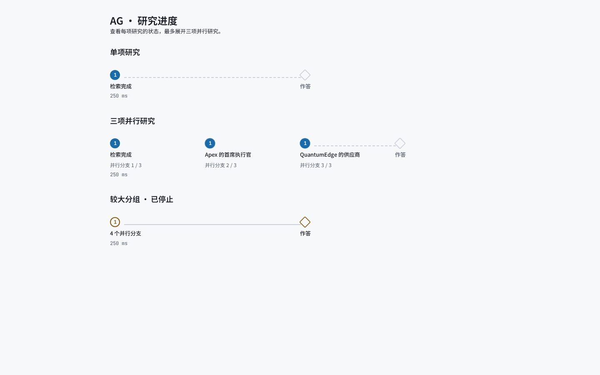

# Multi-agent evaluation

The feature remains opt-in: `agent.mode: single`, `max_parallel: 1` by default.
This report evaluates the blackboard runtime; a pure dependency chain cannot gain
reasoning parallelism from increasing `max_parallel`.

## Migration and validation

| Step | Commit | Unit tests | Coverage |
|---|---|---:|---:|
| (a) Additive blackboard | `6244272` | 1,014 passed | 91.53% |
| (b) Serial researcher subgraph | `41c5f1d` | 1,021 passed | 91.24% |
| (c) Concurrent researchers and HopRail | `11fd940` | 1,029 passed | 91.61% |
| (d) Per-role models and budgets | `3afaad2` | 1,036 passed | 91.72% |
| (e) Legacy loop confined to offline entry | `fa360c3` | 1,037 passed | 91.56% |

`5e2322b` additionally makes the initializer's field types explicit, preserves
healthy retrieval channels when another fails, and routes checkpoint resume
directly to the saved graph. `9fe1bcc` enforces live register routing at the graph
factory and applies the small budget tier before fast-path escalation.
`a8d0d19` adds the evaluator and disables LLM response-cache reads and writes.
`95e6ef8` checks cached evidence ownership before it can reach a researcher.
Seed 11 loaded `a8d0d19`; seeds 23 and 47 loaded `95e6ef8`. That cache safety
check preserves valid retrieval and does not change this evaluation's isolated,
unscoped corpus. The machine-readable summary records this revision split.

Final gates: **1,047 passed, 4 expected failures, 91.65% coverage** (threshold
80%). Ruff, formatting, strict mypy (377 source files), `check_code_metrics`,
frontend TypeScript and Vue template compilation all passed. Each of the five
migration commits passed the required gates before the next step.

Tests cover real LangGraph Send overlap at concurrency 3; concurrency 1; local
worker inputs; dependency ordering; rejection caps; grounded conflict creation;
tenant/run cache keys and single-flight retrieval; scope violations; budget
reservation; batched verifier accounting; role-model HTTP payloads; streaming;
and native failed-branch resume with both concurrency settings. Public resume
also checks tenant/question identity and bypasses fresh triage.

## Offline parity: existing G2 suite

Dataset: `evals/datasets/g2_all.jsonl`, 200 cases, with
`data/processed/pilot_triples.jsonl`. Case/configuration order seeds: 11, 23, 47.
The existing QueryApp runner and scorers are used; caches are disabled. These are
order seeds, not a guarantee of upstream model sampling determinism.

| Requested concurrency | Correct / runs | Accuracy | P50 | P95 | Tokens | Cost |
|---|---:|---:|---:|---:|---:|---:|
| 1 | 600 / 600 | 100% | 43 ms | 71 ms | 0 | $0 |
| 3 | 600 / 600 | 100% | 42 ms | 71 ms | 0 | $0 |

Every run had **zero semantic differences** from the pre-migration G2 baseline
for answer, status, route, step count, hop count and explored paths. Paired
McNemar: 0 wins, 0 losses, p=1.0. The offline path intentionally ignores multi
mode, so these timings prove compatibility, not parallel reasoning speedup.
The POC offline floor also passed both force-agentic and triage-enabled modes:
**31/31 each**, against the required 30/31.
These POC queries and score files completed, but the existing CLI subsequently
raised `IsADirectoryError` while copying its accuracy output to an `--out`
directory. The floor checks on both saved score files passed; the G2 matrix
runner exited successfully. The same CLI defect exists in the baseline checkout.
Compositional probes scored **54/54** (floor 52), negative probes **20/20**
(floor 19), and the 200-case gold audit flagged **0** cases. The G2 matrix
includes all 153 questions in `evals/datasets/dev.jsonl` with identical gold
answers and paths, providing the existing offline development regression.

## Live comparison

The configured endpoint exposes `gpt-6-luna` for triage/researcher/writer and
`gpt-5.6-luna` for the independent verifier. The existing 31-case POC suite uses
`data/processed/seed_triples.jsonl`, three order seeds, and disabled caches.
The test includes one full live single-register baseline at seed 11; concurrency
1 and 3 are repeated at all three seeds. Repetitions reuse the same 31 cases and
must not be treated as 93 independent questions.

No model prices are configured. Observed prompt, completion and total tokens are
reported; monetary cost is unavailable, never assumed zero.
The embedding endpoint is unavailable, so these measurements exercise graph /
fulltext retrieval with explicitly reported vector degradation. Healthy vector
retrieval requires separate production latency validation.

The retained live matrix completed successfully: **217/217 queries**, seven
complete runs. All **22 query errors were timeouts** and remain in the accuracy
denominator. LLM response-cache reads and writes were disabled during every
measured foreground query. Earlier cached and sandbox-inaccessible attempts
were excluded. A regression test verifies that repeated prompts reach the
provider despite existing cache files, without changing those files.

### Aggregate results

| Mode / seeds | Correct / runs | Wall P50 (s) | Wall P95 (s) | Prompt tokens | Completion tokens | Total tokens | Errors | USD cost |
|---|---:|---:|---:|---:|---:|---:|---:|---:|
| single / 11 | 27/31 (87.10%) | 24.939 | 43.773 | 107,629 | 27,439 | 135,068 | 2 | unknown |
| multi-1 / 11, 23, 47 | 73/93 (78.49%) | 33.773 | 45.002 | 310,555 | 95,900 | 406,455 | 9 | unknown |
| multi-3 / 11, 23, 47 | 74/93 (79.57%) | 33.007 | 45.002 | 301,134 | 94,224 | 395,358 | 11 | unknown |

Wall latency includes errors and uses linear-interpolated percentiles over
individual query durations. QueryApp times out at 45 seconds. Failed requests
do not retain complete provider usage, so all totals with errors are observed
lower bounds. Unfinished timed-out workers may also consume tokens after the
foreground query returns; these are absent from the reported totals.

### Per-seed results

| Mode / seed | Correct / runs | Wall P50 (s) | Wall P95 (s) | Prompt tokens | Completion tokens | Total tokens | Errors | USD cost |
|---|---:|---:|---:|---:|---:|---:|---:|---:|
| single / 11 | 27/31 (87.10%) | 24.939 | 43.773 | 107,629 | 27,439 | 135,068 | 2 | unknown |
| multi-1 / 11 | 24/31 (77.42%) | 34.796 | 45.002 | 96,489 | 30,076 | 126,565 | 4 | unknown |
| multi-3 / 11 | 24/31 (77.42%) | 35.039 | 45.002 | 101,050 | 31,472 | 132,522 | 4 | unknown |
| multi-1 / 23 | 23/31 (74.19%) | 34.341 | 45.002 | 106,893 | 32,833 | 139,726 | 3 | unknown |
| multi-3 / 23 | 24/31 (77.42%) | 32.996 | 45.003 | 99,460 | 29,965 | 129,425 | 4 | unknown |
| multi-1 / 47 | 26/31 (83.87%) | 32.592 | 44.889 | 107,173 | 32,991 | 140,164 | 2 | unknown |
| multi-3 / 47 | 26/31 (83.87%) | 33.303 | 45.002 | 100,624 | 32,787 | 133,411 | 3 | unknown |

### Paired correctness

| Seed | Baseline → candidate | Baseline-only correct | Candidate-only correct | Exact McNemar p |
|---:|---|---:|---:|---:|
| 11 | multi-1 → multi-3 | 3 | 3 | 1.000000 |
| 11 | single → multi-1 | 5 | 2 | 0.453125 |
| 11 | single → multi-3 | 5 | 2 | 0.453125 |
| 23 | multi-1 → multi-3 | 2 | 3 | 1.000000 |
| 47 | multi-1 → multi-3 | 2 | 2 | 1.000000 |

A non-significant paired difference does not establish non-inferiority. The
three order seeds repeat the same small corpus; model sampling is not seeded.

### Status and strict scoring

| Mode | Answered | Partial | No answer | Error | Exact entity set / eligible cases | Extra entities | Recorded sibling queries |
|---|---:|---:|---:|---:|---:|---:|---:|
| single | 17 | 11 | 1 | 2 | 20/24 (83.33%) | 4 | — |
| multi-1 | 47 | 25 | 12 | 9 | 51/72 (70.83%) | 12 | 0/93 |
| multi-3 | 50 | 21 | 11 | 11 | 56/72 (77.78%) | 6 | 1/93 |

The primary metric preserves the existing containment scorer. A partial
answer naming the gold entity may pass; status alone is not correctness.
The report-only exact-set scorer excludes open, yes/no and no-answer golds
and counts additional known entities after removing entities in the question.
Writer context/reserve exhaustion can cause abstention after a clear register.
Sibling counts use recorded researcher events; failed queries lack complete
branch metadata, and single mode has no researcher event ledger.

### Role usage in multi mode

| Mode | Role | Calls | Prompt tokens | Completion tokens |
|---|---|---:|---:|---:|
| multi-1 | triage | 84 | 33,447 | 16,686 |
| multi-1 | researcher | 181 | 171,197 | 54,871 |
| multi-1 | verifier | 92 | 22,249 | 13,042 |
| multi-1 | writer | 147 | 83,662 | 11,301 |
| multi-3 | triage | 82 | 32,636 | 16,244 |
| multi-3 | researcher | 176 | 159,921 | 52,138 |
| multi-3 | verifier | 95 | 23,347 | 14,648 |
| multi-3 | writer | 149 | 85,230 | 11,194 |

Usage comes from the per-role ledger; failed queries lack their ledger.
The triage role also covers register initialization. Batched verifier tokens
are split across requirements while each batch call is counted once.

See [multi_agent_eval_summary.json](multi_agent_eval_summary.json) for exact
percentiles, stop reasons, degraded-channel counts, role usage and paired
case flips. Per-case runtime traces remain outside Git.

### Promotion decision and remaining limits

Keep **`agent.mode: single` and `max_parallel: 1` as the defaults**. Increasing
concurrency yielded one additional correct answer over 93 repetitions, with
McNemar p=1.0 at each seed. Both multi variants scored 24/31 versus the single
baseline's 27/31 at seed 11. This small degraded-stack comparison does not
establish accuracy non-inferiority. P95 remains about 45 seconds, well above
the 8-second target; the timeout ceiling prevents comparison with the reported
92-second production tail.

Recorded concurrency-1 waves had at most one ready requirement. Concurrency 3
exposed two ready requirements only for `poc-3hop-04` at seed 47 ("Did Elena
Varga and Marcus Chen both work at Orion Systems?"). It took 23.339 seconds;
the same seed's concurrency-1 run initialized one combined requirement and took
17.270 seconds. The different plans prevent a direct parallel speedup claim.
Pure dependency chains cannot gain reasoning parallelism from a larger cap.

The writer reported budget/context abstention 11 times in concurrency 1 and
8 times in concurrency 3; 7 and 4 respectively occurred after a clear register.
For example, `poc-open-01` at seed 11 abstained despite a clear register in both
multi variants. This and the degraded seed retrieval need attention before
promotion. Rerun the live development suite with healthy embeddings and known
prices, and use a corpus with independent sibling requirements to assess the
parallel scheduler's latency benefit. Offline development parity and unit
coverage are engineering evidence, not production acceptance.

## Reproduce

```bash
AGR_RUNTIME_DIR=/tmp/agr-multi-offline PYTHONPATH=src .venv/bin/python scripts/eval_multi_agent.py \
  --no-llm --out /tmp/agr-multi-g2

cat > /tmp/agr-multi-eval-roles.json <<'JSON'
{
  "triage": {"model": "gpt-6-luna"},
  "researcher": {"model": "gpt-6-luna"},
  "verifier": {"model": "gpt-5.6-luna"},
  "writer": {"model": "gpt-6-luna"}
}
JSON

AGR_RUNTIME_DIR=/tmp/agr-multi-live-eval PYTHONPATH=src .venv/bin/python scripts/eval_multi_agent.py \
  --live --roles /tmp/agr-multi-eval-roles.json \
  --cases evals/datasets/poc_cases.jsonl \
  --seed-triples data/processed/seed_triples.jsonl \
  --seeds 11 --parallel 1 3 --include-single \
  --out /tmp/agr-multi-poc-uncached

AGR_RUNTIME_DIR=/tmp/agr-multi-live-eval PYTHONPATH=src .venv/bin/python scripts/eval_multi_agent.py \
  --live --roles /tmp/agr-multi-eval-roles.json \
  --cases evals/datasets/poc_cases.jsonl \
  --seed-triples data/processed/seed_triples.jsonl \
  --seeds 23 47 --parallel 1 3 \
  --out /tmp/agr-multi-poc-uncached
```

Configure credentials locally. `--roles path.json` accepts the four role configs
and optional prices; the runner never persists credentials. It fails before
starting if researcher and verifier resolve to the same model, and stops after
three consecutive query errors. Per-case JSONL and per-run accuracy JSON preserve
the existing scoring contract; failed requests mark token totals incomplete.

## HopRail inspection

The existing component was rendered at 1440, 768 and 390 px: 0 inspector failures.
One branch stays sequential, three show individual labels without sibling
connectors, and a larger group collapses while preserving stopped/failed state.
The standalone fixture's bottom whitespace and existing 12 px sublabels account
for the two inspector warnings. Evidence selection still groups by round/hop.



